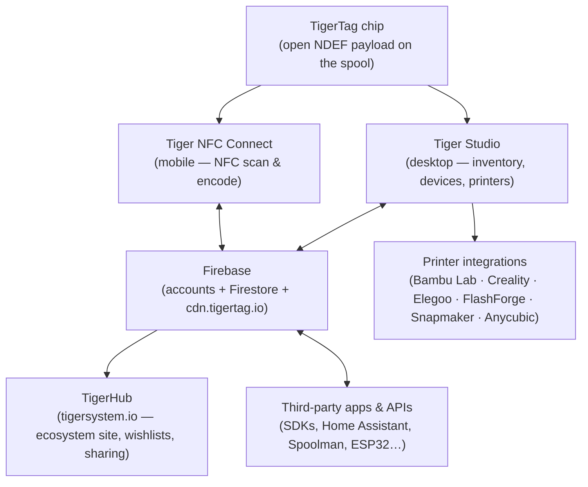
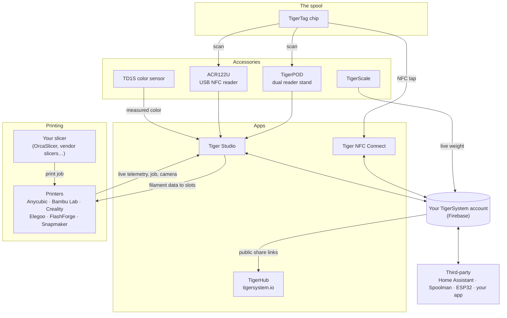

# Panoramica dell'architettura

## Lo stack, dall'alto in basso

## Livelli

| Livello | Ruolo | Documentazione di riferimento |
|---|---|---|
| **Chip TigerTag** | Identità portatile e aperta della bobina fisica | [Formato del chip](../concepts/tigertag-chip.md) |
| **Tiger NFC Connect** | Il ponte smartphone: scansione, codifica, consultazione | [Pagina del prodotto](../products/tiger-nfc-connect.md) |
| **Firebase** | Un unico database condiviso: account, inventario, sincronizzazione; il punto di interoperabilità della sandbox | [Inventario e sincronizzazione cloud](../concepts/inventory-and-cloud-sync.md) |
| **TigerHub** | La casa web dell'ecosistema: vetrina, liste dei desideri, amici, condivisione | [Pagina del prodotto](../products/tigerhub.md) |
| **Tiger Studio** | Banco di lavoro desktop: inventario, rack, sensori, stampanti | [Pagina del prodotto](../products/tiger-studio.md) |
| **Integrazioni con le stampanti** | Collegamenti LAN in tempo reale con sei marche di stampanti | [Compatibilità](../compatibility/README.md) |
| **API di terze parti** | SDK + superficie Firestore documentata per chiunque | [Sviluppatori](../developers/README.md) |

## La mappa completa: ogni elemento e le sue connessioni

Accessori, app, cloud, stampanti, slicer e integrazioni di terze parti, in
un'unica immagine:

Leggila da sinistra a destra: il **chip** identifica la bobina; gli **accessori**
catturano la realtà (scansioni, peso, colore); le **app** e il **cloud** mantengono tutto
sincronizzato; la **stampante** riceve i dati del filamento e riferisce in tempo reale.
Il tuo **slicer mantiene il suo compito**: TigerSystem non esegue lo slicing, fa in modo che
tutti (tu, la macchina, le app) sappiano esattamente quale filamento si trova dove.

## Principi di progettazione

1. **Il chip è autosufficiente.** Una bobina si identifica da sola senza cloud, senza
 account, senza rete: il payload è completo e aperto.
2. **Il cloud appartiene all'utente, non al sistema.** Tutto lo stato risiede sotto l'account
 dell'utente; sono le regole di sicurezza lato server, non il codice client, a far rispettare
 l'accesso.
3. **Ogni livello è opzionale.** L'uso solo con telefono, solo desktop, solo chip o solo
 API funziona sempre; i componenti aggiungono valore ma non si bloccano mai a vicenda.
4. **Le integrazioni parlano il protocollo nativo della stampante.** Nessuna modifica al firmware, nessun
 giro tramite il cloud: Tiger Studio comunica via MQTT/WebSocket/HTTP direttamente sulla LAN
 (vedi [flusso dei dati](./data-flow.md)).

---

**◀ Precedente:** [Inventario e sincronizzazione cloud](../concepts/inventory-and-cloud-sync.md) · **▲ [Indice della documentazione](../../README.md)** · **Successivo ▶** [Flusso dei dati](./data-flow.md)

**Vedi anche:** [Prodotti](../products/README.md), [Sviluppatori](../developers/README.md)
