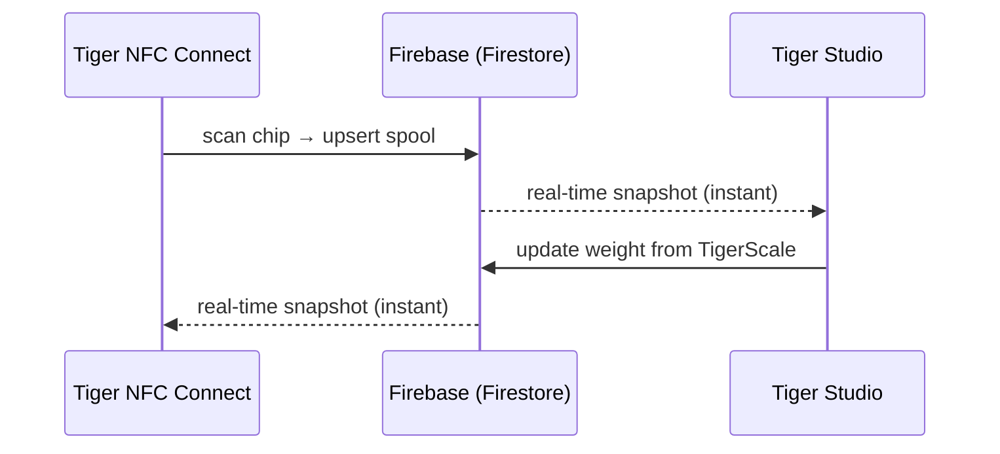

# Inventario e sincronizzazione cloud

## Un solo account, ogni dispositivo

L'inventario di un utente risiede nel **suo account TigerSystem**, sostenuto da
**Firebase** semplice (Auth + Firestore): un'infrastruttura volutamente senza marchio il cui
compito è semplice: **un solo database condiviso, in un solo posto**, così ogni elemento della
sandbox (desktop, mobile, bilancia, web) interopera sugli stessi dati. Ogni client — mobile, desktop, web — si sottoscrive agli stessi
documenti in tempo reale:

Non esiste un «pulsante di sincronizzazione»: le modifiche si propagano tramite i listener
in tempo reale di Firestore, e i client mantengono una cache locale per le letture offline.

## Cosa si sincronizza

- **Inventario**: un documento per bobina (identità, peso, contenitore, immagine…).
- **Rack**: disposizione fisica degli scaffali e posizionamento delle bobine.
- **Amici e condivisione**: collegamenti tra amici, richieste in arrivo, notifiche.
- **Preferenze**: lingua, impostazioni per account.
- **Backup dei chip**: record dei chip [TigerTag+](../products/tigertag-plus.md).

Il modello dei dati autorevole, campo per campo, è documentato nel
[repository di integrazione Firebase](https://github.com/TigerTag-Project/TigerTag_Firebase_Integration)
(`docs/03-data-model.md`): il riferimento per gli integratori di terze parti.

## Cosa lascia il tuo banco e cosa resta

L'ecosistema dice ovunque che il cloud è opzionale. Ecco che cosa
significa in concreto e quanto costa dire di no.

**L'identificazione è locale per progetto.** Un dispositivo non chiede a un server che cosa sia un tag.
Le tabelle di marche e materiali risiedono nella sua memoria e vengono aggiornate dal
[repository di riferimento](https://github.com/TigerTag-Project/TigerTag-RFID-Guide)
**pubblico** al massimo una volta al giorno. Quindi una ricerca non attende mai la rete e funziona
anche senza internet.

**Senza un account perdi esattamente una cosa: la sincronizzazione tra dispositivi.** Una
[TigerScale](../products/tigerscale.md) pesa comunque, legge comunque i tag, identifica comunque
marca e materiale, serve comunque la propria interfaccia web sulla tua LAN. Nulla
del chip in sé ha bisogno di noi: è tutto il senso di scrivere i dati
[sul chip](./tigertag-chip.md).

**Con un account, ecco che cosa invia davvero un dispositivo.** Prendendo la bilancia come
esempio concreto, a ogni pesata completata e a ogni heartbeat scrive,
nel tuo documento utente: gli UID dei tag della bobina, il peso netto/lordo/del contenitore,
la versione del firmware, il segnale WiFi e l'IP, il fattore di calibrazione, l'ora dell'ultimo heartbeat,
lo stato della batteria e lo stato dello schermo. Diagnostica e misure, nient'altro. Ogni
campo è documentato nel
[riferimento della bilancia](https://github.com/TigerTag-Project/Tiger-Scale-V3/blob/main/docs/TELEMETRY.md).

**Ed ecco che cosa memorizza in locale, che conta di più.** Un dispositivo con accesso effettuato
conserva un refresh token, il tuo ID utente e le tue credenziali WiFi. Non memorizza mai
la tua password: l'accesso la scambia con dei token. Ma considera un dispositivo configurato
come **detentore di una credenziale**: prima di prestarne, venderne o regalarne uno, esci
*e* dimentica il WiFi. Un semplice reflash non cancella nessuno dei due: quella memoria
è conservata di proposito perché un aggiornamento del firmware non ti costi la tua configurazione.

**Due scelte deliberate da conoscere.** L'API LAN di un dispositivo è
**non autenticata**: chiunque sia già sulla tua rete può leggerne lo stato e
avviare una tara. È una semplificazione per una rete domestica: mettila su una VLAN
ospiti se non ti fidi della tua. E la chiave Firebase visibile nel sorgente è un
**identificatore pubblico del progetto**, non un segreto; ogni client Firebase la include, e
il controllo degli accessi è applicato da regole lato server rispetto all'utente connesso,
non nascondendo una stringa.

Per la bilancia, tutto questo è documentato per intero in
[`docs/CLOUD.md`](https://github.com/TigerTag-Project/Tiger-Scale-V3/blob/main/docs/CLOUD.md),
che fa fede.

## Modello di condivisione (riepilogo)

- Ogni utente ha un **codice di scoperta** pubblico (`XXX-XXX`) per la ricerca di un amico in O(1).
- L'amicizia è **bidirezionale e basata sul consenso**: richiesta → accettazione; ciascuna
 parte può rimuoverla. L'accesso in lettura all'inventario di un amico è applicato
 lato server dalle regole di sicurezza di Firestore, mai dal client.
- Un inventario può anche essere contrassegnato come **pubblico**, o condiviso come elenco web
 in sola lettura tramite i link di [TigerHub](../products/tigerhub.md).

## Modello di sicurezza (riepilogo)

- Tutti i dati per utente sono riservati al proprietario per impostazione predefinita; l'accesso tra utenti richiede sempre
 una relazione preliminare (amicizia, richiesta), applicata dalle regole lato server.
- La configurazione del progetto Firebase è pubblica di proposito (schema standard);
 **la sicurezza sta nelle regole, non nella segretezza**. Vedi
 [API dell'account e integrazione](../developers/account-api.md).

---

**◀ Precedente:** [Il chip TigerTag](./tigertag-chip.md) · **▲ [Indice della documentazione](../../README.md)** · **Successivo ▶** [Panoramica dell'architettura](../architecture/overview.md)

**Vedi anche:** [TigerHub](../products/tigerhub.md), [Sviluppatori — API dell'account](../developers/account-api.md)
