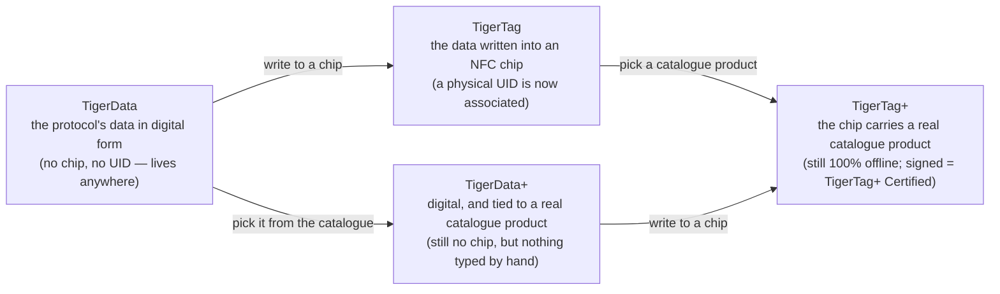

# Identità universale del filamento

## Un'identità, leggibile ovunque

Un chip TigerTag dà a una bobina un'**identità universale**: un unico record aperto di
ciò che il filamento *è*, indipendente da chi lo ha prodotto, da chi lo vende e da quale
stampante lo fonderà.

L'identità comprende (elenco non esaustivo):

| Famiglia di campi | Esempi |
|---|---|
| **Marca** | qualsiasi produttore di filamento, da un elenco di riferimento condiviso |
| **Materiale / tipo** | PLA, PETG, ABS, TPU… + sottotipo |
| **Aspetto / colore** | valore del colore, finitura |
| **Geometria** | diametro (1,75 / 2,85 mm) |
| **Impostazioni di stampa** | temperature consigliate |
| **Ciclo di vita** | peso, data di produzione |

## Il database di riferimento condiviso

Le identità non sono testo libero: marche, materiali, aspetti, tipi, diametri e
unità provengono da un **database di riferimento condiviso** servito da `cdn.tigertag.io`
(ospitato nello stesso progetto Firebase degli account). Ogni app risolve gli stessi ID con lo stesso significato, così un
chip codificato da uno strumento viene letto in modo identico in ogni altro.

Le tabelle sono pubblicate due volte, e sono le stesse tabelle. Sono file JSON
nella cartella
[`database/`](https://github.com/TigerTag-Project/TigerTag-RFID-Guide/tree/main/database)
della guida RFID, liberi da integrare (CC0) e sincronizzati dal catalogo ogni
6 ore. Le serve anche l'API pubblica, ciascuna con il proprio endpoint
([l'elenco](https://github.com/TigerTag-Project/TigerTag-RFID-Guide#reference-tables-ship-with-the-protocol--the-api-is-optional)).
I file sono ciò che il protocollo garantisce: risolvono ogni id che un chip può
portare, senza rete e senza account. Tiger Studio li include
(`assets/db/tigertag/`) e li aggiorna dal CDN.

## Un'identità, quattro stati

L'identità è il *record*, non il *chip*, e attraversa quattro
stati:

- **TigerData** è il protocollo *prima* del chip: la stessa identità, memorizzata
 in forma digitale — in un inventario, un database, un file, ovunque. Il protocollo
 TigerTag può vivere interamente fuori da un chip RFID. Questa nozione di **chip
 virtuale è un'innovazione di TigerSystem: non esiste altrove**: gestire un inventario completo
 con zero chip NFC, trasferire un'identità in un chip più tardi o mai,
 e l'interoperabilità del protocollo è preservata in entrambi i casi.
- **TigerData+** è un TigerData che sa *esattamente di quale prodotto si tratta*. Ancora
 nessun chip, ancora nulla da acquistare — ma invece di ciò che ha digitato il suo proprietario,
 porta un vero prodotto del catalogo ufficiale: marca, colore,
 materiale, temperature, diametro, SKU ed EAN esatti, direttamente dalla fonte. È
 ciò che ottieni scegliendo un prodotto anziché descriverlo.
 >**Non** è un TigerTag+, e non pretende mai di esserlo: nessun chip, nessun UID. Il `+`
 >significa *identificato*, non *certificato*. Per gli sviluppatori: una bobina è un TigerData+
 >quando è senza chip **e** porta un vero id di prodotto — questa coppia è la
 >definizione, ed è riportata sul record come `protocol: "TigerData+"` così
 >puoi leggerla direttamente. Vedi la
 >[struttura dei dati Firestore](https://github.com/TigerTag-Project/TigerTag_Firebase_Backend#-firestore-data-structure).
- Nel momento in cui quei dati vengono **scritti in un chip NFC**, diventano un
 **TigerTag**: un **UID fisico viene finalmente associato** all'identità.
- Scrivi in quel chip un **prodotto di catalogo** anziché valori digitati a mano
 ed è un [**TigerTag+**](../products/tigertag-plus.md) — stesso `+` di
 TigerData+, stesso significato: *identificato*. Firmato da un produttore certificato,
 diventa un **TigerTag+ Certified**. In ogni caso il chip resta leggibile al 100 %
 offline.

Un TigerData può restare digitale per sempre, oppure essere **promosso a chip reale
in modo atomico** quando sei pronto (Tiger Studio lo fa in un solo passaggio). E
tutti e quattro gli stati viaggiano come file: il
[**formato di scambio `.ttag`**](../developers/ttag-format.md) trasporta uno o
più materiali di inventario — TigerData, TigerData+, TigerTag o TigerTag+ — su una chiavetta
USB, in una e-mail, tra strumenti.

## Il record e il chip

I quattro stati qui sopra sono stati del **record**. La
[guida RFID](https://github.com/TigerTag-Project/TigerTag-RFID-Guide#three-tag-types)
elenca invece tipi di tag, e quelli descrivono il **chip**: ciò che è scritto
sul silicio, letto offline, senza account. Sono due assi, non due versioni
della stessa lista, e nessuno dei due è sbagliato.

Cosa trova un lettore sul chip, per ogni stato:

| Stato del record | Sul chip |
|---|---|
| **TigerData**, **TigerData+** | niente: non c'è ancora un chip |
| **TigerTag** | `ID TigerTag` `0x5BF59264`, e `ID Product` `0xFFFFFFFF` (nessuno) |
| **TigerTag+** | `ID TigerTag` `0xBC0FCB97`, e un `ID Product` del catalogo |
| **TigerTag+ Certified** | lo stesso di un TigerTag+, più una firma valida nelle pagine `0x18`–`0x27` |

Un TigerTag+ porta lo stesso id di tipo, firmato o no. Per sapere se un chip è
un TigerTag+ Certified, un lettore verifica la firma; l'id di tipo non può
dirlo.

L'asse del chip ha un valore senza alcun record dietro: **TigerTag Init**
(`0x6C41A2E1`). Contrassegna un chip vergine preparato per ricevere una
scrittura. Sul filamento non è ancora stato deciso nulla, quindi non c'è alcun
record che possa trovarsi in uno stato, e non è un quinto.

## Promozione: da un record a un chip

*Promuovere* una bobina significa passare dalla sinistra del diagramma alla
destra: un record TigerData o TigerData+ esistente viene scritto su un chip NTAG
vergine, e da quel momento la bobina porta con sé la propria identità, offline.

Ciò che si ottiene dipende solo da ciò che si è messo dentro:

| Promuovi… | Ottieni… | Perché |
|---|---|---|
| un **TigerData** — valori scelti dal suo proprietario | un **TigerTag** | ora un UID fisico è associato all'identità |
| un **TigerData+** — un vero prodotto del catalogo | un **TigerTag+** | ora il chip porta l'ID prodotto del catalogo: *sempre identificato, sempre non firmato* |

Quella seconda riga è tutto il vocabolario del `+` in una riga. La promozione
cambia lo *stato* — da digitale a chip — e mai il significato del `+`. Solo la
firma di un produttore certificato rende un chip un
[TigerTag+ Certified](../products/tigertag-plus.md), e nessuna promozione ne
produce uno.

Né la promozione è una porta a senso unico. I chip non sono mai bloccati in
scrittura: un chip promosso può essere cancellato da
[Tiger NFC Connect](../products/tiger-nfc-connect.md) o da Tiger Studio e
riscritto ([il chip TigerTag](./tigertag-chip.md)). L'identità è il record; il
chip è solo il posto in cui vive in questo momento.

---

**◀ Precedente:** [Flusso di lavoro Seconda vita](../philosophy/second-life.md) · **▲ [Indice della documentazione](../../README.md)** · **Successivo ▶** [Il chip TigerTag](./tigertag-chip.md)

**Vedi anche:** [Pagina del prodotto TigerTag](../products/tigertag.md), [Inventario e sincronizzazione cloud](./inventory-and-cloud-sync.md)
