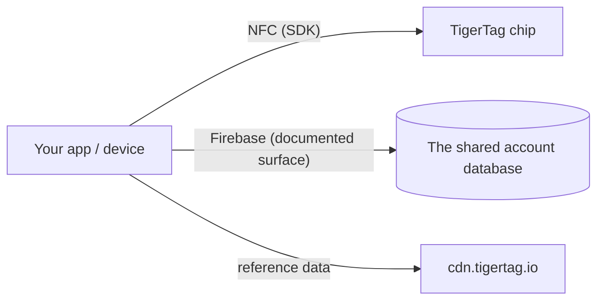

# Documentazione per sviluppatori

Costruisci su TigerSystem: leggi i chip, comunica con il cloud o integra il tuo
hardware e software. Nulla richiede un permesso: il protocollo è aperto.

## Cosa puoi costruire?

Per leggere un TigerTag basta **qualsiasi smartphone NFC**, un **lettore USB ACR122U**
collegato a un computer, o un **dispositivo fai da te: un semplice ESP32 con un modulo
lettore PN532 o RC522** (l'approccio usato da TigerScale). Hardware comune, nessuna
attrezzatura proprietaria. Da quell'unica scansione, integra ovunque un'identità
sia utile:

- **ERP / gestione delle scorte**: collega identità e quantità delle bobine al
 sistema di inventario già in uso nella tua azienda.
- **Tracciamento dell'uso**: registra quale materiale è finito in quale lavoro, macchina
 o ordine cliente.
- **Dashboard personalizzate e automazione**: monitoraggio di farm di stampa, avvisi di scorta
 bassa, trigger di riordino.
- **Sistemi di prestito**: fablab, scuole, makerspace che registrano il materiale in entrata
 e in uscita.
- **Progetti di R&S, privati o pubblici**: un supporto di identità aperto, riscrivibile e documentato
 con cui sperimentare.

Nessuno di questi richiede le nostre app o il nostro cloud: il chip + un SDK bastano. Aggiungi la
[superficie dell'account](./account-api.md) solo se vuoi account e sincronizzazione.

Costruiscilo e sarà **TigerTag Compatible**: gratuito, autodichiarato, senza audit e
senza permessi. Sottoponilo all'audit e potrà diventare **TigerTag
Certified**, aperto a qualsiasi cosa costruisca una terza parte, hardware o software, in
due ambiti (**TigerTag** e **TigerTag+**). La linea di separazione tra i livelli non è
che cosa sia il tuo prodotto, ma se qualcuno l'ha verificato. Compatible dice *«funziona»*
sulla tua parola, Certified dice *«lo abbiamo testato»* sulla nostra
([criteri](https://github.com/TigerTag-Project/TigerTag-RFID-Guide/blob/main/CERTIFICATION.md), contattaci tramite l'
[organizzazione GitHub](https://github.com/TigerTag-Project)).

La governance è volutamente a doppio varco: **chiunque** può implementare il
protocollo e dire «compatibile con TigerTag» — nessun permesso, mai — e mostrare
il logo TigerTag, non modificato, per dirlo: nella tua app, nella tua documentazione, nella tua
scheda di negozio. Quell'uso referenziale è gratuito. Solo i **partner certificati**
(elencati nel registro dei certificati) possono apporre il marchio — logo **o nome** — **su un
chip di qualsiasi formato (chip, inlay, adesivo, etichetta, supporto), su una bobina o sulla sua
confezione**, dove smette di descrivere la compatibilità e comincia ad affermare
l'origine; il testo semplice *«Compatibile con TigerTag»* sulla scatola di un
lettore, una stampante o un'app compatibili resta libero, e solo loro possono emettere le **firme TigerTag+** (TigerTag
detiene la chiave privata). Il varco del marchio è commerciale; il varco della firma
è tecnico; **nessuno dei due limita il protocollo di una sola riga**: un chip
non certificato funziona perfettamente, semplicemente non può dimostrare la propria origine.

Due dettagli da avere esattamente giusti. La dichiarazione di compatibilità copre anche il
**livello `+`**: verificare una firma TigerTag+ è gratuito, offline e
senza restrizioni — le chiavi pubbliche sono pubblicate — quindi un lettore che le controlla può
dire *«compatibile con TigerTag+»*. Ciò che non può fare è chiamare **un tag** un
TigerTag+ a meno che quel tag non porti davvero una firma emessa da TigerTag. E
la parola **«certified» non si applica mai da sé**: la concede TigerSystem, nessuno
la rivendica.

È volutamente il modello usato da Zigbee e Matter: un livello *Compatible* gratuito
in cui chiunque può entrare, e un livello *Certified* concesso che significa qualcosa
per un acquirente proprio perché è concesso. Policy completa, livelli di certificazione
e risorse del marchio: [TRADEMARK.md](https://github.com/TigerTag-Project/TigerTag-RFID-Guide/blob/main/TRADEMARK.md) e
[CERTIFICATION.md](https://github.com/TigerTag-Project/TigerTag-RFID-Guide/blob/main/CERTIFICATION.md).

## Da dove iniziare

| Voglio… | Leggi |
|---|---|
| Vedere chi ha già costruito su TigerTag | [Integrazioni di terze parti](./integrations.md) |
| Capire i vari pezzi | [Panoramica dell'architettura](../architecture/overview.md) |
| Sapere quale repository fa cosa | [Repository](./repositories.md) |
| Leggere/scrivere chip TigerTag | [SDK](./sdks.md) |
| Scambiare inventari come file | [Il formato `.ttag`](./ttag-format.md) |
| Mostrare il colore di una bobina come fa ogni altra app | [Il campione di materiale](./material-swatch.md) — e il suo [renderer di riferimento dal vivo](./material-swatch-playground.html) |
| Sincronizzare con l'inventario cloud dell'utente | [API dell'account e integrazione](./account-api.md) |
| Capire il payload del chip | [Il chip TigerTag](../concepts/tigertag-chip.md) |

## Percorsi di integrazione

1. **Solo chip**: analizza e codifica i chip con un SDK. Nessun account, nessuna rete.
2. **Collegato al cloud**: autentica l'*account dell'utente stesso* e leggi/scrivi
 i suoi dati entro le regole di sicurezza lato server
 ([contratto di integrazione](./account-api.md)).
3. **Hardware**: esistono esempi funzionanti per ESP32/Arduino, Home Assistant e
 un bridge Spoolman (vedi gli
 [esempi del repository di integrazione](https://github.com/TigerTag-Project/TigerTag_Firebase_Integration/tree/main/examples)).

## Convenzioni

- **Versioni**: le release dei prodotti usano SemVer; il payload del chip porta una
 propria versione del formato per la retrocompatibilità.
- **Nomi**: nomi autoesplicativi anziché codificati o ingegnosi; niente
 valori magici a più stati.
- **ID, mai etichette**: qualsiasi logica che dipenda da un valore delle
 tabelle di riferimento (`id_aspect`, `id_brand`, `id_material`, `id_type`,
 `id_diameter`, `id_measure_unit`, `id_version`…) confronta il suo **ID numerico**,
 mai la sua etichetta come stringa. Un'etichetta è testo da visualizzare: viene tradotta, può
 essere rinominata o corretta nel database di riferimento, e si legge
 in modo diverso in ogni lingua — un ID non cambia mai. Tieni l'ID accanto
 all'etichetta, dai un nome agli ID su cui ramifichi (ad es. aspetto `Tricolor 24`, `Rainbow 145`,
 `Bicolor 252`) e usa le etichette solo per la visualizzazione.
- **Colore**: il colore di una bobina è memorizzato come dato, non come immagine, quindi ogni
 superficie deve trasformare quel dato nella stessa immagine:
 [la convenzione del campione di materiale](./material-swatch.md) è normativa e
 include un [renderer di riferimento](./material-swatch-playground.html) con cui puoi verificare la
 tua implementazione.
- **Contributi**: ogni repository ha la propria guida; i contributi alla documentazione seguono
 [CONTRIBUTING.md](../../CONTRIBUTING.md) qui.

---

**◀ Precedente:** [OpenSpool](../compatibility/openspool.md) · **▲ [Indice della documentazione](../../README.md)** · **Successivo ▶** [Repository](./repositories.md)
