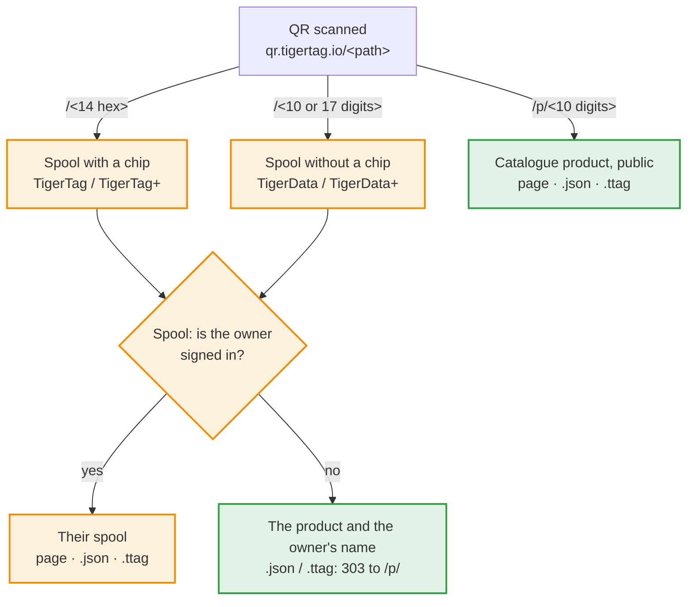

# Id delle bobine e link QR

> **Ratificato il 2026-11-05 — non ancora implementato.** Le app si basano su
> questo contratto. I punti ancora aperti sono elencati alla fine; risolverne uno
> cambia solo ciò che nomina. Le sezioni contrassegnate come **Proposto** non sono
> ancora ratificate: non costruirci sopra prima che lo siano.

## Spiegazione rapida

Un codice QR TigerTag contiene un solo link breve,
`https://qr.tigertag.io/<path>`. Il percorso dice che cosa apre:



Arancione: privato, solo per il proprietario della bobina; verde: pubblico.

| Codice QR su | Percorso | Esempio |
|---|---|---|
| una bobina con chip (TigerTag / TigerTag+) | l'UID del chip in esadecimale, 14 caratteri, stampato in minuscolo; l'UID del chip gemello apre la stessa bobina | [qr.tigertag.io/1d33dbda0d1080](https://qr.tigertag.io/1d33dbda0d1080) |
| una bobina senza chip (TigerData / TigerData+) | l'id senza il prefisso `TigerData_`: 10 o 17 cifre; funziona anche la forma lunga (`TigerData_6130922252`, `tigerdata-…`) | [qr.tigertag.io/6130922252](https://qr.tigertag.io/6130922252) |
| un prodotto (TigerQR+) | `p/` + l'`id_product` in decimale, sempre 10 cifre, con zeri iniziali (`p/0010303748`); le etichette più vecchie con 8 caratteri esadecimali (`p/9f5e0644`) si aprono ancora | [qr.tigertag.io/p/2673739332](https://qr.tigertag.io/p/2673739332) |

- **Un link di bobina:** il proprietario, con l'accesso effettuato, vede la sua
  bobina; chiunque altro vede il prodotto e il nome del proprietario. `.json` e
  `.ttag` danno la bobina solo al suo proprietario; gli altri ricevono un `303`
  verso il `.json` / `.ttag` del prodotto.
- **Un link di prodotto** è pubblico, senza accesso: la pagina del catalogo, i
  suoi dati ([`p/2673739332.json`](https://qr.tigertag.io/p/2673739332.json)) e il suo file ([`p/2673739332.ttag`](https://qr.tigertag.io/p/2673739332.ttag)).
- L'id e la terminazione `.json` / `.ttag` si leggono in maiuscolo o in
  minuscolo.
- Per condividere una bobina o un prodotto, condividi questo link breve: è
  quello stampato sulle etichette, e ogni app lo legge.

Il resto di questa pagina è il contratto vero e proprio.

Le regole che ogni app TigerSystem segue:

1. come una **bobina senza chip** (TigerData / TigerData+) ottiene il suo id;
2. come una bobina **mantiene il suo link** quando riceve un chip;
3. come l'id di una bobina viene scritto nel **codice QR** di un'etichetta
   stampata, e riletto;
4. come un'app **chiama una bobina con dei valori** (un peso, una nota) tramite
   un link;
5. come un **prodotto** ottiene il proprio link;
6. come un link risponde in **JSON** o come **file `.ttag`**.
7. cosa porta un'**etichetta stampata**, e i suoi modelli.

## 1. Id delle bobine

Una bobina è un documento dell'inventario dell'account,
`users/{uid}/inventory/{spoolId}`. L'id del documento **è** l'id della bobina:
un account non può contenere due bobine con lo stesso id.

| Bobina | Id | Esempio |
|---|---|---|
| Chip (TigerTag / TigerTag+) | l'UID NFC del chip, esadecimale maiuscolo, 14 caratteri (l'UID a 7 byte di un NTAG) | `04AB12CD3E4F80` |
| Senza chip, generato d'ora in poi | `TigerData_` + **millisecondi** epoch (13 cifre) + un numero casuale **0000–9999** (sempre 4 cifre) | `TigerData_17623456789014213` |
| Senza chip, generato prima di questo contratto | `TigerData_` + 10 cifre casuali | `TigerData_4480517985` |
| Senza chip, prefisso storico | `CLOUD_` + 10 cifre casuali | `CLOUD_4480517985` |
| Decimale storico (vecchia app Android) | l'UID scritto in decimale, in fase di migrazione all'esadecimale | `1234567890123456` |

Gli id già generati non vengono **mai riscritti** da questo contratto. I lettori
verificano solo il prefisso (`TigerData_` / `CLOUD_` → senza chip); nessuno di
loro dipende dal numero di cifre. L'id è un identificatore, nient'altro: non
ricavarne mai una data di creazione. Un UID a 4 byte (un chip proprietario
collegato a una bobina) non è mai il nome di un documento dell'inventario, quindi
non compare mai in un link.

### Generare un id senza chip

Ogni app che crea bobine senza chip (oggi Tiger Studio, più avanti l'app mobile)
genera l'id allo stesso modo:

1. **Comporre** `TigerData_<Date.now()><four random digits>`.
2. **Controllo locale** — se l'id è già nell'inventario che l'app possiede (la
   copia del listener in tempo reale, cache offline compresa) o nella sua
   `uidMigrationMap`, componine un altro. Funziona offline.
3. **Scrivere**
   - **online:** in una transazione che legge prima il documento e fallisce se
     esiste; in caso di errore, torna al passo 1;
   - **offline:** una scrittura semplice, messa in coda da Firestore finché la
     rete non torna. I passi 1 e 2 sono l'unica protezione.

Un semplice `set()` su un id che esiste già **sovrascrive** la bobina che c'era,
in silenzio. È ciò che il passo 3 impedisce.

Le quattro cifre casuali rendono inoltre un nuovo id senza chip praticamente
unico **su tutti gli account** (circa una collisione ogni 600 anni con un milione
di bobine senza chip all'anno), così un server potrà in seguito risolvere un link
per qualcuno che non sia il proprietario senza cambiare alcuna etichetta
stampata.

## 2. Mantenere il link quando una bobina riceve un chip

Programmare un chip su una bobina senza chip sposta la bobina sull'UID del chip.
In **un solo batch**:

1. scrivere la bobina sotto l'UID del chip (e sotto l'UID gemello, per una coppia
   gemella);
2. eliminare il documento `TigerData_…`;
3. scrivere il reindirizzamento `users/{uid}/uidMigrationMap/{old id}` →
   `{ hex_uid, migrated_at }`.

Il batch fa sì che le tre operazioni avvengano insieme o per niente. Il
reindirizzamento vive in `uidMigrationMap` (la collezione che già associa gli id
decimali storici all'esadecimale), mai come documento segnaposto
nell'inventario: tutto ciò che legge l'inventario conta un documento come una
bobina.

## 3. Link QR

Un'etichetta di bobina stampata porta un codice QR che contiene un link alla
bobina, **e nient'altro** (nessun peso, nessuna nota: i valori stampati
invecchiano):

```
https://qr.tigertag.io/<id>
```

Accanto al codice non si stampa nulla in chiaro: né id, né link. Il codice QR è
la strada per tornare alla bobina.

`<id>` è l'id della bobina **senza il suo prefisso**:

| Bobina | Link |
|---|---|
| Chip | `https://qr.tigertag.io/04ab12cd3e4f80` |
| Senza chip (nuova) | `https://qr.tigertag.io/17623456789014213` |
| Senza chip (prima di questo contratto) | `https://qr.tigertag.io/4480517985` |
| `CLOUD_` | **nessun link QR** — l'etichetta viene stampata senza codice QR |
| Decimale storico | **nessun link QR** — migra prima la bobina all'esadecimale |

### Codifica

- L'intero link è in **minuscolo**, id compreso: `https://qr.tigertag.io/04ab12cd3e4f80`.
  Provato il 2026-11-07: la fotocamera dell'iPhone apre un link in entrambe le
  forme, ma la fotocamera Samsung (Galaxy S24) mostra un link `HTTPS://` in
  maiuscolo come testo semplice e apre solo uno in minuscolo.
- Un solo segmento in modalità **byte**. Uno schema in minuscolo non può usare la
  modalità alfanumerica, e dividere il link in segmenti non fa risparmiare nulla
  (misurato: ogni variante è 29 × 29).
- Correzione d'errore **M** (15 %): le etichette si graffiano e si piegano.
- Risultato: **29 × 29 moduli** per ogni link di bobina e di prodotto. Disegna
  ogni modulo su un numero intero di punti della stampante, con la zona di
  rispetto standard di 4 moduli.

### Rileggere un link

I lettori ricavano l'id dal link **offline**: un'app che scansiona un'etichetta
non ha mai bisogno del sito web. Leggono il percorso senza distinguere maiuscole
e minuscole, ignorano una `/` finale e lo risolvono in base alla sua forma:

| Percorso | Id della bobina |
|---|---|
| 17 cifre | `TigerData_<17 digits>` |
| 10 cifre | `TigerData_<10 digits>` |
| 14 caratteri esadecimali | l'UID, in maiuscolo |
| 13 caratteri esadecimali che iniziano con `4` | un UID NTAG troncato: `0` + i 13 caratteri ([regola di riparazione](https://github.com/TigerTag-Project/TigerTag-Studio-Manager/issues/146)) |
| `p/` + l'`id_product`: 10 cifre decimali (forma stampata) o 8 caratteri esadecimali (etichette precedenti) | un prodotto — [sezione 5](#5-link-dei-prodotti) |

Una terminazione `.JSON` o `.TTAG` chiede la risposta per gli strumenti — [sezione 6](#6-risposte-json-e-ttag).

Le app **scrivono** la forma breve qui sopra, ma i lettori **accettano anche la
forma lunga**: il prefisso `TigerData` in maiuscolo o minuscolo, seguito da `_` o
`-`, poi le 17 o 10 cifre — `TigerData_17623456789014213`,
`TigerData-17623456789014213`, `TIGERDATA-17623456789014213`,
`tigerdata_4480517985` si risolvono tutti nella stessa bobina. Un link digitato o
condiviso a mano continua a funzionare. Il prefisso `CLOUD` non è accettato in
nessuna delle due forme.

Un UID può essere composto solo da cifre, ma è lungo 14 caratteri, mai 17 o 10,
quindi decide sempre la lunghezza. Nessun id decimale storico arriva a un
lettore, perché nessuno viene mai stampato. Qualsiasi **altra forma** è
un'etichetta di una versione più recente: il lettore lo dice («aggiorna l'app»)
invece di fallire. Ogni altro tipo di oggetto ha la propria cartella, una lettera
e una `/` (`p/` per un prodotto, più avanti `r/` per un rack), così non può mai
entrare in conflitto con i link di bobina già stampati.

### Risolvere la bobina

1. Cerca l'id **nell'inventario dello spettatore che ha effettuato l'accesso**.
2. Non c'è → cercalo nella `uidMigrationMap` dello spettatore e segui il
   reindirizzamento.
3. Una coppia gemella ha un'unica etichetta, con l'UID principale; entrambi gli
   UID aprono la bobina.
4. Una bobina eliminata (`deleted: true`) si apre come «eliminata», non come un
   errore.

   **Il proprietario vede la bobina sulla pagina stessa**, letta nel browser dal
   proprio documento di inventario (le regole lo limitano a lui): il prodotto
   (foto sul suo colore), marca, materiale, livello, peso residuo rispetto alla
   capacità, temperature di ugello, piano di stampa ed essiccazione, diametro,
   rack e slot, peso della bobina vuota. Due pulsanti: «Open in Tiger Studio»
   (`https://studio.tigersystem.io/?spool=<docId>`, con i valori del link) e
   «See the product page». Un proprietario che ha effettuato l'accesso a Studio
   Web sul dispositivo ma non al sito viene mandato a Studio Web: il sito non può
   leggere il documento senza una propria sessione. *(2026-11-07.)* Il
   proprietario può modificare lì il peso e la nota, con la stessa scrittura di
   Studio: `weight_available` o `message` (al massimo 28 byte UTF-8),
   `updatedAt` (ora del server), `needUpdateAt` (ora del server) su un formato
   con chip, il gemello nello stesso batch. Anche il contenitore (bobina vuota)
   può essere modificato lì, così come lo scrive Studio: `container_id`,
   `container_weight` (con la correzione propria dell'account), `updatedAt`, il
   gemello nello stesso batch. La pagina ha un pulsante per uscire.
   *(2026-11-08.)*

5. Chiunque **non sia il proprietario** — senza accesso, un altro account, un
   amico accettato compreso — viene **mandato al prodotto** della bobina, senza
   mai vedere la bobina: il server trova la bobina tramite il suo id su tutti gli
   account (un indice sull'id della bobina), legge il suo `id_product` e
   reindirizza al link del prodotto della [sezione 5](#5-link-dei-prodotti). Lo
   stesso id in due account con prodotti diversi (un chip riscritto il cui
   vecchio documento è rimasto in un altro account) → il prodotto del documento
   aggiornato per ultimo (`updatedAt`), corretto praticamente in ogni caso.
   Nessun prodotto o nessuna corrispondenza → una pagina che dice che la bobina
   è privata, con «Start my inventory». La ricerca viene eseguita solo per
   quelle scansioni, quindi il suo costo segue le scansioni, non il numero di
   account. *(Ratificato il 2026-11-06; la regola dei conflitti il 2026-11-07.)*

   Un visitatore **senza sessione** (nessun accesso trovato sul dispositivo) non
   viene reindirizzato: la pagina lo lascia scegliere. Mostra una scheda del
   prodotto della bobina (solo il prodotto pubblico, mai per una bobina
   privata), fa accedere sul posto (una volta effettuato l'accesso, il controllo
   del proprietario viene rieseguito e il proprietario arriva sulla bobina)
   oppure prosegue verso la pagina del prodotto. Chi ha effettuato l'accesso ma
   non è il proprietario viene mandato al prodotto come sopra. *(2026-11-07.)*

   **Di chi è la bobina.** Chiunque scansioni una bobina, con o senza accesso,
   vede il suo proprietario: il nome visualizzato e la foto da `userProfiles`
   dell'account il cui documento è stato aggiornato per ultimo, anche quando il
   profilo non è pubblico e anche per una bobina senza prodotto, così chi trova
   una bobina sa a chi appartiene. Mai l'uid o l'e-mail. *(2026-11-08.)*

**Privacy:** conoscere un id non mostra mai una bobina. Un link scansionato apre
una bobina solo per il suo proprietario; all'interno delle app, una bobina viene
mostrata solo a chi le regole di Firestore già permettono di leggerla (il
proprietario, un amico accettato, un inventario pubblico). Gli id contengono un
timestamp e si possono indovinare; non deve mai avere importanza. Il prodotto di
una bobina non è privato: è stampato sull'etichetta, e un chip TigerTag+ lo porta
in chiaro per qualsiasi telefono NFC. Il peso, la nota e il rack non escono mai;
il proprietario compare solo come nome visualizzato e foto (sopra). Una
scansione viene contata una volta per scheda del browser e bobina (ricaricare non
è una nuova scansione), con il suo prodotto, la marca, il materiale e un luogo a
livello di città, mai l'id della bobina. Il report di scansione contiene anche
l'indirizzo IP del visitatore, conservato contro i flood e per l'analisi: è
mostrato solo nella cronologia di amministrazione, mai alle marche, e serve a
verificare la città segnalata dall'edge. Viene conservato per un anno, solo per
la sicurezza. Una scansione da parte di un visitatore che ha effettuato l'accesso
è collegata al suo account.

## 4. Chiamare una bobina con dei valori

Un'app può costruire un link che apre una bobina **e propone dei valori**, con
normali parametri di query (questi link non vengono mai stampati, quindi la
leggibilità conta più della dimensione del QR):

```
https://qr.tigertag.io/04AB12CD3E4F80?weight=640&note=Opened%20in%20June
```

### Parametri

| Parametro | Valore | Limite |
|---|---|---|
| `weight` | peso netto del filamento, in grammi | numero intero, da 0 alla capacità della bobina |
| `note` | la nota della bobina (il campo `message`) | testo semplice, al massimo 28 byte UTF-8 (lo spazio sul chip) |

I nomi non distinguono maiuscole e minuscole. Un parametro sconosciuto viene
ignorato, non è mai un errore. Un valore fuori dal suo limite viene rifiutato. I
nuovi parametri si aggiungono a questa tabella, non vengono mai inventati da una
sola app.

### Chi può applicarli

| Situazione | Cosa succede |
|---|---|
| Senza accesso | Valori **rifiutati**. Il link propone di accedere, poi apre la bobina senza di essi. |
| Con accesso, non il proprietario (bobina di un amico compresa) | Valori **rifiutati**. La bobina si apre se le regole lo consentono. |
| Con accesso, il proprietario | Studio: la bobina si apre con i valori **precompilati**, e **un solo gesto** li salva («Update: 640 g»). La pagina dell'Hub: un peso che rientra nella capacità e differisce da quello memorizzato viene **salvato subito**, sulla bobina e sul suo gemello in un solo batch, poi un banner propone di rimettere il peso precedente («Revert to 772 g»), nel caso di un vecchio link scansionato di nuovo. *(Hub, 2026-11-08.)* |

Un link di qualcun altro non scrive mai: i valori si applicano solo alla bobina
del proprietario stesso. Un'app che deve scrivere senza conferma (una bilancia
che aggiorna il peso di continuo, un'integrazione) non usa i link: scrive tramite
l'account dell'utente secondo le regole di Firestore
([guida all'integrazione](https://github.com/TigerTag-Project/TigerTag_Firebase_Integration)).

## 5. Link dei prodotti

> **Ratificato il 2026-11-06.**

Un prodotto — un filamento del catalogo, a prescindere da chi possieda una sua
bobina — ha il proprio link, per la confezione, lo scaffale di un negozio, uno
showroom o un catalogo stampato:

```
https://qr.tigertag.io/p/<id_product>
```

- `<id_product>` si scrive in **decimale, sempre su 10 cifre**, completato con
  zeri iniziali: un `id_product` non supera mai le 10 cifre (il più grande è
  `4294967295`). Esempi: prodotto `2855882328` →
  `https://qr.tigertag.io/p/2855882328`; prodotto `10303748` →
  `https://qr.tigertag.io/p/0010303748`. **29 × 29** moduli.
- Le etichette stampate prima portano la forma precedente, l'`id_product` in **8
  caratteri esadecimali** minuscoli (`p/aa394e58`); resta leggibile per sempre
  (vedi sotto).
- Un id che non è, o non è più, nel catalogo — `p/0000000000` e `p/4294967295`
  («nessun prodotto», mai stampati), un id sconosciuto, un prodotto archiviato,
  eliminato o unito — apre **un'unica pagina di «prodotto dimenticato»**: questo
  filamento non è più nel catalogo, con la ricerca. Un solo stato per tutti,
  `404` (la pagina e le risposte `.json` / `.ttag` allo stesso modo): perché un
  prodotto sia sparito non importa a chi legge. Un `id_product` non viene mai
  assegnato a un altro prodotto: un'etichetta già incollata non può mai aprire il
  filamento sbagliato.
- I link sono serviti dall'**Hub** (`tigersystem.io`): `qr.tigertag.io` punta a
  esso. La pagina è la pagina del catalogo dell'Hub (sotto); le risposte
  `.JSON` e `.TTAG` sono route dell'API dell'Hub che leggono il catalogo (in
  cache).
- Un'etichetta di bobina non ripete mai il suo prodotto: il link della bobina vi
  conduce già ([sezione 3](#risolvere-la-bobina)).

### Leggere un link di prodotto

Un link di prodotto ben formato ha una di due lunghezze, quindi non può mai essere
letto male:

1. **10 cifre** → decimale (`p/2673739332`, `p/0010303748`).
2. **8 caratteri** `0-9` / `a-f` → esadecimale, la forma stampata precedente,
   sempre accettata (`p/9f5e0644` apre lo stesso prodotto di `p/2673739332`).

Come tolleranza, senza garanzia, un decimale digitato a mano con un'altra
lunghezza si legge in decimale, tranne esattamente 8 cifre: quelle si leggono
prima in esadecimale, poi in decimale se quel prodotto non esiste. Un valore oltre
`4294967295` è un link sconosciuto. `0` e `4294967295`, in qualsiasi forma,
significano «nessun prodotto» (`404`). Le terminazioni `.json` e `.ttag`
funzionano su tutte le forme, senza distinzione tra maiuscole e minuscole.

### La pagina che apre

`p/…` reindirizza (`302`) alla **pagina del catalogo esistente** del prodotto,
`tigersystem.io/<lang>/catalog/<id_product in decimal>`, nella lingua del
telefono. Non c'è una pagina di scansione separata: la pagina del catalogo è
pensata **prima per il telefono** (responsive), dato che la maggior parte delle
sue visite arriva da una scansione — foto e campione di colore, marca, materiale
e nome del colore in alto, le impostazioni di stampa leggibili a colpo d'occhio,
poi il resto della pagina.

## 6. Risposte JSON e .TTAG

> **Ratificato il 2026-11-06.**

Un link che termina con `.JSON` (maiuscolo o minuscolo) — o inviato con
`Accept: application/json` — risponde in JSON invece che con una pagina. Un link
che termina con `.TTAG` risponde con lo stesso record come
[file `.ttag`](./ttag-format.md) da scaricare
(`Content-Disposition: attachment`). Sono indirizzi per gli strumenti, mai
stampati.

La stessa logica di una scansione ([risolvere la bobina](#risolvere-la-bobina)):
il proprietario ottiene la bobina, chiunque altro il suo prodotto.

| Link | Il proprietario (`Authorization: Bearer <Firebase ID token>`) | Chiunque altro (senza accesso, un altro account, un amico) |
|---|---|---|
| `…/p/2855882328.json` | il record del prodotto | lo stesso |
| `…/p/2855882328.ttag` | il prodotto come file `.ttag` | lo stesso |
| `…/04ab12cd3e4f80.json` | la bobina | `303` → `…/p/<id_product>.json`; nessun prodotto del catalogo (un TigerData, un TigerTag di un maker) → `404` |
| `…/04ab12cd3e4f80.ttag` | la bobina come file `.ttag` | `303` → `…/p/<id_product>.ttag`; nessun prodotto del catalogo → `404` |

Senza un prodotto del catalogo non si risponde nulla della bobina, nemmeno il suo
materiale: il `404` corrisponde alla pagina «bobina privata» di una scansione.

- **Bobina:** un [file `.ttag`](./ttag-format.md) che contiene quel solo record,
  il documento dell'inventario così come lo memorizza Firestore. Contiene
  `id_product`; uno strumento che vuole il prodotto chiama poi
  `…/p/<id_product>.json`.
- **Prodotto:** il record del catalogo così come lo restituisce l'API dei
  prodotti, nella lingua di `?lang=` (inglese per impostazione predefinita). In
  cache sul server e consentito da qualsiasi sito.
- Una risposta per una bobina non viene mai messa in cache: dipende da chi la
  chiede.
- Aperto in Tiger Studio, il `.ttag` di una bobina si importa in modalità
  **Restore** (la bobina com'era, chip e backup compresi); il `.ttag` di un
  prodotto si importa in modalità **Import**, come un nuovo TigerData+ con un id
  nuovo.
- Una richiesta JSON o `.TTAG` non scrive mai: lì i valori del link
  (`?weight=`, `?note=`) vengono ignorati.

## 7. Etichette stampate

Ogni app stampa le stesse etichette: due tipi, un solo insieme di modelli, così
un'etichetta stampata da Tiger Studio, dall'app mobile o dal sito web ha lo
stesso aspetto e si scansiona allo stesso modo.

| Etichetta | Il suo codice QR | Stampata per |
|---|---|---|
| **Bobina** | il link della bobina ([sezione 3](#3-link-qr)) | qualsiasi bobina che abbia un link QR (non `CLOUD_`, non decimale storico) |
| **Prodotto** (cartoncino campione) | il link del prodotto ([sezione 5](#5-link-dei-prodotti)) | una bobina o un prodotto del catalogo con un vero `id_product` (TigerTag+, TigerData+) |

Il proprietario che scansiona un'etichetta di bobina ottiene la bobina; chiunque
altro il suo prodotto ([risolvere la bobina](#risolvere-la-bobina)).
Un'etichetta di prodotto apre il prodotto per tutti: è quella per un campione,
uno scaffale o uno showroom.

### Cosa porta un'etichetta

- la marca, dove andrebbe il logo di un produttore (i loghi dei produttori arriveranno più avanti);
- la serie in bianco su una barra nera (`PLA Rainbow`; il materiale quando non c'è una serie);
- il nome del colore, e il suo o i suoi codici esadecimali (`#F2D066`, fino a tre sui modelli larghi);
- su un'etichetta di bobina, il nome dell'etichetta nell'angolo in alto a destra, come pillola con contorno:
  `TigerQR+` quando il suo riferimento è un prodotto del catalogo (un vero `id_product`) o un
  chip TigerTag+, altrimenti `TigerQR` (quindi un chip TigerTag senza prodotto dà `TigerQR`);
  un'etichetta di prodotto (filamento) porta sempre `TigerQR+`. Come per TigerTag e TigerTag+,
  il `+` significa collegato al catalogo. La pillola non dice se la bobina ha un chip;
- fino a **quattro caselle di valori**, scelte dall'utente tra: intervallo dell'ugello, intervallo del piano di stampa,
  essiccazione (temperatura · durata), TD, diametro;
- il codice QR.

Solo ciò che non cambia: mai il peso residuo, la nota, il rack o il
proprietario. Niente in chiaro accanto al codice QR ([sezione 3](#3-link-qr)).

### Modelli

Otto modelli, le dimensioni e le impaginazioni comuni delle etichette per bobine:

| Modello | Dimensioni (larghezza × altezza) | Impaginazione |
|---|---|---|
| Classic (predefinito) | 40 × 30 mm | marca, barra, colore + hex, quattro caselle, QR in basso a destra |
| Wide | 50 × 30 mm | il Classic, con la barra più larga |
| Compact | 40 × 25 mm | marca, QR a sinistra, barra, colore, hex — nessuna casella |
| Slim | 40 × 12 mm | QR a sinistra, marca, barra, colore — nessuna casella |
| Slicer-friendly | 40 × 30 mm | marca, serie, colore impilati in grande, QR grande a destra — nessuna casella |
| Vertical | 30 × 40 mm | marca, barra, colore in grande, hex, una riga, caselle impilate a sinistra, QR in basso a destra |
| Vertical bold | 30 × 40 mm | marca, barra a tutta larghezza, colore, una riga, QR centrato sotto — nessuna casella |
| Vertical compact | 25 × 40 mm | marca, barra, colore, hex, una riga, QR grande sotto — nessuna casella |

Ogni modello è un SVG impaginato in decimi di millimetro e scalato sui punti
della stampante. Il codice QR riempie lo stesso riquadro delle comuni etichette
per bobine (≈ 14 mm sul Classic), con un numero intero di punti della stampante
per modulo: il più vicino, arrotondato per eccesso quando resta entro il 6 % del
riquadro. I margini bianchi dell'etichetta sono la sua zona di rispetto. A
203 dpi un codice 29 × 29 ha 4 punti per modulo sul Classic (≈ 14,5 mm).

### Output

- **PDF**, **PNG** (alla risoluzione della stampante) e **SVG**, così funziona
  qualsiasi stampante, se necessario tramite la sua app;
- la stampa diretta sulle stampanti per etichette (Brother QL, Niimbot, Phomemo)
  arriverà più avanti, stampante per stampante, con gli stessi modelli.

## Punti aperti

- **Link alle app.** iOS (`apple-app-site-association`) e Android (intent
  filter) confrontano i percorsi distinguendo maiuscole e minuscole per
  impostazione predefinita: i link sono stampati in minuscolo, ma un link
  digitato o condiviso a mano potrebbe non esserlo, quindi l'app mobile dichiara
  un confronto che non distingue maiuscole e minuscole (iOS) e filtra il
  percorso nel codice (Android).
- **Dominio.** `qr.tigertag.io` resta stampato per sempre: rinnova `tigertag.io`
  a lungo termine.

---

**▲ [Indice della documentazione](../../README.md)** · **Vedi anche:** [Identità universale del filamento](../concepts/universal-filament-identity.md), [Inventario e sincronizzazione cloud](../concepts/inventory-and-cloud-sync.md), [Panoramica per sviluppatori](./README.md)
