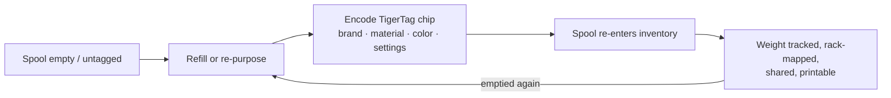

# Il flusso Second Life

## Il problema delle bobine «intelligenti» oggi

Quando una bobina con tag di un produttore finisce, il tag muore con lei: descriveva
una sola bobina riempita in fabbrica, nel formato di un solo fornitore, e non può essere riutilizzato. Il
supporto della bobina viene buttato o ricaricato «muto».

## Second Life: reidentificare, non buttare

Un chip TigerTag è **scrivibile e riscrivibile**. Quando una bobina viene svuotata
e ricaricata — o quando una bobina di qualsiasi marca non ha alcun tag utile — l'utente
codifica un chip TigerTag con il vero profilo del nuovo filamento e lo applica.
La bobina ottiene una *seconda vita* come oggetto di prima classe, capace di identificarsi da sé:

*Anche un refill senza bobina porta con sé la sua identità: il chip viaggia sulla matassa stessa.*

## Come avviene la codifica

- **Tiger NFC Connect** (mobile) — programma i chip con un tocco NFC.
- **Tiger Studio** (desktop) — aggiornamento guidato del chip con un lettore ACR122U /
 [TigerPOD](../products/tigerpod.md): posiziona il chip, verifica della corrispondenza dell'UID,
 scrittura verificata.
- **Digital-first** — il *TigerData* di Tiger Studio ti permette di creare subito una bobina completamente digitale
 (senza chip) e di **promuoverla in seguito a chip reale, in modo atomico**.

> **Nota:** il catalogo di marche, materiali e colori usato durante la codifica è
> fornito dal [database di riferimento](../concepts/universal-filament-identity.md) condiviso, così
> un chip ricodificato è preciso quanto uno di fabbrica.

## La seconda vita del chip stesso — zero rifiuti elettronici

La bobina non è l'unica ad avere una seconda vita: **anche i chip ce l'hanno.**
Ogni bobina porta [due chip](../concepts/tigertag-chip.md) — quindi ogni chilo
di filamento che stampi ti lascia **due chip NTAG standard** da recuperare. Staccali
e ricodificali come semplice NDEF per qualsiasi uso: un portachiavi intelligente, un
biglietto da visita NFC, un oggetto connesso tutto tuo — l'editor è integrato
nell'app. Può perfino riscrivere un chip **nel formato che si aspettano le stampanti Elegoo**:
il tuo chip, la tua scelta.

È proprio per questo che la produzione ufficiale di chip di marca è passata a **NTAG215**:
più margine di memoria significa più possibilità di riutilizzo quando la bobina è vuota.
L'obiettivo è semplice: **il chip di una bobina non dovrebbe mai diventare un rifiuto elettronico.**

---

**◀ Precedente:** [Concetto di Smartphone Bridge](./smartphone-bridge.md) · **▲ [Indice della documentazione](../../README.md)** · **Successivo ▶** [Identità universale del filamento](../concepts/universal-filament-identity.md)

**Vedi anche:** [TigerTag](../products/tigertag.md), [TigerTag+](../products/tigertag-plus.md)
