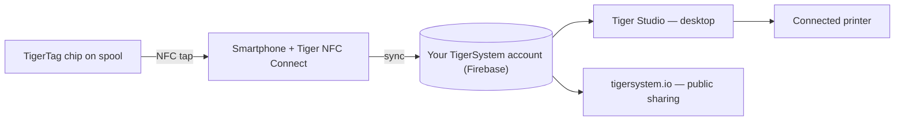

# Il concetto di Smartphone Bridge

## L'intuizione

> In Cina continuavamo a chiederci: *«Dove sono i lettori RFID?»* Tutti rispondevano:
> *«Nelle Bambu Lab.»* Falso — i lettori di Bambu sono nell'AMS, non nella
> stampante; la macchina non riesce a rilevare affatto una bobina di terze parti. **I lettori
> RFID sono nelle tue tasche** — in ogni telefono, pronti all'uso, senza che
> tu lo sappia nemmeno.

Ogni smartphone moderno contiene un lettore NFC. Questo significa che **ogni
utente della stampa 3D possiede già l'hardware TigerTag** — nessun lettore proprietario, nessun
aggiornamento della stampante, nessun acquisto necessario per iniziare.

Il telefono funge da **ponte** tra la bobina fisica e l'inventario
digitale:

1. **Tocca** — il profilo del chip (marca, materiale, colore, parametri) viene letto con un solo gesto.
2. **Sincronizza** — la bobina compare subito nell'inventario cloud dell'utente.
3. **Ovunque** — l'app desktop, il web e le stampanti collegate ora conoscono la bobina.

## RFID nativo e bridge

Alcune stampanti leggono i tag in modo nativo (con il proprio formato proprietario); la maggior parte non
legge nulla. Il bridge rende irrilevanti le capacità della stampante:

| Percorso | Richiede | Funziona con |
|---|---|---|
| **RFID nativo** | Una stampante che legge il tag bloccato di quel produttore | Una sola marca |
| **Smartphone bridge** | Qualsiasi telefono NFC | **Ogni stampante**, ogni marca, persino le macchine completamente offline |

Con il bridge, i dati del filamento raggiungono la stampante tramite
[le integrazioni delle stampanti di Tiger Studio](../compatibility/README.md) (sei marchi
attivi oggi) — la bobina si identifica presso il *sistema*, e il sistema parla
con la macchina.

La prova con un esempio: **le stampanti FlashForge non hanno alcun lettore RFID** —
e grazie al bridge ora funzionano comunque con il filamento identificato via NFC. Una
capacità del tutto nuova, aggiunta alle macchine di qualcun altro, **totalmente gratuita per
l'utente** ([il caso FlashForge](../compatibility/flashforge.md)).

---

**◀ Precedente:** [Ecosistema aperto](./open-ecosystem.md) · **▲ [Indice della documentazione](../../README.md)** · **Successivo ▶** [Flusso Second Life](./second-life.md)

**Vedi anche:** [Tiger NFC Connect](../products/tigertag-connect.md), [Panoramica dell'architettura](../architecture/overview.md)
