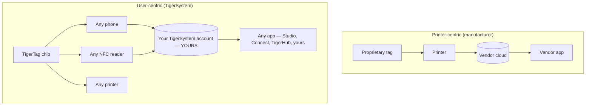

# Incentrato sull'utente o sulla stampante

> **Un'intelligenza al servizio dell'utente — non solo della stampante.**

## Due architetture opposte

In un mondo incentrato sulla stampante il centro è la **stampante**: il tag esiste per servire
la macchina, e i dati confluiscono nel silo del produttore.

In TigerSystem il centro è l'**utente**. L'utente possiede:

- **il filamento** — di qualsiasi marca, di qualsiasi produttore;
- **i metadati** — materiale, colore, parametri di stampa, codificati su un chip che controlla;
- **l'inventario** — conservato nel proprio account cloud, esportabile;
- **lo storico** — pesi, posizioni, utilizzo nel tempo;
- **la sincronizzazione** — lo stesso account alimenta ogni app e ogni dispositivo.

TigerSystem si limita a **collegare tra loro tutti i componenti**.

## Perché i produttori bloccano l'RFID

I tag dei produttori sono di solito bloccati crittograficamente (vedi la
[sezione sulla compatibilità](../compatibility/README.md) per i dettagli di ciascun produttore:
chiavi derivate dall'UID, settori cifrati con AES, firme RSA). Il blocco serve
al produttore: lega l'acquisto dei materiali di consumo alla macchina e mantiene la pipeline
dei dati proprietaria. Significa anche che **il tuo inventario di bobine non è tuo**.

I chip TigerTag adottano la posizione opposta: un payload NDEF aperto su un chip
NTAG standard, documentato pubblicamente, con SDK aperti per leggerlo e scriverlo.

---

**◀ Precedente:** [Perché esiste TigerSystem](../vision/why-tigersystem.md) · **▲ [Indice della documentazione](../../README.md)** · **Successivo ▶** [Ecosistema aperto](./open-ecosystem.md)

**Vedi anche:** [Identità universale del filamento](../concepts/universal-filament-identity.md), [Compatibilità](../compatibility/README.md)
