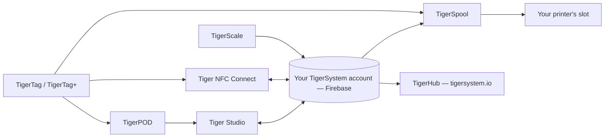

# Prodotti

L'ecosistema TigerSystem, una pagina per prodotto.

**Questi sono i prodotti ufficiali** — progettati e pubblicati da TigerSystem.
«Ufficiale» qui significa *li abbiamo fatti noi*, non *ti servono*: ognuno di essi
è open source e forkabile, e i loro nomi (Tiger Studio, TigerHub, TigerScale,
TigerPOD, Tiger NFC Connect) sono volutamente **non rivendicati come marchi**.
È riservato solo il marchio **TigerTag** in sé, e solo per il chip.

Chiunque può costruire e vendere un'alternativa — un lettore, un'app, una bilancia, un intero
sistema di inventario. Vedi l'[hardware di terze parti](../compatibility/third-party-hardware.md)
e il [software costruito su TigerTag](../developers/integrations.md) per ciò che
esiste già. Un prodotto di terze parti è **TigerTag Compatible** semplicemente
funzionando; diventa **TigerTag Certified** solo quando TigerSystem lo concede
([politica sul marchio](../../TRADEMARK.md)).

> **Nota:** ogni prodotto **rivolto all'utente** qui sotto — e ogni prodotto futuro — è una
> **proof of concept** funzionante. Il loro unico scopo è mostrare il potenziale di un
> protocollo open source, standard, agnostico e multipiattaforma, e ispirare
> ciò che altri costruiranno con esso. (La toolchain di programmazione dei chip lato fabbrica
> è un'altra storia: di livello industriale, in produzione.) Vedi
> [Una sandbox, di proposito](../vision/why-tigersystem.md).

| Prodotto | Che cos'è | Tipo |
|---|---|---|
|  [TigerData](../concepts/universal-filament-identity.md) | Il chip virtuale — l'identità in forma digitale, nessun chip necessario, aggiornabile in qualsiasi momento | Concetto |
|  [TigerTag](./tigertag.md) | Chip RFID/NFC aperto + standard per l'identità della bobina | Hardware + specifica |
|  [TigerTag+](./tigertag-plus.md) | Un TigerTag che porta un ID prodotto del catalogo e un arricchimento facoltativo — ancora 100% offline; firmato, è un TigerTag+ Certified | Hardware + specifica |
|  [Tiger NFC Connect](./tiger-nfc-connect.md) | App mobile (iOS/Android) — scansiona, codifica, sfoglia | App |
|  [Tiger Studio](./tiger-studio.md) | App desktop — inventario, rack, sensori, stampanti | App |
|  [TigerHub](./tigerhub.md) | La casa web dell'ecosistema — vetrina, liste dei desideri, amici e condivisione su `tigersystem.io` | Web |
|  [TigerPOD](./tigerpod.md) | Supporto con doppio lettore NFC stampabile in 3D | Hardware |
|  [TigerScale](./tigerscale.md) | Bilancia per filamento open source basata su ESP32 | Hardware |
|  [TigerSpool](./tigerspool.md) | Scatola open source basata su ESP32 accanto alla stampante — tocca una bobina, scegli uno slot, di qualsiasi marca | Hardware |
|  [Tiger Touch](./tigertouch.md) | Firmware open source per lo schermo BIGTREETECH Panda Touch / K-Touch — ogni marca di stampante, in tempo reale, su un solo schermo | Firmware |
|  [TigerTag Factory & Manager](./factory-suite.md) | Programmazione industriale dei chip e strumenti per il database dei filamenti destinati alle fabbriche — **non pubblici**, di livello produttivo | Industriale |

---

**◀ Precedente:** [Flusso dei dati](../architecture/data-flow.md) · **▲ [Indice della documentazione](../../README.md)** · **Successivo ▶** [TigerTag](./tigertag.md)
