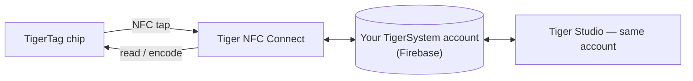

# Tiger NFC Connect (app mobile)

## Scopo

**Il tuo telefono è già un lettore TigerTag — Connect lo accende.** L'app
iOS/Android legge qualsiasi bobina con un tocco, scrive i chip con la stessa facilità, e
tiene l'intera collezione in tasca. È il punto d'ingresso quotidiano
all'ecosistema e l'incarnazione del
[ponte dello smartphone](../philosophy/smartphone-bridge.md).

<strong>iPhone · iPad</strong>
<a class="ts-cta-primary" href="https://apps.apple.com/app/id6745437963">App Store</a>
Inquadra con la fotocamera, o tocca il pulsante

<strong>Android</strong>
<a class="ts-cta-primary" href="https://play.google.com/store/apps/details?id=com.tigertag.connect">Google Play</a>
Inquadra con la fotocamera, o tocca il pulsante

<a href="https://tigersystem.io/download">Tutti i download su tigersystem.io</a>
<a href="https://testflight.apple.com/join/jVHhmK4C">Beta TestFlight (iOS)</a>
<a href="https://play.google.com/apps/testing/com.tigertag.connect">Beta Google Play</a>

Gratuita, su entrambi gli store. L'app legge un chip con l'NFC del telefono — niente
da comprare, nessun lettore, nessun account necessario per leggere.

## Dove si colloca

## Funzionalità

- **Scansione NFC in movimento** — tocca una bobina, vedi il suo profilo completo.
- **Programmazione dei chip** — codifica e ricodifica i chip TigerTag dal telefono.
- **Esplorazione del catalogo** — il database di riferimento condiviso di marche/materiali/colori.
- **Account condiviso** — stesso backend Firebase di Tiger Studio: inventario,
 amici e rack restano sincronizzati in tempo reale tra i dispositivi.
- **Accessori USB-C** — supporta l'analizzatore di filamento **TD-1 / TD1s** di
 AJAX-3D via USB-C: misura la Transmission Distance (e il
 colore) di un filamento direttamente dal telefono
 ([hardware di terze parti compatibile](../compatibility/third-party-hardware.md)).

## Come ottenerla

- **Pubblicata** su **App Store (iOS)** e **Google Play (Android)** —
 versione 1.0.2 oggi.
- **Beta pubbliche** disponibili (TestFlight su iOS, beta aperta su Android).
- Tutti i link di download: **[tigersystem.io/download](https://tigersystem.io/download)**
 — un codice QR è sempre disponibile anche nella barra laterale di Tiger Studio.

> **Nota sul nome:** pubblicata in precedenza come *«TigerTag RFID Connect»* — rinominata
> **Tiger NFC Connect** per richiamare il lettore NFC già presente in ogni telefono.
> L'app è **gratuita ma proprietaria** (non open source) per ora —
> a differenza di Tiger Studio, degli SDK e dell'hardware, che sono aperti.

## Architettura

App Flutter che dialoga con Firebase (Auth + Firestore) — l'unico database di account
condiviso dietro tutte le app. La connettività alle stampanti su mobile è orientata al cloud dove i produttori
lo consentono.

## Interazioni

| Con | Come |
|---|---|
| Chip TigerTag | Lettura e scrittura con un tocco NFC |
| Firebase (database degli account) | Sincronizzazione in tempo reale di inventario / amici / preferenze |
| Tiger Studio | Compagno desktop — stesso account, funzionalità complementari |

## In immagini

|| | | |
|---|---|---|---|
|  |  |  |  |

---

**◀ Precedente:** [TigerTag+ Certified](./tigertag-plus-certified.md) · **▲ [Indice della documentazione](../../README.md)** · **Successivo ▶** [Tiger Studio](./tiger-studio.md)

**Vedi anche:** [Ponte dello smartphone](../philosophy/smartphone-bridge.md), [Inventario e sincronizzazione cloud](../concepts/inventory-and-cloud-sync.md)
