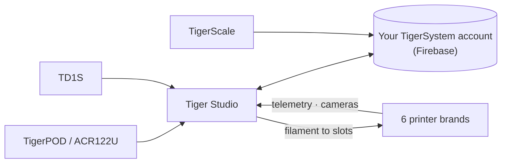

# Tiger Studio (app desktop)

## Scopo

**Tiger Studio è la sala di controllo del tuo filamento.** Ogni bobina, ogni
rack, ogni stampante su un solo schermo — scansiona un chip e la sua bobina si apre,
aggiorna un peso e si sincronizza ovunque, dai un'occhiata a una stampante e vedi cosa
sta facendo in questo momento. Open source, su Windows / macOS / Linux.

*Tiger Studio sulla scrivania, l'app in tasca, un lettore accanto — lo
stesso inventario, ovunque lo tocchi.*

<a class="ts-cta-primary" href="https://tigersystem.io/download">Scarica Tiger Studio — gratis</a>

<a href="https://github.com/TigerTag-Project/TigerTag-Studio-Manager"> Sorgenti</a>

È volutamente **un laboratorio, non la destinazione** — una dimostrazione di
ciò che il protocollo aperto rende possibile, leggibile, forkabile e liberamente copiabile
([filosofia](../philosophy/open-ecosystem.md)).

## Dove si colloca

## Funzionalità (in evidenza)

- **Inventario** — sincronizzazione Firestore in tempo reale, viste a tabella/griglia, pannello di dettaglio,
 monitoraggio del peso, calibrazione dei contenitori, bobine digitali (TigerData) con
 promozione atomica a chip.
- **Stampanti** — integrazioni in tempo reale per **6 marche** (telemetria, filamento per
 slot, avanzamento del lavoro, telecamere e, per alcune marche, pannelli di controllo completi). Vedi
 [compatibilità](../compatibility/README.md).
- **Rack** — mappatura fisica dello stoccaggio con trascinamento.
- **Amici e condivisione** — codici di scoperta, inventari degli amici in sola lettura.
- **Dispositivi** — di prima parte: [TigerPOD](./tigerpod.md) e
 [TigerScale](./tigerscale.md); di terze parti: il lettore NFC ACR122U, gli analizzatori
 **AJAX-3D TD-1 e TD1s** (TD + colore direttamente nel profilo della bobina) e le
 **bilance USB HID** (serie DYMO M e qualsiasi bilancia conforme) —
 elenco completo: [hardware di terze parti compatibile](../compatibility/third-party-hardware.md).
- **11 lingue** — EN · FR · DE · ES · IT · NL · PL · PT-BR · PT-PT · RU · 中文.

Il catalogo completo e sempre aggiornato si trova nel
[FEATURES.md](https://github.com/TigerTag-Project/TigerTag-Studio-Manager/blob/main/FEATURES.md) del repository dell'app.

## Architettura

Electron + JS vanilla, nessun bundler. I collegamenti alle stampanti parlano direttamente il **protocollo
LAN nativo** di ciascun produttore (MQTT / WebSocket / HTTP) — le note sui protocolli per marca sono
mantenute nel repository dell'app (`renderer/printers/<brand>/PROTOCOL.md`).

## In immagini

## Link

- Repository + download: [TigerTag-Studio-Manager](https://github.com/TigerTag-Project/TigerTag-Studio-Manager) (MIT)
- Catalogo completo delle funzionalità: [FEATURES.md](https://github.com/TigerTag-Project/TigerTag-Studio-Manager/blob/main/FEATURES.md)

---

**◀ Precedente:** [Tiger NFC Connect](./tigertag-connect.md) · **▲ [Indice della documentazione](../../README.md)** · **Successivo ▶** [TigerHub](./tigerhub.md)

**Vedi anche:** [Compatibilità](../compatibility/README.md), [Architettura](../architecture/overview.md)
