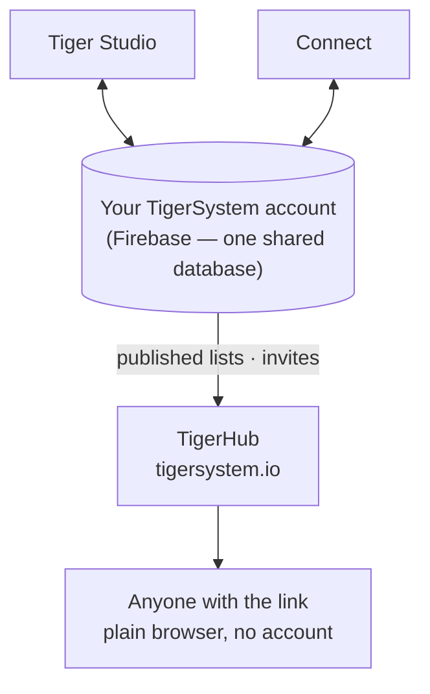

# TigerHub

## Scopo

**TigerHub è la casa dell'ecosistema sul web** — il sito su
**[tigersystem.io](https://tigersystem.io)**. Presenta la sandbox di TigerSystem
e ciò che il protocollo aperto TigerTag rende possibile, e ospita il
**lato social** della sandbox: condividere una lista dei desideri, invitare qualcuno a diventare
amico, pubblicare una lista in sola lettura che chiunque può aprire in un browser.

## Dove si colloca

## Funzionalità — tutte attive oggi

- **Vetrina dell'ecosistema** — la home racconta l'intera storia: come funziona,
 le sei marche di stampanti, i componenti e i tre livelli (TigerData —
 monitoraggio solo software · TigerTag — il chip offline · TigerTag+ — autenticità
 verificata).
- **Il tuo account sul web** (`/account`) — accedi al tuo account TigerSystem
  da un browser.
- **Liste dei desideri** — pubbliche e solo per gli amici, entrambe attive.
- **Codici amico e inviti** — aggiungetevi come amici dal web.
- **Link pubblici alle liste** — condividi un inventario o una lista dei desideri in sola lettura come
 `https://tigersystem.io/list/<token>`; chi la visualizza non ha bisogno di un'app né di un
 account.
- **Catalogo dei materiali e database di riferimento** (`/materials`, `/database`) —
 sfoglia il catalogo condiviso su cui si basano tutte le app.
- **Stampanti e funzionalità** (`/printers`, `/features`) — cosa funziona con cosa.
- **Modelli 3D** (`/models`) — modelli stampabili (TigerPOD e simili).
- **Per produttori, sviluppatori e stampa** (`/manufacturers`, `/developers`,
 `/press`) — la storia B2B, indicazioni per l'integrazione, risorse multimediali.
- **Goodies** (`/goodies`) — il cappellino e il polo ufficiali. Comprarne uno è uno
 dei modi per [sostenere il progetto](../support.md).

## TigerHub non è il database

Gli account utente e i dati dietro tutte le app vivono su **Firebase semplice**
(Auth + Firestore) — un'infrastruttura volutamente senza marchio: **un solo database
condiviso, in un solo posto**, così Tiger Studio, Tiger NFC Connect, TigerScale
e l'account TigerSystem interoperano tutti sugli stessi dati. TigerHub è la
**superficie web** costruita sopra di esso. Vedi
[Inventario e sincronizzazione cloud](../concepts/inventory-and-cloud-sync.md).

## Interazioni

| Con | Come |
|---|---|
| Tiger Studio / Connect | Generano e revocano link di condivisione, inviano inviti ad amici |
| Firebase (database dell'account) | Fonte dei dati pubblicati |
| Visitatori | Browser semplice, nessun account necessario |

---

**◀ Precedente:** [Tiger Studio](./tiger-studio.md) · **▲ [Indice della documentazione](../../README.md)** · **Successivo ▶** [TigerPOD](./tigerpod.md)

**Vedi anche:** [Inventario e sincronizzazione cloud](../concepts/inventory-and-cloud-sync.md), [Architettura](../architecture/overview.md)
