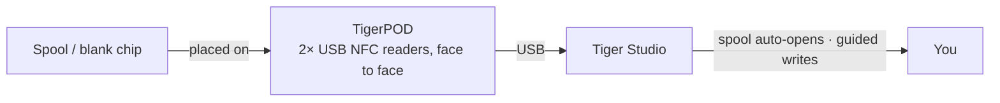

# TigerPOD

## Scopo

**Il primo «lettore CD» per le bobine di filamento intelligenti.** TigerPOD mette uno scanner
di bobine sulla tua scrivania — e lo stampi tu stesso.
Un supporto stampabile in 3D, gratuito e open source, che regge **due** lettori NFC USB **uno
di fronte all'altro**: appoggi una bobina e si identifica da sola in Tiger Studio; appoggi un
chip vuoto e lo codifichi. Naturale come avvicinare un telefono, ma a mani libere sulla scrivania.

*Appoggia la bobina; si presenta da sola.*

<a class="ts-cta-primary" href="https://tigersystem.io/tigerpod">Prendi un TigerPOD</a>
<a href="https://makerworld.com/fr/models/1289152-tigerpod-for-openspool-tigertag-rfid-filament#profileId-1318958">Stampalo — STL gratuito</a>

<a href="https://github.com/TigerTag-Project/TigerPOD"> Sorgenti</a>

## Perché due lettori, uno di fronte all'altro

È tutto il senso del guscio, e l'unica cosa da fare bene. **Consigliamo sempre due
lettori.** Un solo lettore funziona, tecnicamente, ma peggiora l'esperienza in due modi
concreti:

- **Lettura.** Una bobina porta
 [**due chip, su facce opposte**](../concepts/tigertag-chip.md). Con un solo
 lettore, una bobina che capita dal lato «sbagliato» va sollevata e
 girata prima di essere vista. Con un lettore per lato, in qualunque verso tu
 la appoggi, un chip è già davanti a un lettore. Niente da girare, niente
 da puntare.
- **Scrittura.** Quando tagghi tu una bobina, scrivi **entrambi** i chip. Un solo
 lettore significa due passaggi, e due occasioni di farli non coincidere. Due lettori scrivono
 la coppia **in un colpo solo**, e Tiger Studio può verificarli l'uno contro l'altro.

Il Pod esiste per mantenere questa geometria: due lettori, in piedi, uno di fronte all'altro, alla distanza
di una bobina. Tutto il resto è un guscio intorno.

## Dove si colloca

## Due gusci da stampare — entrambi gratuiti

| | **TigerPOD Mini** — *consigliato* | **TigerPOD (originale)** |
|---|---|---|
| |  |  |
| Stampa | Più veloce, meno filamento | Più lunga, più filamento |
| Spazio sulla scrivania | Meno | Più |
| Cavi | Instradati **dentro** il guscio | Esterni |
| Tag | TigerTag **e** OpenSpool (NDEF) | TigerTag **e** OpenSpool (NDEF) |
| Download | **[MakerWorld — TigerPOD Mini](https://makerworld.com/fr/models/3190348-tigerpod-mini-for-openspool-tigertag-rfid-filament#profileId-3609236)** | **[MakerWorld — TigerPOD originale](https://makerworld.com/fr/models/1289152-tigerpod-for-openspool-tigertag-rfid-filament#profileId-1318958)** |

Entrambi accolgono gli stessi due lettori di classe ACR122U uno di fronte all'altro. Il Mini è un
ridisegno dell'originale ed è semplicemente il Pod migliore: parti da lì, a meno che tu non voglia
proprio la culla più grande.

Con licenza **CC BY 4.0** — remixa e adatta liberamente.

## Di cosa è fatto

L'STL è il guscio; queste sono le parti che ci vanno dentro. Niente è
esclusivo — va bene qualsiasi lettore di classe ACR122U e qualsiasi splitter USB-C — ma questa è
la combinazione attorno a cui è progettato il guscio:

| Parte | Quantità | Che cos'è |
|---|---|---|
| **TigerTag Player** | **2** | Il lettore NFC USB — un dispositivo di classe ACR122U. Uno per lato, così entrambi i chip della bobina vengono raggiunti in un solo passaggio. |
| **TigerTag Spliter** | 1 | USB-C verso 2× USB-A, così i due lettori raggiungono il computer su una sola porta e possono essere programmati in parallelo. |
| **Il guscio stampato** | 1 | **Mini** oppure originale — vedi sopra. |

### Procurarsi le parti

Il guscio è un download gratuito; i due lettori e lo splitter sono la parte che
compri. Sono venduti in bundle, che è il modo più economico per ritrovarsi con la
coppia giusta:

- **[TigerTag Player Bundle — 2 lettori + Spliter](https://www.atome3d.com/products/tigertag-player-bundle-2pcs-spliter)** (Atome3D)
- Disponibile anche su **[tigertag.io](https://shop.tigertag.io/collections/tigertag-rfid-maker)**

> **Nota:** assemblarne uno da te o comprarne uno già assemblato porta
> esattamente allo stesso dispositivo. Vanno bene due lettori qualsiasi di classe ACR122U — il bundle
> ti evita solo di procurarteli separatamente.

## Costruiscine uno

1. **Stampa un guscio** — il Mini o l'originale, qui sopra.
2. **Procurati due lettori compatibili ACR122U**, nel negozio che preferisci, e una confezione di
 chip NTAG 213 / 215 / 216 vuoti su cui scrivere.
3. **Infila un lettore in ciascuna fessura** — niente viti, niente colla, niente cablaggio.
4. **Collega entrambi al computer.** Uno splitter ne fa un solo cavo; due porte
 USB funzionano altrettanto bene.
5. **Installa [Tiger Studio](./tiger-studio.md)** — rileva i lettori da
 solo.

Budget indicativo, acquistando le parti separatamente — i prezzi variano per negozio e regione:

| Parte | Qtà | Circa | Dove |
|---|---|---|---|
| Lettore NFC compatibile ACR122U | 2 | 15–25 € l'uno | [Amazon](https://amzn.to/4vok3d7) · o qualsiasi negozio |
| Chip NTAG 213 / 215 / 216 vuoti | 1 confezione | 10–20 € — due chip per bobina, quindi una confezione ne tagga molte | [Amazon](https://amzn.to/3TzxGc7) · [chip ufficiali](./tigertag.md) |
| Il guscio stampato | 1 | solo filamento | MakerWorld, qui sopra |
| Splitter USB (2× USB-A femmina → 1× USB-A maschio) | 1 | 5–10 €, facoltativo | [Amazon](https://amzn.to/4plgsv8) |

> Alcuni link di questa tabella sono **link di affiliazione Amazon**: in quanto Partner
> Amazon, TigerTag guadagna dagli acquisti idonei, **senza costi aggiuntivi per
> te**. Aiuta a finanziare il protocollo aperto. Comprare le stesse parti altrove
> funziona esattamente allo stesso modo.

Acquistare invece il [kit](https://shop.tigertag.io/collections/tigertag-rfid-maker)
costa meno che procurarsi le stesse parti una per una, i lettori arrivano
con il logo ufficiale del progetto e finanzia lo standard — uno dei
tanti modi per [sostenere il progetto](../support.md). Ma costruirne uno con parti
generiche **non è una via di serie B — è lo stesso Pod**. Questo significa
protocollo aperto.

### Compatibilità dei lettori

L'ACR122U parla **PC/SC**, lo standard di smart card a livello di sistema operativo che ogni lettore di
questa classe implementa. Poiché il Pod si basa su PC/SC e non su un driver proprietario,
la stessa configurazione funziona su **Windows, macOS e Linux**, e qualsiasi libreria PC/SC
può pilotarla.

## Funzionalità

- Guscio stampabile in 3D — **STL gratuiti su MakerWorld**, nelle dimensioni **Mini** e
 **originale**.
- Ospita due lettori USB di classe ACR122U, faccia a faccia (stazioni di lettura + scrittura).
- Plug-and-play con [Tiger Studio](./tiger-studio.md): la scansione di un chip
 apre automaticamente la bobina corrispondente; il flusso guidato di aggiornamento del chip lo usa per
 scritture con verifica dell'UID.
- Non è vincolato a TigerTag: gli stessi due lettori gestiscono anche i tag **OpenSpool** (NDEF).

## Più di TigerTag — una stazione NFC universale

Il Pod **non è vincolato al protocollo TigerTag**. Sono, letteralmente, due
lettori PC/SC standard in un supporto a forma di bobina: **tutto ciò che un ACR122U sa fare,
lo sa fare il Pod.**

Controlli il chip completamente — leggere ciò che contiene, scrivere qualcosa di nuovo,
cambiare ciò che c'è, cancellarlo fino a riportarlo vuoto. Tutti e quattro, in entrambe le direzioni. Niente
scrittura unica, niente strada a senso unico, nessun vincolo con un produttore. E per il filamento tutto questo avviene in
**Dual NFC**, con entrambi i chip di una bobina gestiti insieme, sulle bobine di qualsiasi marca.

L'ACR122U gestisce molto più degli NTAG: **ISO 14443 Type A e B**, **MIFARE**
(Classic 1K/4K, Ultralight, DESFire), **FeliCa**, **Topaz/Jewel** e i **tipi 1–4 dei tag NFC
Forum**. Tutto ciò che puoi leggere o scrivere con un ACR122U, puoi
leggerlo o scriverlo nel Pod — compresi i tag [OpenSpool](../compatibility/openspool.md).

È anche ciò che rende reale la [seconda vita](../philosophy/second-life.md). Un
TigerTag non è mai protetto in scrittura, quindi quando una bobina è finita puoi cancellarne i
chip e riscriverli come TigerTag nuovi — oppure trasformarli in qualcos'altro:
un semplice tag **NDEF** per la domotica, un passaggio di Wi-Fi, un URL, un biglietto
da visita. E poi di nuovo in un TigerTag quando vuoi. Il chip è una risorsa
riutilizzabile, non un imballaggio monouso.

## Interazioni

| Con | Come |
|---|---|
| Chip TigerTag | Leggere / codificare / verificare — entrambi i chip di una bobina insieme |
| Tiger Studio | Identificazione istantanea della bobina, promozione e aggiornamento del chip |

## In immagini

## Link

- Repository: [TigerPOD](https://github.com/TigerTag-Project/TigerPOD)
- STL — **[TigerPOD Mini](https://makerworld.com/fr/models/3190348-tigerpod-mini-for-openspool-tigertag-rfid-filament#profileId-3609236)** · [TigerPOD originale](https://makerworld.com/fr/models/1289152-tigerpod-for-openspool-tigertag-rfid-filament#profileId-1318958)
- Lettori: [TigerTag Player Bundle (2 pz + Spliter)](https://www.atome3d.com/products/tigertag-player-bundle-2pcs-spliter)

---

**◀ Precedente:** [TigerHub](./tigerhub.md) · **▲ [Indice della documentazione](../../README.md)** · **Successivo ▶** [TigerScale](./tigerscale.md)

**Vedi anche:** [Flusso Second Life](../philosophy/second-life.md)
