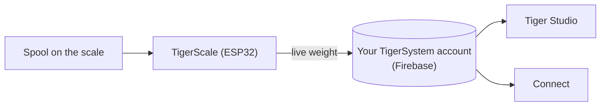

# TigerScale

## Scopo

**TigerScale risponde all'eterna domanda: quanto filamento è rimasto?** Metti una
bobina sulla bilancia open source ESP32 e il peso in tempo reale arriva direttamente nel tuo
inventario — niente inserimento manuale, niente scuotere la bobina vicino all'orecchio.

*La bobina va sopra, e la bilancia sa già che cos'è: il chip fornisce la
marca, il materiale e il colore, la cella di carico fornisce i grammi. Niente
digitato, niente tirato a indovinare.*

<a class="ts-cta-primary" href="https://tigertag-project.github.io/Tiger-Scale-V3/">Installa dal browser</a>

<a href="https://tigersystem.io/tigerscale">TigerScale su tigersystem.io</a>
<a href="https://makerworld.com/en/models/3161869-tigerscale-v3-best-smart-filament-scale-with-nfc#profileId-3573543">Stampa la scocca</a>
<a href="https://github.com/TigerTag-Project/Tiger-Scale-V3"> Sorgenti</a>

> **Il chip sa che cosa *è* il filamento; la bilancia sa quanto ne è
> *rimasto*.** Insieme rendono l'inventario davvero veritiero: l'identità viene da
> [TigerTag](./tigertag.md), la quantità in tempo reale da TigerScale.

## TigerScale V3 — la generazione attuale

[Tiger-Scale-V3](https://github.com/TigerTag-Project/Tiger-Scale-V3), MIT.
È quella da costruire.

- **Sa quale bobina c'è sopra**: **due lettori NFC PN532**, uno per
 lato — una [bobina con doppio tag](../concepts/tigertag-chip.md) viene identificata
 in qualunque verso la appoggi. Legge il tag, pesa, sottrae il peso della
 bobina vuota, sincronizza — niente digitazione, niente congetture.
- **ESP32-S3** (16 MB di flash, PSRAM), **touchscreen a colori da 3,5″ 480×320**
 (LVGL) con configurazione completa a schermo: selettore WiFi + tastiera, procedura guidata di
 calibrazione, autotest hardware, aggiornamenti OTA.
- **Alimentata a batteria** (PMIC AXP2101, stato di carica a schermo), codec audio.
- Pesatura di precisione: HX711 + cella di carico, filtraggio mediano + EMA adattiva —
 tarata per la sensazione di una bilancia da cucina.
- **8 lingue per il firmware**, interfaccia web in 9 lingue.
- **Monitoraggio del peso in tempo reale** — gli aggiornamenti compaiono in tempo reale in Tiger Studio e
 Tiger NFC Connect tramite Firestore.
- Funziona con la **calibrazione del peso del contenitore** di Tiger Studio, così il peso netto
 del filamento resta accurato per ogni tipo di contenitore.
- **Funziona offline.** L'identificazione di marca e materiale viene da un database
 conservato nella flash del dispositivo, aggiornato al massimo una volta al giorno — la ricerca di un
 tag non aspetta mai la rete.
- **La sincronizzazione cloud è facoltativa.** La bilancia è pienamente utilizzabile senza un account.
- **La sua interfaccia web**, servita dal dispositivo, adatta al mobile, in tempo reale via
 WebSocket a 10 Hz — nessuna app da installare per pilotarla da un telefono.
- **Nessun blob binario**: tutto si compila dai sorgenti.

*Sul banco: appoggia la bobina, si identifica e si pesa da sola.*

## Costruirne una

> **Non ti appassiona l'elettronica?** Una bilancia USB e un [TigerPOD](./tigerpod.md) fanno lo
> stesso lavoro senza nulla da cablare o flashare — l'
> [alternativa ufficiale senza elettronica](#una-bilancia-usb-e-un-tigerpod-senza-elettronica).

La bilancia è un progetto fai da te, e i passaggi che ci si aspetta difficili non lo sono:

1. **Stampa la scocca.** Un unico progetto Bambu Studio `.3mf` con i piatti
 già disposti — [su MakerWorld](https://makerworld.com/en/models/3161869-tigerscale-v3-best-smart-filament-scale-with-nfc#profileId-3573543).
 Aprilo in Bambu Studio o Orca e premi Slice: niente da orientare, nessun
 supporto da posizionare.
2. **Cabla i componenti.** Collega cella di carico, HX711, altoparlante ed entrambi i
 lettori PN532 alla scheda seguendo lo [schema di cablaggio](#schema-di-cablaggio)
 qui sotto — la stessa piedinatura per entrambe le varianti della scheda.
3. **Flasha dal browser.** Il
 [web installer](https://tigertag-project.github.io/Tiger-Scale-V3/) serve sempre
 la release attuale; dopo di che la bilancia si aggiorna da sola via etere.

I componenti sono di uso comune:

| Qtà | Componente | Dove |
|---|---|---|
| 1 | Waveshare **ESP32-S3-Touch-LCD-3.5B** — touch IPS 480×320 (va bene anche la **-3.5** senza B) | [-3.5B](https://link.amazon/B0gaANfF5) · [-3.5](https://link.amazon/B0dpgOlOQ) |
| 2 | Modulo NFC **PN532 V3** — servono pin header **e** selettore di modalità | [Amazon](https://link.amazon/B0iTXrhjd) |
| 1 | Cella di carico da 5 kg + HX711 | [Amazon](https://link.amazon/B09LOUuI1) |
| 1 | Cavo USB-C a 4 pin + connettore | [cavo](https://link.amazon/B0aoW8qQx) · [connettore](https://link.amazon/B0aiEyjLx) |
| 1 | Batteria Li-ion — **facoltativa**, la bilancia funziona via USB | [Amazon](https://link.amazon/B0etKlE1i) |
| — | Fili Dupont, viti autofilettanti M3 | [fili](https://link.amazon/B0bl6jvMs) · [viti](https://link.amazon/B0ekzxx1E) |
| — | 2× M4×30 e 2× M5×30 (cella di carico), 4× M2×6 (display) | qualsiasi ferramenta |
| 1 | Un piccolo altoparlante | incluso con la scheda ESP32-S3 |

<figure>

<figcaption><strong>Entrambe le varianti funzionano, ma richiedono un firmware diverso.</strong> Leggi la serigrafia: <strong>-3.5B</strong> oppure <strong>-3.5</strong>. Il web installer chiede quale hai; il cablaggio e la scocca sono gli stessi in entrambi i casi. Se flashi la build sbagliata la bilancia si avvia perfettamente ma non vede mai un tag, senza nulla a schermo che ne spieghi il motivo.</figcaption>
</figure>
<figure>

<figcaption><strong>Attenzione:</strong> la cella di carico deve avere 2 fori filettati M4 e 2 M5, e la scheda HX711 deve essere identica a quella mostrata — altrimenti non entrerà nell'alloggiamento previsto.</figcaption>
</figure>

> Alcuni link di questa tabella sono **link di affiliazione Amazon**: in quanto Partner
> Amazon, TigerTag guadagna dagli acquisti idonei, **senza costi aggiuntivi per
> te**. Aiuta a finanziare il protocollo aperto. Comprare le stesse parti altrove
> funziona esattamente allo stesso modo.

La distinta base completa con i costi si trova nel
[repository](https://github.com/TigerTag-Project/Tiger-Scale-V3).

### Assemblaggio

<figure>

<figcaption>Tre quarti anteriore</figcaption>
</figure>
<figure>

<figcaption>Tre quarti posteriore</figcaption>
</figure>
<figure>

<figcaption>Tre quarti posteriore, da vicino</figcaption>
</figure>
<figure>

<figcaption>Prospetto laterale</figcaption>
</figure>

<figure>

<figcaption>Posizione e orientamento della bilancia</figcaption>
</figure>
<figure>

<figcaption>PN532 inserito nel suo alloggiamento</figcaption>
</figure>

### Schema di cablaggio

*[Schema interattivo in Cirkit Designer](https://app.cirkitdesigner.com/project/c6aa6c0a-9462-498f-8923-9ad4454e0e69)*

### Risoluzione dei problemi

**Nessuna porta COM rilevata per l'ESP32-S3 nel [web installer](https://tigertag-project.github.io/Tiger-Scale-V3/)?**

Potrebbe mancare un driver per il tuo sistema. [Segui la guida all'installazione del driver](../tutorials/tigerscale-serial-port-driver.md).

## Da fabbricare e da vendere

**Chiunque può produrre e vendere hardware TigerScale. Nessuna licenza da pagare, nessuna
royalty, nessuna registrazione.** Costruiscila, flasha il firmware ufficiale, spediscila.

L'unica condizione per chiamare il tuo prodotto **TigerScale** è eseguire quel
firmware ufficiale **senza modifiche**, così ogni unità si comporta in modo identico all'interno
dell'ecosistema. Fanne un fork se vuoi cambiarlo — e dai al fork un nome
diverso. Questo è tutto l'accordo.

## Dove si colloca

## La storia finora

Tre generazioni, e la forma della cosa è cambiata a ogni passaggio:

| | Lettura | Schermo | Scheda | Fattore di forma |
|---|---|---|---|---|
| **V1** — mai rilasciata pubblicamente | **un** PN532 | mini OLED | ESP32 | un **portabobina**: un supporto centrale che attraversa il centro della bobina |
| **V2** — [Tiger-Scale](https://github.com/TigerTag-Project/Tiger-Scale), MIT | 2× RC522 | OLED da 0,96″ | ESP32-WROOM, alimentata via USB | una bilancia piatta |
| **V3** — [Tiger-Scale-V3](https://github.com/TigerTag-Project/Tiger-Scale-V3), MIT | 2× PN532 | touchscreen a colori da 3,5″ | ESP32-S3, a batteria | una bilancia piatta, autonoma |

La V1 portava già in sostanza l'elettronica della V2 — ESP32, mini OLED,
una scheda HX711 con cella di carico da 5 kg — ma con un **solo** lettore e un corpo
completamente diverso.

> **La V3 è hardware diverso, non un aggiornamento del firmware.** Le due non sono
> intercambiabili: una V2 che hai già costruito mantiene il suo repository e continua a
> funzionare. Semplicemente non è più sviluppata.

Tutte e tre sono completamente open source (MIT) su componenti di uso comune — la prova vivente
che un ESP32 e un modulo lettore NFC (classe PN532 / RC522) bastano per
costruire un dispositivo che legge i TigerTag.

## Una bilancia USB e un TigerPOD, senza elettronica

L'**alternativa ufficiale per chi non vuole costruire una bilancia**. Una
bilancia USB standard e un [TigerPOD](./tigerpod.md), entrambi collegati al
computer, e Tiger Studio fa il resto — niente da saldare, cablare o flashare.

1. **Collega la bilancia al computer** via USB.
2. **Appoggia il TigerPOD sopra** — il Mini o l'originale.
3. **Tara la bilancia**, con il TigerPOD sopra.
4. **Apri Tiger Studio.**
5. **Appoggia una bobina sul TigerPOD.** Legge i chip della bobina e Tiger
 Studio ne apre la scheda.
6. **La bilancia la pesa**, e Tiger Studio aggiorna da solo il peso della
 bobina.

### Quali bilance funzionano

Tiger Studio legge i **dispositivi USB standard «HID Scale»** (pagina d'uso HID
`0x8D`, uso `0x20`): a cominciare dalla **DYMO M5** e dal resto della serie
DYMO M (M10, M25… stesso protocollo), e **qualsiasi HID Scale conforme**, di qualunque
marca. La bilancia è hardware di terze parti, non un prodotto Tiger; la configurazione
che la circonda è ufficiale e supportata.

Protocollo, validato su hardware reale — *Scale Data Report* da 6 byte a ~1 Hz:

| Byte | Significato |
|---|---|
| `[0]` | id del report `0x03` |
| `[1]` | stato: 1 guasto · 2 stabile a zero · 3 in movimento · 4 stabile · 5 negativo · 6 oltre la portata |
| `[2]` | unità (codici HID PoS): `0x02` grammo · `0x0B` oncia · `0x0C` libbra |
| `[3]` | esponente di dieci con segno applicato al valore grezzo |
| `[4..5]` | peso, LE16 (LSB, MSB) |

Vendor id DYMO `0x0922`; la M5 ha pid `0x8009`. Stranezza: il primissimo frame
subito dopo una tara riporta l'unità `0x00`.

> **La DYMO M2 non è supportata** — non ha alcuna porta USB, quindi non c'è
> nulla da collegare a un computer. Il protocollo è irrilevante.

## Interazioni

| Con | Come |
|---|---|
| Firebase (database degli account) | Scrive il peso in tempo reale nell'account dell'utente |
| Tiger Studio / Connect | Mostrano il peso in tempo reale; monitoraggio dello stato |

## Link

- **V3 (attuale)**: [Tiger-Scale-V3](https://github.com/TigerTag-Project/Tiger-Scale-V3) (MIT)
- Flashala dal browser: [web installer](https://tigertag-project.github.io/Tiger-Scale-V3/)
- Stampa la scocca: [MakerWorld](https://makerworld.com/en/models/3161869-tigerscale-v3-best-smart-filament-scale-with-nfc#profileId-3573543)
- V2, non più sviluppata: [Tiger-Scale](https://github.com/TigerTag-Project/Tiger-Scale) (MIT)

---

**◀ Precedente:** [TigerPOD](./tigerpod.md) · **▲ [Indice della documentazione](../../README.md)** · **Successivo ▶** [Compatibilità](../compatibility/README.md)

**Vedi anche:** [Inventario e sincronizzazione cloud](../concepts/inventory-and-cloud-sync.md)
