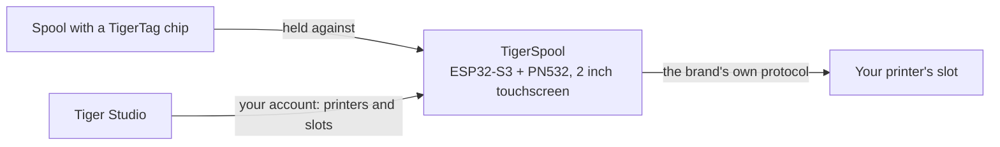

# TigerSpool

**Una piccola scatola accanto alla stampante. Tocca uno slot, avvicina una bobina, e il
filamento viene scritto in quello slot — su qualsiasi marca di stampante.**

*La scatola, una bobina e gli slot della stampante a schermo — ognuno mostra
ciò che vi è caricato. Scegli uno slot, avvicina la bobina alla scatola, fatto.*

<a class="ts-cta-primary" href="https://tigertag-project.github.io/TigerSpool-RFID/">Installa dal browser</a>

<a href="https://github.com/TigerTag-Project/TigerSpool-RFID"> Sorgenti</a>

La tua stampante tiene già un elenco di slot. La tua bobina porta già la propria
[identità](../concepts/universal-filament-identity.md). TigerSpool sono i trenta
centimetri tra le due: nessuna app da aprire, nessuna tastiera, niente da digitare di nuovo
che il chip non sappia già.

Open source con licenza **MIT**, ESP32-S3, circa **40 €** di componenti comuni.

## Cosa fa

1. **Tocca lo slot** che vuoi sul touchscreen — gli stessi nomi di slot che usa
 la stampante stessa.
2. **Avvicina la bobina alla scatola.** Il [chip TigerTag](../concepts/tigertag-chip.md)
 viene letto al contatto, e l'assegnazione parte subito verso la stampante, con
 il protocollo proprio di quella marca: materiale, marca, colore e temperature, nello
 slot giusto. Non c'è nulla da confermare.
3. **Carica la bobina.** La scatola ti dice in quale slot è finita.

Parla nove lingue, chiede quale usare prima di ogni altra cosa, e si aggiorna
da sola via etere.

:::caution[Avvertenza]
Scansionare un TigerTag su uno slot dello schermo non carica
nulla — dice solo alla stampante che cosa *è* la bobina. **Devi comunque
mettere fisicamente la bobina in quello slot tu stesso** — il CFS, l'AMS, l'
unità ACE, o come si chiama il vassoio di quella stampante. Se non lo fai, la
stampante segnala l'assenza di filamento, perché in effetti non ce n'è
nessuno caricato.
:::

## Dove si colloca

TigerSpool non è un scrittore di chip — quello è il compito del [TigerPOD](./tigerpod.md),
sulla scrivania. TigerSpool prende un'identità che esiste già e la mette dove
la stampante se l'aspetta.

## Cosa deve esistere prima

**È qui che si inciampa, quindi viene prima dell'hardware.**

La scatola non ha tastiera né modo di digitare l'indirizzo di una stampante, di proposito.
Legge le tue stampanti **dal tuo account TigerSystem**, il che significa che due
cose devono esistere prima che sia utile:

1. **Un account, creato in [Tiger Studio](./tiger-studio.md).** La scatola vi
 accede — con l'e-mail, o con Google tramite un codice QR, così nessuna password
 viene mai digitata su uno schermo da due pollici.
2. **Le tue stampanti, aggiunte in Tiger Studio.** Indirizzo, codice di accesso, marca e
 modello vivono tutti lì.

Se salti questo passaggio, l'elenco delle stampanti sulla scatola è **vuoto**. Non è un
guasto e non c'è nulla da riparare sul dispositivo: ti sta mostrando esattamente
ciò che contiene il tuo account. Aggiungi la stampante in Tiger Studio e comparirà
alla sincronizzazione successiva.

> **In breve:** Tiger Studio → crea un account → aggiungi le tue stampanti →
> *poi* configura la scatola.

## Quali stampanti

**Le sei marche che Tiger Studio integra sono coperte** — scritte e testate
su hardware. Non sono tutte le stampanti sul mercato, e *«qualsiasi stampante»*
resta l'obiettivo; sono tutte le marche con cui questo ecosistema parla oggi:

| Marca | Firmware | Trasporto |
|---|---|---|
| [Creality](../compatibility/creality.md) | implementato, provato | WebSocket |
| [FlashForge](../compatibility/flashforge.md) | implementato, provato | HTTP |
| [Bambu Lab](../compatibility/bambu-lab.md) | implementato, provato | MQTT su TLS |
| [Snapmaker](../compatibility/snapmaker.md) | implementato, provato | Moonraker su WebSocket |
| [Elegoo](../compatibility/elegoo.md) | implementato, lettura provata — scrittura non ancora confermata su una stampante | MQTT |
| [Anycubic](../compatibility/anycubic.md) | implementato, lettura provata — scrittura non ancora confermata; solo modalità LAN | MQTT su TLS |

I nomi degli slot seguono quelli della stampante: `Ext.` e `1A`–`1D` su Creality e
FlashForge, da `A1` a `A4` poi da `B1` a `B4` su Bambu Lab, da `E1` a `E4` su Snapmaker, da `S1` a `S4` sul Canvas
di Elegoo, e una lettera per ogni unità ACE su Anycubic — `A1`, `A2`… poi
`B1`… per una seconda scatola.

Controlla lo [stato per marca](https://github.com/TigerTag-Project/TigerSpool-RFID/blob/main/docs/PRINTER-COMPATIBILITY.md)
prima di comprare le parti per una macchina specifica.

## Costruirne una

Tre cose da comprare, quattro fili, un guscio stampato — più due extra da
considerare. **L'elettronica è identica per ogni marca di stampante** — cambia solo
il guscio, ed è ciò che permette di avere un solo firmware e un'unica lista delle parti.

| Qtà | Componente | Dove |
|---|---|---|
| 1 | Scheda di sviluppo Waveshare **ESP32-S3-Touch-LCD-2** — touch capacitivo IPS 2,0" 240×320, ESP32-S3**R8**, 16 MB di flash, 8 MB di PSRAM octal. Schermo, pannello touch e MCU su una sola scheda, e i 16 MB sono ciò che rende comodi due slot OTA | [Amazon](https://link.amazon/B0c5hr3uf) |
| 1 | Modulo NFC **PN532 V3** — DIP switch, deve supportare **HSU/UART**, entrambi gli switch su `0` / OFF. Una confezione da due costa poco più di uno | [Amazon](https://link.amazon/B0dyEfwKa) |
| 1 | Un cavo USB-C **che trasporti dati** — la velocità è irrilevante, va bene qualsiasi cavo dati USB 2.0 | [Amazon](https://link.amazon/B00Xg3WT4) |
| 1 | Connettore USB-C magnetico — **consigliato**: la porta è la parte che si maneggia ogni giorno, e a staccarsi è il cavo, non la presa | [Amazon](https://link.amazon/B0bWVIBa0) |
| 1 | Cella LiPo da 3,7 V 1000 mAh, PH1.25 — **facoltativa**, si carica via USB; la scatola funziona poi senza cavo. La scheda non può rilevare una cella, quindi la dichiari in Impostazioni › Batteria. Controlla la polarità | [Amazon](https://link.amazon/B0fL0jjf3) |

> Alcuni link di questa tabella sono **link di affiliazione Amazon**: in quanto Partner
> Amazon, TigerTag guadagna dagli acquisti idonei, **senza costi aggiuntivi per
> te**. Aiuta a finanziare il protocollo aperto. Comprare le stesse parti altrove
> funziona esattamente allo stesso modo.

I **quattro fili jumper sono inclusi con il PN532** — 3V3, GND, TX, RX, e questo è
l'intero cablaggio. Nessun convertitore di livello: il PN532 funziona a 3V3, come la scheda.
La batteria è **facoltativa** — la scatola sta normalmente accanto a una stampante già
collegata alla corrente, e la cella qui sopra serve per quando non lo è.

*L'intero cablaggio. Sul PN532 i due pin dati sono serigrafati `SDA` e
`SCL` — in modalità HSU trasportano l'UART: il **TX della scheda va a `SCL`**, il suo
**RX a `SDA`**, ed entrambi i DIP switch stanno su `0` / OFF.
[Schema interattivo](https://app.cirkitdesigner.com/project/5b546f4e-70b8-4735-afff-be6bd36bc10c).*

**Il flash si fa dal browser** — collega la scheda, clicca Install, aspetta
un minuto. Chrome, Edge od Opera su desktop; Safari e Firefox non
implementano WebSerial, e nessun browser mobile lo fa.

**[Installala dal browser →](https://tigertag-project.github.io/TigerSpool-RFID/)**

### Tre trappole da conoscere prima di ordinare

- **Il lettore va su GPIO43/44, mai su GPIO6/7.** Quella coppia è un bus I²C
 con pull-up su questa scheda: un PN532 collegato lì si accende, risponde, e
 restituisce UID casuali con letture che falliscono. Sembra un tag difettoso. Non lo è,
 e costa una giornata.
- **`TXD` si incrocia con l'RX della scheda, `RXD` con il suo TX.** Chi trasmette parla a chi
 riceve. Se il lettore segnala la versione firmware 0 all'avvio, scambia quei due
 prima di cambiare qualsiasi altra cosa.
- **Un cavo USB di sola ricarica fa sembrare morta una scheda funzionante.** Lo schermo
 si accende e non compare mai alcuna porta seriale, quindi il web installer non trova
 nulla su cui installare. Usa un cavo che sai trasferire file.

Waveshare vende diverse schede simili; quelle da 1,28", 1,69" e 3,5" della
stessa famiglia hanno controller del pannello e piedinature diversi, e questo firmware
non girerà correttamente su di esse. Controlla la serigrafia, non il titolo dell'inserzione.

Lista completa delle parti, schema di cablaggio e checklist di messa in servizio:
[TigerSpool-RFID](https://github.com/TigerTag-Project/TigerSpool-RFID).

## A che punto siamo oggi

Messo per iscritto invece che scoperto:

- **Il primo guscio stampato è pubblicato**: un supporto da scrivania autoportante,
 con la bobina a sinistra o a destra, in
 [Model3D/](https://github.com/TigerTag-Project/TigerSpool-RFID/tree/main/Model3D).
 Le scocche che si montano su una data stampante seguono la stessa regola — stessa scheda, stesso
 lettore, stessi quattro fili, stesso ingresso USB-C — così un'unica immagine firmware gira su
 ogni modello e chiunque può contribuirne una senza toccare il codice.
- **Il firmware non è firmato.** La sua connessione di aggiornamento è verificata rispetto
 all'archivio dei certificati radice, quindi la scatola sa con chi sta parlando — ma non chi
 ha prodotto l'immagine.
- **Al massimo dieci stampanti connesse contemporaneamente** — delle 24 che un account può
 passarle — e non più di tre che parlano TLS (Bambu Lab, Anycubic), che costano
 più memoria.

---

**▲ [Indice della documentazione](../../README.md)** · **Vedi anche:** [TigerPOD](./tigerpod.md), [Tiger Studio](./tiger-studio.md), [Il chip TigerTag](../concepts/tigertag-chip.md), [Compatibilità delle stampanti](../compatibility/README.md)
