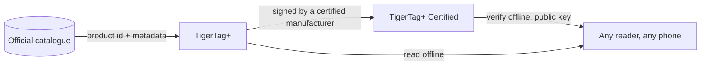

# TigerTag+ Certified

## Scopo

**Certified è il livello che può provare da dove viene un chip.** Un
[TigerTag+](./tigertag-plus.md) che porta in più una **firma
crittografica** è un **TigerTag+ Certified**. La firma è scritta da un
produttore in possesso della [certificazione TigerTag+](../developers/README.md), a cui
vengono forniti gli strumenti di firma come parte di essa; la chiave privata è custodita da TigerTag.

È l'unico dei tre livelli non aperto a tutti, e l'unico
che risponde a una domanda a cui gli altri due non sanno rispondere: *questa bobina è autentica?*

## I tre livelli a confronto

| | TigerTag | TigerTag+ | TigerTag+ Certified |
|---|---|---|---|
| Dati di stampa, **sul chip** | ✅ | ✅ | ✅ |
| Funziona del tutto offline | ✅ | ✅ | ✅ |
| ID prodotto del catalogo, **sul chip** | — | ✅ | ✅ |
| Metadati di arricchimento, **tramite la Web API, facoltativi** | — | ✅ | ✅ |
| Firma di origine, **sul chip** | — | — | ✅ |
| Chi può produrne uno | chiunque | chiunque | **un produttore certificato** |

Leggi con attenzione la colonna di sinistra: i metadati di arricchimento sono l'unica riga che
**non** vive sul chip. Vengono cercati nel catalogo quando sei
online, e possono migliorare dopo che il chip è stato scritto — ed è
proprio per questo che non possono mai essere qualcosa di cui il chip ha bisogno. Tutto ciò che la stampante
richiede è nelle righe contrassegnate *sul chip*, ed è ciò che mantiene tutti e tre i
livelli al 100 % offline.

## Verificare è gratuito — emettere è ciò che la certificazione concede

**Verificare** una firma è gratuito, offline e senza restrizioni: le chiavi pubbliche
sono pubblicate e qualsiasi lettore può controllarne una senza account né rete.
**Emetterne** una è ciò che la certificazione concede.

Il messaggio firmato copre volutamente l'**UID** del chip stesso, quindi un payload firmato
copiato su un altro chip non corrisponde più: un tag clonato non supera
la verifica, sul telefono stesso del cliente. La stessa proprietà è il motivo per cui i due
chip di una bobina portano due firme *diverse*
([come i due chip sono legati](../concepts/tigertag-chip.md)).

## Dove si colloca

La struttura a livello di byte — gli id dei tipi di chip, l'area della firma di 64 byte alle pagine
`0x18`–`0x27` — è specificata in
[TigerTag-RFID-Guide](https://github.com/TigerTag-Project/TigerTag-RFID-Guide).

## Chi è certificato

L'elenco di riferimento dei produttori autorizzati ad apporre il marchio su un prodotto è
il [registro dei partner certificati](../certified-partners.md). Il logo o il nome
TigerTag su un chip di qualsiasi formato, su un carrier, su una bobina o sulla sua confezione è autorizzato solo per i produttori elencati in quella pagina.

---

**◀ Precedente:** [TigerTag+](./tigertag-plus.md) · **▲ [Indice della documentazione](../../README.md)** · **Successivo ▶** [Tiger NFC Connect](./tigertag-connect.md)

**Vedi anche:** [Il chip TigerTag](../concepts/tigertag-chip.md), [Partner certificati](../certified-partners.md), [Documentazione per sviluppatori](../developers/README.md)
