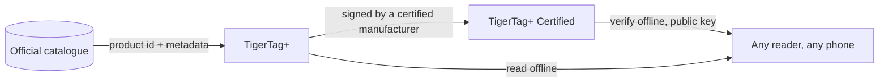

# TigerTag+

## Scopo

**Il `+` significa identificato.** Un TigerTag+ è un TigerTag la cui identità porta un
**ID prodotto del catalogo ufficiale** — non valori digitati da qualcuno, ma il
prodotto esatto: marca, colore, materiale, temperature, diametro, SKU, EAN,
direttamente dalla fonte. In più può portare **metadati di arricchimento
facoltativi**, forniti dalla Web API e migliorabili dopo che il chip è stato scritto.

Il chip stesso resta **100 % offline**. Tutto ciò che serve per stampare è su di esso,
esattamente come su un TigerTag standard — l'ID del catalogo aggiunge la possibilità di cercare
dati più ricchi e aggiornati *quando sei online*, e non toglie nulla
quando non lo sei. Un TigerTag+ letto in modalità aereo si comporta come qualsiasi altro
TigerTag.

E *«online»* non è nemmeno un requisito. L'intero riferimento è pubblicato come
un unico file — ogni id di ogni filamento del database, libero per chiunque di copiare
e replicare — così un lettore che lo possiede risolve un ID del catalogo senza alcuna rete.
Vedi [la Web API](../developers/web-api.md).

È lo stesso `+` di [TigerData+](../concepts/universal-filament-identity.md):
in entrambi i casi significa *questa identità è un vero prodotto del catalogo*, e in
nessuno dei due significa *certificato*.

> **Nota sul nome:** in precedenza venduto come **«TigerTag Pro»** — il nome è ora
> **TigerTag+**.

## Cosa aggiunge il `+`

| | TigerTag | TigerTag+ |
|---|---|---|
| Dati di stampa, **sul chip** | ✅ | ✅ |
| Funziona del tutto offline | ✅ | ✅ |
| ID prodotto del catalogo, **sul chip** | — | ✅ |
| Metadati di arricchimento, **tramite la Web API, facoltativi** | — | ✅ |
| Chi può produrne uno | chiunque | chiunque |

I metadati di arricchimento sono l'unica riga che **non** vive sul chip. Vengono
cercati nel catalogo quando sei online, e possono
migliorare dopo che il chip è stato scritto — ed è proprio per questo che non possono mai essere
qualcosa di cui il chip ha bisogno. Tutto ciò che la stampante richiede è sul chip, ed è
ciò che mantiene ogni livello al 100 % offline.

## La variante firmata

Un TigerTag+ che porta in più una firma crittografica è un
**[TigerTag+ Certified](./tigertag-plus-certified.md)** — il livello che può
provare l'origine di una bobina, e l'unico riservato ai produttori
certificati. Verificare una firma resta gratuito e offline per tutti.

## Dove si colloca

## Fare il backup di un chip — una funzione separata

Tiger Studio può **salvare il contenuto esatto di un chip** nel tuo account, legato
al suo UID fisico, e in seguito riprogrammarlo riportandolo a quello stato. È utile e
non c'entra con il `+`: vale per qualsiasi chip che puoi scansionare, e avere un backup
non rende un chip un TigerTag+.

- **Ripristino allo stato di fabbrica**: se un chip viene riscritto per errore o si corrompe,
 rimettilo esattamente com'era — firma inclusa, se l'aveva.
- **Solo lo stesso chip**: il ripristino è valido sul chip originale, perché il
 backup è legato al suo UID. Una salvaguardia per *quel* chip, mai un modo per clonare.
- **Prova di possesso**: una scansione che corrisponde al backup mostra che il chip originale
 è fisicamente nelle tue mani.

> **Nota:** creare un backup richiede attualmente **Tiger Studio + un lettore USB
> (TigerPOD / ACR122U)**; il supporto mobile è pianificato.

## Interazioni

| Con | Come |
|---|---|
| Tiger Studio + TigerPOD/ACR122U | Legge e verifica le firme; crea e ripristina i backup dei chip |
| Tiger NFC Connect | Legge e verifica; supporto ai backup in arrivo |
| SDK | `tigertag[verify]` verifica una firma offline, in Python o JS |
| Firebase (database dell'account) | Conserva il catalogo, i metadati di arricchimento e i backup dei chip per account |

## Link

- Chip ufficiali: **[tigertag.io](https://tigertag.io)** (negozio)

---

**◀ Precedente:** [TigerTag](./tigertag.md) · **▲ [Indice della documentazione](../../README.md)** · **Successivo ▶** [TigerTag+ Certified](./tigertag-plus-certified.md)

**Vedi anche:** [Identità universale del filamento](../concepts/universal-filament-identity.md), [Il chip TigerTag](../concepts/tigertag-chip.md), [Documentazione per sviluppatori](../developers/README.md)
