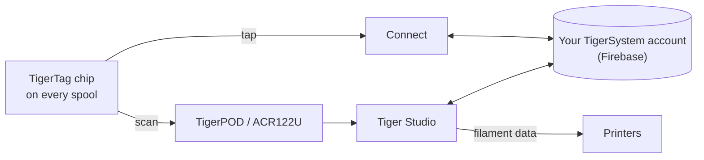

# TigerTag

## Scopo

**TigerTag dà a ogni bobina una memoria tutta sua.** Un piccolo chip NFC contiene
tutto sul filamento — marca, materiale, colore, come gli piace essere
stampato — così non devi mai indovinare, etichettare o ricordare. Avvicinalo al
telefono e la bobina ti dice da sola chi è.

<a class="ts-cta-primary" href="https://tigersystem.io/tigertag">Che cos'è TigerTag — su tigersystem.io</a>

<a href="https://github.com/TigerTag-Project/TigerTag-RFID-Guide"> La specifica aperta del chip</a>

Tecnicamente, è il cuore dell'ecosistema: uno standard RFID aperto, leggibile
da qualsiasi app o lettore compatibile — nessun vincolo con un produttore, nessun formato segreto.

## Dove si colloca

## Funzionalità

- Chip standard **NTAG213 / 215 / 216** (consigliato rotondo da 25 mm), payload NDEF aperto
 da 144 byte — dimensionato per stare nel più piccolo NTAG213; nessuna chiave, nessun vincolo.
- **Due chip per bobina, su lati opposti** — uno è sempre rivolto verso il lettore
 (slot della stampante, AMS, telefono in mano) e ciascuno fa da backup all'altro
 ([perché](../concepts/tigertag-chip.md)).
- Identità risolta rispetto al [database di riferimento](../concepts/universal-filament-identity.md) condiviso.
- Scrivibile e **riscrivibile** — rende possibile il [flusso Second Life](../philosophy/second-life.md);
 i chip ufficiali con marchio escono come NTAG215, così il chip stesso può essere riutilizzato come
 semplice oggetto NDEF (portachiavi, biglietto da visita…) quando la bobina è vuota —
 mai rifiuto elettronico.
- Leggibile da qualsiasi smartphone NFC, dai lettori ACR122U e dal [TigerPOD](./tigerpod.md).
- Un'**area riservata da 64 byte** (pagine `0x18`–`0x27`, che lascia 80 byte di dati):
 libera per **funzioni aggiuntive della comunità** su un TigerTag standard; porta la
 firma di origine — 32 byte di `R`, 32 di `S` — su un
 [TigerTag+](./tigertag-plus.md).

## Architettura

Vedi [Il chip TigerTag](../concepts/tigertag-chip.md) per il riepilogo del formato e
[TigerTag-RFID-Guide](https://github.com/TigerTag-Project/TigerTag-RFID-Guide)
per la specifica canonica a livello di byte.

## Interazioni

| Con | Come |
|---|---|
| Tiger NFC Connect | Tocco NFC: lettura, codifica |
| Tiger Studio | La scansione del lettore apre automaticamente la bobina; aggiornamento guidato del chip |
| SDK | Analisi / verifica / codifica da JS o Python |
| Stampanti | Indirettamente — tramite il [ponte dello smartphone](../philosophy/smartphone-bridge.md) e i collegamenti alle stampanti di Studio |

## In immagini

> **Nota sul nome:** i chip standard erano un tempo venduti come **«TigerTag Maker»**
> — il nome ora è semplicemente **TigerTag**.

## I chip ufficiali, e quelli di tutti gli altri

**TigerSystem produce i chip ufficiali** e vi mette il logo TigerTag.
Esistono in due formati, ed escono entrambi **vuoti**:

| Formato | Per |
|---|---|
| **Adesivo** | qualsiasi bobina tu abbia già — uno su ciascun lato ([perché due](../concepts/tigertag-chip.md)) |
| **Supporto per refill** | [refill](../philosophy/second-life.md) di filamento con anima di cartone: un supporto porta già **entrambi i chip**, sta dentro l'anima prima che il refill vada su una masterspool riutilizzabile, così il chip viaggia con il filamento, non con il rocchetto |

Chi può dire cosa, quando un chip è in vendita:

| Chi | Cosa vende | Può chiamarlo | Logo |
|---|---|---|---|
| **TigerSystem** | i chip che produce | **ufficiale** — fatto da noi | sì — applica il marchio |
| **Qualsiasi rivenditore o distributore** | quegli stessi chip originali | **ufficiale** — lo è la merce | sì — il marchio è già su di essi |
| **Una terza parte verificata da TigerSystem** | tutto ciò che ha costruito — chip, inlay, supporti, un dispositivo, un'app | **certificato** — concesso, verificato, elencato, revocabile | sì, sul prodotto |
| **Chiunque produca il proprio chip** | il proprio chip compatibile | *«compatibile con TigerTag»* — e con **TigerTag+** se verifica le firme. Mai *«certificato»*, che solo TigerSystem concede | nella sua app, nella documentazione e nella scheda del negozio; *«Compatible with TigerTag»* in testo semplice sulla scatola di un dispositivo compatibile — **mai il logo o il nome sul chip (in qualsiasi formato), sul supporto, sulla bobina o sulla confezione** |

Quest'ultima distinzione è l'intera politica sul marchio, ed è più stretta di quanto
sembri. Dire che il tuo prodotto *dialoga con* TigerTag è un fatto sul tuo prodotto,
e mostrare il logo per dirlo è libero. Mettere il marchio — logo o nome —
**su** un chip di qualsiasi formato è un'affermazione su **chi lo ha fatto** — smette di significare «questo funziona con TigerTag»
e comincia a significare «questo *è* un TigerTag». Solo questo secondo uso richiede un'autorizzazione
scritta. Vedi [TRADEMARK.md](../../TRADEMARK.md).

Sono stati prodotti più di **2,5 milioni di chip TigerTag** — la maggior parte integrati
in fabbrica dai marchi di filamento (Rosa3D, eSun, Sunlu, Landu, Jamg He, R3D,
Filforme, Lotactree, Smart3DPT, Nanovia — e altri in corso di integrazione). Tutti sono
[partner certificati](../certified-partners.md); quella pagina è il registro, e
l'unico modo autorevole per verificare che un marchio su una scatola sia legittimo.

|| | |
|---|---|---|
|  |  |  |

|| | | |
|---|---|---|---|
|  |  |  |  |

*Le scatole e le bobine al loro interno — comprate in un negozio, non allestite per una
foto. Ecco che aspetto ha «il più diffuso».* Ma il protocollo non è
volutamente **legato ai chip ufficiali**: qualsiasi chip NTAG vuoto ed economico comprato
ovunque (Amazon, AliExpress, in negozio) funziona in modo identico, e nulla lo
blocca. I chip con marchio aiutano a sostenere la R&S; l'adozione del protocollo è la prima
ricompensa. Altri modi per aiutare — compresi quelli che non costano nulla — sono in
[Sostieni il progetto](../support.md).

La libertà vale in entrambe le direzioni: **i chip non sono mai protetti in scrittura**. TigerTag è
semplicemente il protocollo di base con cui le fabbriche di filamento spediscono le bobine — se preferisci
un altro protocollo NFC/RFID (personalizzato o esistente), puoi riscrivere il chip e
migrarvi i suoi dati. La tua bobina, il tuo chip, il tuo formato.

## Dove comprarli

Entrambi i formati escono **vuoti**, ed entrambi sono venduti da TigerSystem e dai suoi
rivenditori:

| | **Adesivo** | **Supporto per refill** |
|---|---|---|
| Cosa ottieni | chip adesivi rotondi da 25 mm — **due per bobina**, uno per lato | un supporto = **due chip già abbinati**, uno per estremità piegata, per l'anima di cartone |
| Per | qualsiasi bobina con flange | refill di filamento montati su una masterspool |
| Negozio ufficiale | [tigertag.io](https://shop.tigertag.io/collections/tigertag-rfid-maker) | [tigertag.io](https://shop.tigertag.io/collections/tigertag-rfid-maker) |
| Rivenditore (FR) | [TigerTag Officiel, Atome3D](https://www.atome3d.com/products/tigertag) | [TigerTag Refill Officiel, Atome3D](https://www.atome3d.com/products/tigertag-pro-for-refill-1000-pcs) |

Entrambi sono disponibili in diverse dimensioni di confezione, fino a quantità professionali. E niente di tutto questo
è obbligatorio: **qualsiasi chip NTAG vuoto comprato ovunque funziona in modo identico** — comprare
quelli ufficiali finanzia il protocollo, nient'altro.

## Link

- Chip ufficiali: **[tigertag.io](https://tigertag.io)** (negozio — sostiene la R&S)
- Formato del chip: [TigerTag-RFID-Guide](https://github.com/TigerTag-Project/TigerTag-RFID-Guide)

---

**◀ Precedente:** [Prodotti](./README.md) · **▲ [Indice della documentazione](../../README.md)** · **Successivo ▶** [TigerTag+](./tigertag-plus.md)

**Vedi anche:** [Identità universale del filamento](../concepts/universal-filament-identity.md), [Second Life](../philosophy/second-life.md)
