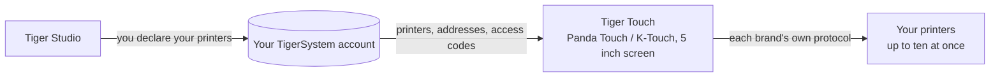

# Tiger Touch

**Il tuo Panda Touch è in un cassetto. Dagli tutte le stampanti che possiedi.** Un firmware
gratuito e open source che trasforma il BIGTREETECH Panda Touch e il K-Touch in un unico
touchscreen in tempo reale per tutte le tue stampanti 3D — senza saldature, senza computer.

*Due schede stampante in tempo reale su un solo schermo: una FlashForge AD5X e una Bambu Lab X1C.*

<a class="ts-cta-primary" href="https://tigertag-project.github.io/Tiger-Touch/">Installa dal browser</a>

<a href="https://github.com/TigerTag-Project/Tiger-Touch"> Sorgenti</a>

BIGTREETECH vende un piccolo touchscreen da 5" con due nomi: il **Panda Touch**,
fatto per le stampanti Bambu Lab, e il **K-Touch**, fatto per le stampanti Klipper. Stessa
scheda, due firmware, ciascuno legato a una famiglia di macchine. Cambi stampante, e
lo schermo finisce in un cassetto.

**Tiger Touch è un nuovo firmware per quello stesso schermo**, scritto da zero. Accede
al tuo account TigerTag gratuito, trova tutte le stampanti che vi hai dichiarato,
e parla con ciascuna direttamente, con il suo protocollo, tutte allo stesso tempo. Se
possiedi un Panda Touch o un K-Touch che non corrisponde più alle tue stampanti, è l'hardware
per cui Tiger Touch è stato fatto.

Open source con licenza **MIT**. Niente da saldare, niente da stampare, nessun Raspberry Pi,
nessun server in mezzo: colleghi lo schermo a una porta USB, premi **Install** nel
tuo browser, e due minuti dopo mostra le tue stampanti.

## Cosa fa

- **Tutte le marche su un solo schermo** — Bambu Lab, Creality, Elegoo, Anycubic,
  Snapmaker, FlashForge, Prusa, più qualsiasi macchina Klipper (Moonraker) o OctoPrint.
- **Cloud e LAN** — Bambu Lab tramite il cloud Bambu o in modalità LAN, Anycubic
  tramite il cloud Anycubic o in LAN, le altre sulla tua rete locale.
- **In tempo reale, tutte** — stato, avanzamento, file, tempo rimanente e ora di fine,
  ugelli, piano, camera e unità filamento (AMS, CFS, Station, ACE, corsie MMU / AFC),
  con fino a **dieci stampanti** seguite contemporaneamente.
- **Controlli sicuri** — pausa, ripresa, stop (una pressione di 1,5 s, così un dito
  sbadato non interrompe mai una stampa) e la luce della stampante. **Non viene mai inviato
  altro**: niente riscaldamento, niente movimenti, nessun avvio di stampa.
- **Si aggiorna da solo** — le nuove versioni arrivano via Wi-Fi, verificate prima dell'installazione,
  con ripristino automatico se non si avviano.
- **Undici lingue** — inglese, francese, tedesco, spagnolo, italiano, cinese,
  portoghese (Brasile e Portogallo), polacco, russo, olandese.

<figure>

<figcaption><strong>Schede</strong>: una scheda in tempo reale per stampante, scorri per vederne altre.</figcaption>
</figure>
<figure>

<figcaption><strong>Elenco</strong>: tutte le stampanti a colpo d'occhio. Un tocco cambia vista.</figcaption>
</figure>
<figure>

<figcaption><strong>Snapmaker U1</strong>: quattro testine, quella attiva cerchiata.</figcaption>
</figure>
<figure>

<figcaption><strong>FlashForge AD5X</strong>: bobina esterna e stazione materiali.</figcaption>
</figure>

## Dove si colloca

## Cosa deve esistere prima

Tiger Touch legge le tue stampanti **dal tuo account TigerSystem**, quindi non
chiede mai un indirizzo o un codice di accesso su uno schermo da 5". Crea l'account e aggiungi
le tue stampanti in [Tiger Studio](./tiger-studio.md) **desktop** (Windows,
macOS, Linux), che le trova sulla tua rete — la versione web non può aggiungere
stampanti.

> **In breve:** Tiger Studio → crea un account → aggiungi le tue stampanti →
> *poi* configura lo schermo.

## Quali stampanti

Tiger Touch sceglie la connessione dalla **marca**, non dal modello: qualsiasi stampante
di queste famiglie che Tiger Studio può aggiungere, Tiger Touch può mostrarla. Il catalogo di Tiger Studio
conta più di 400 modelli di circa 60 produttori.

| Marca | Connessione | Vista su una macchina reale |
|---|---|---|
| [Bambu Lab](../compatibility/bambu-lab.md) (X1, P1, P2S, A1, H2…) | Cloud Bambu, o LAN (MQTT su TLS) | **Sì** — in stampa tramite il cloud (P2S), inattiva in modalità LAN (X1C, A1) |
| [Creality](../compatibility/creality.md) (K2, K1, Hi, Ender-3 V4…) | WebSocket sulla LAN | **Sì** — in stampa (K2), inattiva con il suo CFS (Ender-3 V4) |
| [Snapmaker](../compatibility/snapmaker.md) U1 | WebSocket Moonraker | **Sì** — inattiva, quattro testine |
| [FlashForge](../compatibility/flashforge.md) (AD5X, Adventurer 5M, Creator 5, Creator 5 Pro) | HTTP sulla LAN | **Sì** — AD5X: pausa, stop e la luce |
| [Anycubic](../compatibility/anycubic.md) (Kobra 3, Kobra X, Kobra S1…) | Cloud Anycubic, o LAN (MQTT su TLS) | **Sì** — tramite il cloud (Kobra X), con il suo ACE: la luce, pausa, ripresa e stop |
| [Elegoo](../compatibility/elegoo.md) Centauri Carbon 1 e 2 | MQTT (CC2), SDCP (CC1) | **Sì** — Centauri Carbon 2 e Centauri Carbon: pausa, ripresa, stop, e la luce sulla CC2 |
| **Prusa** (MK4, Core One, XL, MINI) | PrusaLink | **Sì** — avanzamento, temperature, pausa, ripresa, stop |
| [Klipper](../compatibility/klipper.md) — Voron, Qidi, Sovol, RatRig… | HTTP Moonraker | **Sì** — su una vera stampante Klipper: pausa, ripresa, stop e la luce |
| **OctoPrint** — qualsiasi stampante Marlin dietro di esso | API REST di OctoPrint | Solo con la stampante di prova di Tiger Studio |

OctoPrint finora ha incontrato solo la stampante di prova di Tiger Studio, e ogni marca ha
modelli che nessuno ha ancora provato: **una segnalazione dalla tua stampante è la cosa più utile
che puoi inviare.** Pausa, ripresa e stop funzionano ovunque la connessione accetti
comandi (non tramite il cloud Bambu); la luce funziona ovunque tranne su Prusa,
OctoPrint e la Centauri Carbon 1. Ogni marca ha la sua pagina, con la sua configurazione
e le sue domande, sul [sito dell'installer](https://tigertag-project.github.io/Tiger-Touch/).
Ogni campo e ogni test è nello
[stato per marca](https://github.com/TigerTag-Project/Tiger-Touch/blob/main/docs/PRINTER-COMPATIBILITY.md).

**Una stampante appare «offline»?** Controlla prima la sua modalità LAN: è disattivata per impostazione predefinita su
Creality, FlashForge e Bambu Lab.

## Uno schermo, tutte le marche

I firmware con cui lo schermo viene fornito conoscono ciascuno **una** sola famiglia di stampanti.

| | **Tiger Touch** | Firmware Panda Touch | Firmware K-Touch |
|---|---|---|---|
| Famiglie di stampanti su un solo schermo | **9** | 1 (Bambu Lab) | 1 (Klipper) |
| Stampanti in tempo reale contemporaneamente | **fino a 10**, tutte aggiornate insieme | diverse Bambu Lab, rallenta da circa 3 nel nostro uso | **1** alla volta (50 salvate, si passa dall'una all'altra) |
| Stampanti configurate | dal tuo account TigerTag, nulla digitato sullo schermo | IP, seriale, codice di accesso | IP e porta, o una scansione |
| Aggiornamenti via etere | Sì, verificati, con ripristino automatico | No | No |

I firmware di BIGTREETECH danno il pieno controllo della loro unica famiglia — avvio delle stampe,
temperature, movimenti — cosa che Tiger Touch deliberatamente non fa. Puoi tornare
a essi in qualsiasi momento.

*Le colonne Panda Touch e K-Touch vengono dal wiki di BIGTREETECH stesso (letto il
2026-10-16); «rallenta da circa 3» è l'esperienza del team TigerTag, non
un dato BIGTREETECH.*

## Installa in due minuti

1. **Dichiara le tue stampanti** in Tiger Studio, come sopra.
2. **Flasha lo schermo dal browser.** Apri
   **<https://tigertag-project.github.io/Tiger-Touch/>** in **Chrome o Edge** su
   un computer (WebSerial: non Safari, non Firefox, non un telefono), collega lo schermo
   con un cavo USB-C **dati**, premi **Install** e scegli la sua porta. Se sostituisci
   il firmware BIGTREETECH: spunta **Erase device**. Se aggiorni un Tiger Touch via
   USB: lascia la casella vuota, il tuo Wi-Fi e il tuo account vengono conservati.
3. **Segui lo schermo.** Lingua, Wi-Fi, poi il tuo account TigerTag — e-mail
   e password, oppure **Continue with Google** con un codice QR inquadrato dal tuo
   telefono. Attiva le stampanti che vuoi seguire, e hai finito. *Più tardi* è
   sempre una risposta: lo schermo parte subito e si connette in background.

Dopo di che non c'è nulla da fare: lo schermo cerca una nuova versione una volta al giorno
e la installa con due tocchi.

Prima volta? La [guida all'installazione](https://github.com/TigerTag-Project/Tiger-Touch/blob/main/docs/INSTALL.md)
copre il driver USB (obbligatorio su macOS), come conservare una copia del firmware
BIGTREETECH per poter tornare indietro, e l'unica casella da spuntare.

## L'hardware

Il **BIGTREETECH Panda Touch** e il **K-Touch** sono progettati e prodotti da
**BIGTREETECH** (BIQU): un touchscreen IPS 800×480 da 5" attorno a un ESP32-S3 con 8 MB
di PSRAM e 16 MB di flash, Wi-Fi, USB-C e una batteria. Tiger Touch ci gira
senza modifiche, e si appoggia al supporto per la scheda che BIGTREETECH ha pubblicato
con licenza MIT. Il K-Touch è la stessa scheda del Panda Touch, quindi la stessa
immagine è pensata per esso — ma finora Tiger Touch è stato eseguito solo su un Panda Touch:
una segnalazione da un K-Touch è benvenuta.

Tiger Touch è un progetto indipendente, non realizzato né approvato da BIGTREETECH, BIQU
o da alcun produttore di stampanti citato qui.

Costruiscilo tu stesso con ESP-IDF 5.5 — i passaggi sono nel
[repository](https://github.com/TigerTag-Project/Tiger-Touch#build-it-yourself).

---

**▲ [Indice della documentazione](../../README.md)** · **Vedi anche:** [Tiger Studio](./tiger-studio.md), [TigerSpool](./tigerspool.md), [Compatibilità delle stampanti](../compatibility/README.md)
