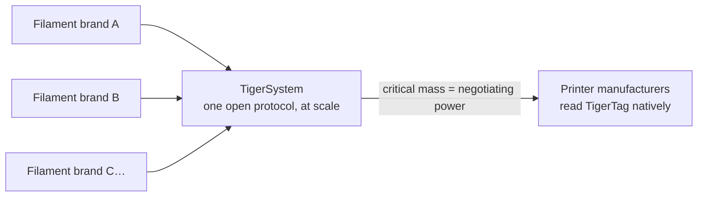

# Per i produttori di filamento

> **Rendi le tue bobine intelligenti e connesse.**

## La bobina intelligente sta arrivando — l'unico modo aperto di farla è qui

Le stampanti si aspettano sempre più spesso filamento intelligente: sistemi di classe AMS,
rilevamento del materiale per slot, impostazioni automatiche. Ogni produttore di stampanti risponde con un
**tag chiuso, legato alle sue macchine, che alimenta il suo cloud** — zero
interoperabilità, zero valore per il tuo marchio fuori dalle sue mura. E ogni
tag bloccato ha un secondo scopo: **orientare i tuoi clienti verso il filamento
del produttore della stampante.** TigerTag è nato nel 2023 proprio perché
i marchi terzi avessero una risposta migliore — bobine più intelligenti di
quelle proprietarie, senza il giardino recintato.

**TigerTag è il protocollo RFID di terze parti più diffuso al mondo** —
e, oggi, l'unica soluzione aperta di bobina intelligente praticabile e distribuita su larga scala: un
protocollo aperto, standard, agnostico e multipiattaforma, con più di
**2,5 milioni di chip già prodotti** e integrati in fabbrica da marchi
come Rosa3D, eSun, Sunlu, Landu, Jamg He e R3D — con Filforme e
Nanovia in corso di integrazione.

## Integrazione in fabbrica: giorni, non mesi

Abbiamo l'esperienza e la tecnologia per portare i chip TigerTag nella tua
linea di produzione **in fretta, con facilità e a costi molto bassi — operativi in
appena 5 giorni**, scrivendo **ogni chip in circa 1 secondo** (migliaia di
bobine al giorno, con un clic):

- Hardware NTAG standard (nessun componente proprietario, nessun vincolo di attrezzatura),
 reperito a una scala e a un costo scelti per un obiettivo non negoziabile: **aggiungere la
 tecnologia senza aggiungere un centesimo al prezzo finale della bobina.**
- Un piano di integrazione collaudato già adottato in diverse fabbriche,
 basato sulla suite industriale [TigerTag Factory & Manager](../products/factory-suite.md):
 il tuo database di filamenti da un lato, la scrittura di massa alla velocità di linea in ogni bobina
 dall'altro — con la **firma di fabbrica
 che prova l'origine di ogni prodotto**.
- Il database di riferimento condiviso dà ai tuoi prodotti un'identità
 precisa e universale che ogni app compatibile risolve in modo identico.

I marchi che spediscono TigerTag nei loro prodotti possono esibire il marchio **TigerTag
Certified** — un segnale visibile ai clienti che la bobina è intelligente e
aperta.

> Scrivi a **[tigertag@tigertag.io](mailto:tigertag@tigertag.io)** (oppure
> tramite l'[organizzazione GitHub](https://github.com/TigerTag-Project)) per
> avviare la conversazione.

## Grazie, integratori

I marchi qui sotto hanno reso reale la bobina aperta — ciascuno al proprio livello di
impegno, e ognuno merita il merito. I livelli sono una
**scala**: più un marchio si impegna, più compare in evidenza —
qui e su ogni superficie dell'ecosistema. I migliori svettano di più.

### Platino — la vetta

**TigerTag+ su tutta la produzione**: ogni formato di bobina, chip firmati
di serie su ogni singola bobina che esce dalla fabbrica. Niente di facoltativo,
niente di parziale — l'esperienza completa della bobina aperta, per ogni cliente, per
impostazione predefinita. Gli integratori Platino ottengono **il primo piano ovunque**: nominati per primi,
logo più grande, la loro storia raccontata.

**[Rosa3D](https://rosa3d.pl)** — il **primo al mondo** tra gli integratori a mettere
TigerTag+ su tutta la sua produzione. Il riferimento che tutti gli altri inseguono.

### Oro — impegnati, su larga scala

**Integrazione su richiesta al momento della produzione**, con grandi quantità già
prodotte, un alto livello di integrazione e un **impegno pubblico
ufficiale**. A un passo dalla vetta: rendere i chip firmati lo standard
su tutta la linea, ed entrare in Platino.

&nbsp;&nbsp;&nbsp;&nbsp;

**[R3D](https://r3dprint.com)** · **[eSun](https://www.esun3d.com)**

### Argento — a bordo

**La tecnologia integrata su richiesta** — il primo passo, già concreto:
i loro clienti possono comprare oggi bobine dotate di TigerTag. Il gradino successivo
è l'Oro: far crescere i volumi e rendere pubblico l'impegno.

&nbsp;&nbsp;&nbsp;&nbsp;&nbsp;&nbsp;&nbsp;&nbsp;

**[Sunlu](https://www.sunlu.com)** · **[Landu](https://www.landustore.com)** · **[Jamg He](https://www.jamghe.com)**

…e altri in corso di integrazione —
[Filforme](https://www.filforme.com), [Nanovia](https://nanovia.tech), e
altri in arrivo.

**Vuoi il tuo logo su questa scala — e più grande?** Una linea di produzione adotta
TigerTag in appena 5 giorni:
[tigertag@tigertag.io](mailto:tigertag@tigertag.io).

## L'hanno annunciato loro stessi

Post pubblici sui canali dei marchi stessi — non il nostro comunicato stampa
(fonti e annunci completi:
[tigersystem.io/en/manufacturers](https://tigersystem.io/en/manufacturers)).
**Clicca su qualsiasi immagine per aprire il post originale:**

|| | |
|---|---|---|
|  |  |  |

> **ROSA 3D FILAMENTS** — *«ha integrato ufficialmente il protocollo RFID aperto TigerTag
> sul 100 % della nostra produzione di filamento.»* Più di 250 000
> bobine già prodotte con TigerTag.
> ([post originale](https://www.instagram.com/p/DVyeOZajZSm/))

> **R3D Filament** — *«ha avviato ufficialmente l'adozione su larga scala del protocollo
> RFID aperto TigerTag sulla sua produzione di filamento in Europa.»*
> ([post originale](https://www.instagram.com/reel/DVoAMqTk5ck/))

> **eSUN** — *«ha integrato ufficialmente la tecnologia RFID TigerTag!»* — in fase pilota
> sul mercato francese, in espansione in tutta Europa.
> ([post originale](https://www.instagram.com/p/DUjydNXkc1W/))

## Come i tag arrivano nelle tue bobine

<table>
<tr>
<td align="center" width="55%">
<strong>Fronte</strong> 
 
<strong>Retro</strong> 

</td>
<td align="center">

</td>
</tr>
</table>

*Fronte — i due chip con marchio, con l'adesivo industriale 3M
(468MP / 200MP) al centro. Retro — le due antenne NFC indipendenti, una
per estremità. Applicato sul refill: un chip per lato, il tuo operatore stacca e
incolla — nient'altro cambia sulla linea.*

## Già sugli scaffali

|| | |
|---|---|---|
|  |  |  |

*Rosa3D, eSun, Sunlu — scatole vere, spedite con TigerTag all'interno.*

|| | | |
|---|---|---|---|
|  |  |  |  |

*Il filamento stesso: Rosa3D, eSUN, Sunlu, R3D — ognuna di queste viene spedita
con chip TigerTag sulla bobina.*

## Cosa ottengono i tuoi clienti dal primo giorno

Una bobina che si identifica con **qualsiasi telefono NFC**, un intero ecosistema di
inventario (mobile, desktop, web), integrazione in tempo reale con sei marche di stampanti,
monitoraggio del peso, condivisione — un'esperienza **ben oltre ciò che offre qualsiasi ambiente
chiuso di un solo produttore**, e funziona con ogni stampante che i tuoi
clienti possiedono, non solo con quelle di una marca.

## Aggiorna i dati anche dopo che escono dalla tua fabbrica

Un'etichetta stampata è congelata il giorno in cui viene stampata. Una bobina TigerTag no:
poiché i chip risolvono la propria identità rispetto al **database di riferimento
condiviso**, puoi affinare o correggere i dati di un prodotto — impostazioni,
descrizioni, immagini — **anche per le bobine già vendute e ferme
nelle case dei tuoi clienti**. TigerTag è l'unica tecnologia sul mercato che mantiene
aggiornabili i dati del tuo prodotto dopo che ha lasciato la fabbrica.

## La mossa collettiva

Ogni marchio di filamento che si unisce a TigerSystem rafforza tutti gli altri:

Da solo, nessun marchio di filamento può convincere i produttori di stampanti a leggere i propri tag.
**Insieme, dietro un unico protocollo aperto, possiamo.** E la richiesta è piccola: un
produttore di stampanti può aggiungere la lettura TigerTag al proprio firmware in **meno di 3 giorni**. Più marchi spediscono
TigerTag, più forte è la ragione per un supporto TigerTag nativo, a livello di firmware,
nelle stampanti stesse — e ogni partecipante beneficia di quella
leva.

---

**▲ [Indice della documentazione](../../README.md)** · **Vedi anche:** [Perché esiste TigerSystem](./why-tigersystem.md), [Compatibilità](../compatibility/README.md), [FAQ — Produttori](../faq/README.md)
