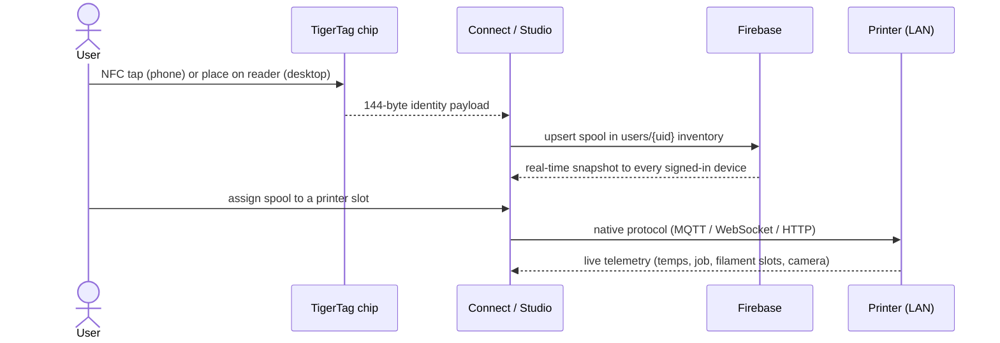
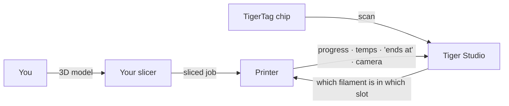

# Gegevensstroom

## Van tik tot print

De volledige reis van één spoel door het systeem:

## Waar elk soort gegevens staat

| Gegevens | Staat in | Opmerkingen |
|---|---|---|
| Spoelidentiteit | De chip + de cloudinventaris van de gebruiker | De chip is leidend voor offlinegebruik |
| Referentiedatabase (merken, materialen…) | `cdn.tigertag.io` (hetzelfde Firebase-project) | Meegeleverd met de apps, ververst vanaf de CDN |
| Spoelafbeeldingen (incl. productfoto's van TigerTag+) | `cdn.tigertag.io` (hetzelfde Firebase-project) | Beschikbaar voor alle apps |
| Inventaris, racks, vrienden, voorkeuren | Firestore `users/{uid}/…` | Standaard alleen voor de eigenaar, afgedwongen door regels |
| Openbare ontdekkingscodes | Firestore `publicKeys/{code}` | Vriend opzoeken in O(1) |
| Printergegevens en telemetrie | **Alleen lokaal** (desktop) | LAN-verkeer gaat nooit via de cloud |
| Live gewicht (TigerScale) | Apparaat → Firestore | Verschijnt live in alle clients |

## Waar je slicer past

TigerSystem **vervangt je slicer niet** — het maakt het plaatje eromheen compleet:

- Je slicet en start printopdrachten precies zoals voorheen, met elke slicer.
- Tiger Studio vertelt de printer **welk filament in welk slot zit**
 (AMS / CFS / Canvas / ACE / IFS), zodat de informatie aan de machinekant
 klopt met de werkelijkheid.
- Wat de print ook gestart heeft, de opdracht verschijnt live in Tiger Studio —
 voortgang, temperaturen, eindtijd, camera.
- De chip bevat de aanbevolen printinstellingen van het filament; er is **vandaag
 geen automatische import van slicerprofielen** — die neem je zelf over in je
 slicerprofiel.

## Twee vlakken, bewust gescheiden

- **Cloudvlak** — identiteit, inventaris, delen. Internet, Firebase,
 afgedwongen door regels.
- **LAN-vlak** — printerbesturing en camera's. Alleen lokaal netwerk, native
 protocollen van de fabrikant, geen enkele afhankelijkheid van de cloud (de desktop-app blijft
 met printers werken als je offline bent).

> **Let op:** de uitzondering is de **cloudmodus** van Anycubic, waarbij de printerkoppeling
> zelf via de MQTT-cloud van de fabrikant loopt — zie
> [Anycubic-compatibiliteit](../compatibility/anycubic.md).

---

**◀ Vorige:** [Architectuuroverzicht](./overview.md) · **▲ [Documentatie-index](../../README.md)** · **Volgende ▶** [Producten](../products/README.md)

**Zie ook:** [Inventaris en cloudsynchronisatie](../concepts/inventory-and-cloud-sync.md), [Compatibiliteit](../compatibility/README.md)
