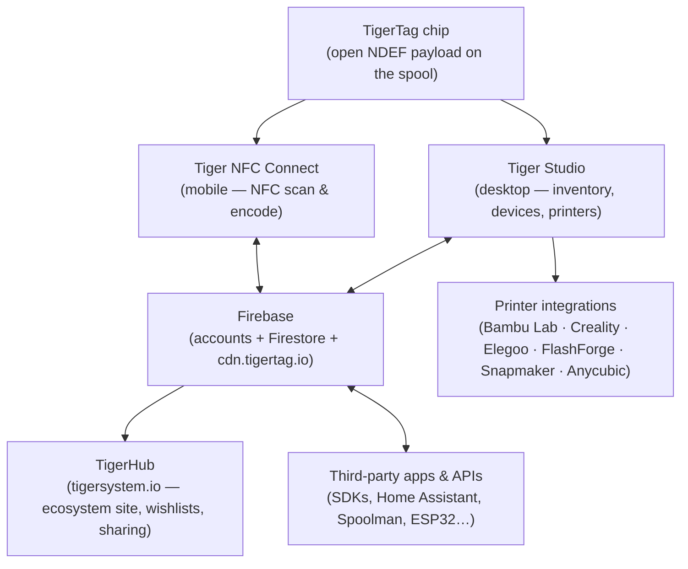
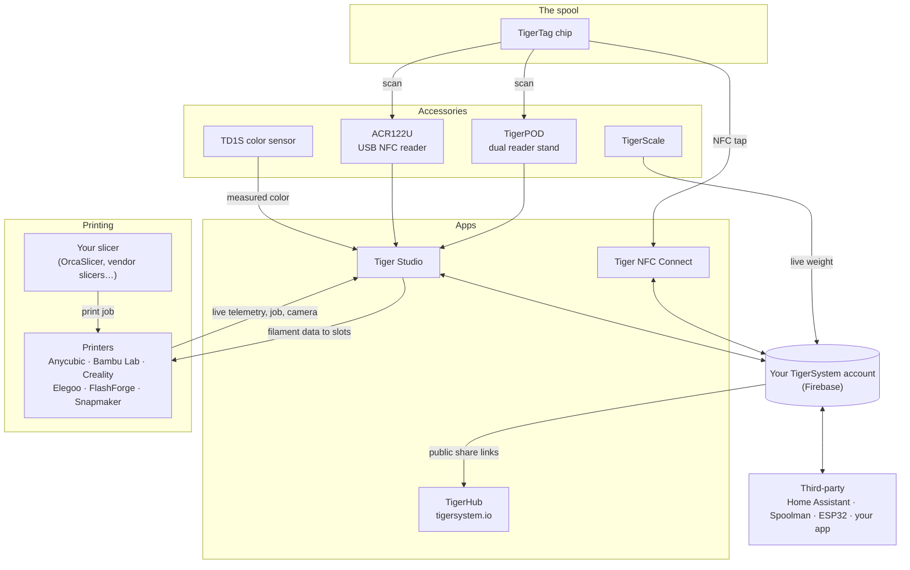

# Architectuuroverzicht

## De stack, van boven naar beneden

## Lagen

| Laag | Rol | Basisdocumentatie |
|---|---|---|
| **TigerTag-chip** | Draagbare, open identiteit van de fysieke spoel | [Chipformaat](../concepts/tigertag-chip.md) |
| **Tiger NFC Connect** | De smartphonebrug: scannen, coderen, bladeren | [Productpagina](../products/tiger-nfc-connect.md) |
| **Firebase** | Eén gedeelde database — accounts, inventaris, synchronisatie; het interoperabiliteitspunt van de zandbak | [Inventaris en cloudsynchronisatie](../concepts/inventory-and-cloud-sync.md) |
| **TigerHub** | Het webhuis van het ecosysteem: etalage, verlanglijstjes, vrienden, delen | [Productpagina](../products/tigerhub.md) |
| **Tiger Studio** | Desktopwerkbank: inventaris, racks, sensoren, printers | [Productpagina](../products/tiger-studio.md) |
| **Printerintegraties** | Live LAN-koppelingen met zes printermerken | [Compatibiliteit](../compatibility/README.md) |
| **API's van derden** | SDK's + gedocumenteerd Firestore-oppervlak voor iedereen | [Ontwikkelaars](../developers/README.md) |

## De volledige kaart — elk element en zijn verbindingen

Accessoires, apps, cloud, printers, slicers en integraties van derden, op
één plaatje:

Lees van links naar rechts: de **chip** identificeert de spoel; **accessoires**
leggen de werkelijkheid vast (scans, gewicht, kleur); de **apps** en de **cloud** houden alles
gesynchroniseerd; de **printer** ontvangt de filamentgegevens en meldt live terug.
Je **slicer houdt zijn taak** — TigerSystem slicet niet, het zorgt ervoor dat
iedereen (jij, de machine, de apps) precies weet welk filament waar zit.

## Ontwerpprincipes

1. **De chip is zelfvoorzienend.** Een spoel identificeert zichzelf zonder cloud, zonder
 account, zonder netwerk — de payload is volledig en open.
2. **De cloud is van de gebruiker, niet van het systeem.** Alle gegevens staan onder het
 account van de gebruiker; beveiligingsregels op de server — niet de clientcode — dwingen
 de toegang af.
3. **Elke laag is optioneel.** Alleen telefoon, alleen desktop, alleen chip of
 alleen API werkt allemaal; componenten voegen waarde toe maar vormen nooit een
 voorwaarde voor elkaar.
4. **Integraties spreken het native protocol van de printer.** Geen firmwaremods, geen
 omwegen via de cloud: Tiger Studio praat via MQTT/WebSocket/HTTP rechtstreeks op het LAN
 (zie [gegevensstroom](./data-flow.md)).

---

**◀ Vorige:** [Inventaris en cloudsynchronisatie](../concepts/inventory-and-cloud-sync.md) · **▲ [Documentatie-index](../../README.md)** · **Volgende ▶** [Gegevensstroom](./data-flow.md)

**Zie ook:** [Producten](../products/README.md), [Ontwikkelaars](../developers/README.md)
