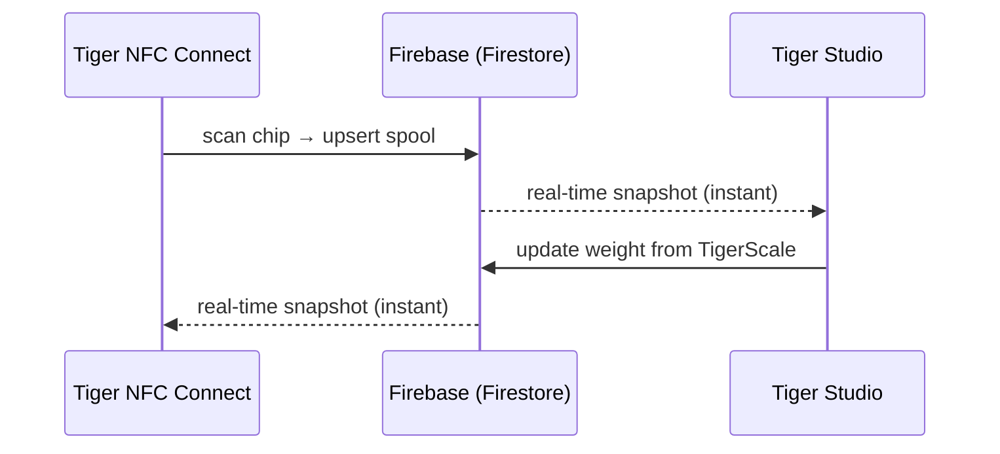

# Inventaris en cloudsynchronisatie

## Eén account, elk apparaat

De inventaris van een gebruiker staat in **zijn TigerSystem-account**, ondersteund door gewone
**Firebase** (Auth + Firestore) — bewust merkloze infrastructuur met een eenvoudige
taak: **één gedeelde database, op één plek**, zodat elk element van de
zandbak (desktop, mobiel, weegschaal, web) met dezelfde gegevens samenwerkt. Elke client — mobiel, desktop, web — abonneert zich in realtime op dezelfde
documenten:

Er is geen “synchroniseerknop”: wijzigingen verspreiden zich via de live
listeners van Firestore, en clients houden een lokale cache bij voor offline lezen.

## Wat er wordt gesynchroniseerd

- **Inventaris** — één document per spoel (identiteit, gewicht, houder, afbeelding…).
- **Racks** — fysieke planklay-outs en plaatsing van spoelen.
- **Vrienden en delen** — vriendenlinks, binnenkomende verzoeken, meldingen.
- **Voorkeuren** — taal, instellingen per account.
- **Chipback-ups** — chipgegevens van [TigerTag+](../products/tigertag-plus.md).

Het gezaghebbende datamodel, veld voor veld, is gedocumenteerd in de
[Firebase-integratierepository](https://github.com/TigerTag-Project/TigerTag_Firebase_Integration)
(`docs/03-data-model.md`) — de referentie voor integrators van derden.

## Wat je werkbank verlaat, en wat blijft

Het ecosysteem zegt overal dat de cloud optioneel is. Hier staat wat dat
werkelijk betekent, en wat het kost als je nee zegt.

**Identificatie is per ontwerp lokaal.** Een apparaat vraagt een server niet wat een tag
is. De merk- en materiaaltabellen staan in de eigen opslag en worden hoogstens eenmaal per dag
ververst vanuit de **openbare** [referentierepository](https://github.com/TigerTag-Project/TigerTag-RFID-Guide).
Een opzoeking wacht dus nooit op het netwerk, en werkt ook als het
internet uitvalt.

**Zonder account verlies je precies één ding: synchronisatie tussen apparaten.** Een
[TigerScale](../products/tigerscale.md) weegt nog steeds, leest nog steeds tags,
herkent nog steeds merk en materiaal, en serveert nog steeds zijn eigen web-UI op je LAN. Niets
aan de chip zelf heeft ons nodig — dat is het hele punt van de gegevens schrijven
[op de chip](./tigertag-chip.md).

**Met een account stuurt een apparaat het volgende.** Met de weegschaal als
uitgewerkt voorbeeld schrijft het bij elke voltooide weging en bij een hartslag, onder
je eigen gebruikersdocument: de tag-UID's van de spoel, netto-/bruto-/houdergewicht,
firmwareversie, wifisignaal en IP, kalibratiefactor, tijd van de laatste hartslag,
batterijstatus en schermstatus. Diagnostiek en metingen — niet meer. Elk
veld is gedocumenteerd in
[de eigen referentie van de weegschaal](https://github.com/TigerTag-Project/Tiger-Scale-V3/blob/main/docs/TELEMETRY.md).

**En dit slaat het lokaal op, wat belangrijker is.** Een aangemeld apparaat
bewaart een refresh-token, je gebruikers-id en je wifigegevens. Je wachtwoord slaat het nooit op —
bij het aanmelden wordt het ingewisseld voor tokens. Maar behandel een geconfigureerd apparaat
als **iets met een inloggegeven**: meld je voordat je er een uitleent, verkoopt of weggeeft af
*en* vergeet het wifi-netwerk. Een gewone herflash wist geen van beide — die opslag blijft
bewust behouden, zodat een firmware-update je niet je configuratie kost.

**Twee bewuste keuzes die je moet kennen.** De LAN-API van een apparaat is
**niet geauthenticeerd**: iedereen die al op je netwerk zit, kan de status lezen en
een tarra activeren. Dat is een vereenvoudiging voor een thuisnetwerk — zet het op een gast-
VLAN als je het jouwe niet vertrouwt. En de Firebase-sleutel die in de broncode te zien is, is een
**openbare projectidentificatie**, geen geheim; elke Firebase-client levert hem mee, en
toegangscontrole wordt afgedwongen door regels op de server tegen de aangemelde gebruiker, niet
door een tekenreeks te verbergen.

Voor de weegschaal is dit alles volledig gedocumenteerd in
[`docs/CLOUD.md`](https://github.com/TigerTag-Project/Tiger-Scale-V3/blob/main/docs/CLOUD.md),
dat leidend is.

## Deelmodel (samenvatting)

- Elke gebruiker heeft een openbare **ontdekkingscode** (`XXX-XXX`) om vrienden in O(1) op te zoeken.
- Vriendschap is **wederzijds en gebaseerd op toestemming**: verzoek → accepteren; elke
 kant kan haar verwijderen. Leestoegang tot de inventaris van een vriend wordt aan de
 serverkant afgedwongen door de beveiligingsregels van Firestore — nooit door de client.
- Een inventaris kan ook als **openbaar** worden gemarkeerd, of als alleen-lezen weblijst worden gedeeld
 via [TigerHub](../products/tigerhub.md)-links.

## Beveiligingsmodel (samenvatting)

- Alle gegevens per gebruiker zijn standaard alleen voor de eigenaar; toegang tussen gebruikers vereist altijd
 een eerdere relatie (vriendschap, verzoek), afgedwongen door regels op de server.
- De configuratie van het Firebase-project is bewust openbaar (standaardpatroon);
 **de beveiliging zit in de regels, niet in geheimhouding**. Zie
 [Account-API en integratie](../developers/account-api.md).

---

**◀ Vorige:** [De TigerTag-chip](./tigertag-chip.md) · **▲ [Documentatie-index](../../README.md)** · **Volgende ▶** [Architectuuroverzicht](../architecture/overview.md)

**Zie ook:** [TigerHub](../products/tigerhub.md), [Ontwikkelaars — Account-API](../developers/account-api.md)
