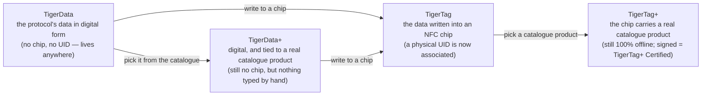

# Universele filamentidentiteit

## Eén identiteit, overal leesbaar

Een TigerTag-chip geeft een spoel een **universele identiteit**: één enkel, open record van
wat het filament *is*, los van wie het maakte, wie het verkoopt en welke
printer het smelt.

De identiteit omvat (niet uitputtend):

| Veldfamilie | Voorbeelden |
|---|---|
| **Merk** | elke filamentfabrikant, uit een gedeelde referentielijst |
| **Materiaal / type** | PLA, PETG, ABS, TPU… + subtype |
| **Uiterlijk / kleur** | kleurwaarde, afwerking |
| **Geometrie** | diameter (1,75 / 2,85 mm) |
| **Printinstellingen** | aanbevolen temperaturen |
| **Levenscyclus** | gewicht, productiedatum |

## De gedeelde referentiedatabase

Identiteiten zijn geen vrije tekst: merken, materialen, uiterlijken, typen, diameters en
eenheden komen uit een **gedeelde referentiedatabase** die wordt aangeboden op `cdn.tigertag.io`
(gehost in hetzelfde Firebase-project als de accounts). Elke app lost dezelfde id's op naar dezelfde betekenis, zodat een
chip die met de ene tool is gecodeerd, in elke andere identiek wordt gelezen.

> **TODO:** link het openbare endpoint voor het bladeren door de database / het dumpformaat zodra de
> RFID-gids dat documenteert. De referentiegegevens worden meegeleverd met Tiger Studio
> (`assets/db/tigertag/`) en worden ververst vanaf de CDN.

## Eén identiteit, vier toestanden

De identiteit is het *record*, niet de *chip* — en ze doorloopt vier
toestanden:

- **TigerData** is het protocol *vóór* de chip: dezelfde identiteit, digitaal
 opgeslagen — in een inventaris, een database, een bestand, overal. Het TigerTag-
 protocol kan volledig buiten een RFID-chip bestaan. Dit idee van een **virtuele
 chip is een innovatie van TigerSystem — het bestaat nergens anders**: beheer een volledige
 inventaris zonder enige NFC-chip, stuur een identiteit later of nooit naar een chip,
 en de interoperabiliteit van het protocol blijft in beide gevallen behouden.
- **TigerData+** is een TigerData die *precies weet welk product het is*. Nog steeds
 geen chip, nog steeds niets te kopen — maar in plaats van wat de eigenaar zelf typte, bevat het
 een echt product uit de officiële catalogus: het exacte merk, de kleur,
 het materiaal, de temperaturen, de diameter, SKU en EAN, rechtstreeks van de bron. Het is
 wat je krijgt door een product te kiezen in plaats van er een te beschrijven.
 >Het is **geen** TigerTag+ en beweert dat ook nooit: geen chip, geen UID. De `+`
 >betekent *geïdentificeerd*, niet *gecertificeerd*. Voor ontwikkelaars: een spoel is een TigerData+
 >wanneer hij zonder chip is **en** een echte product-id bevat — dat paar is de
 >definitie, en het wordt op het record gespiegeld als `protocol: "TigerData+"`, zodat
 >je het rechtstreeks kunt lezen. Zie de
 >[Firestore-datastructuur](https://github.com/TigerTag-Project/TigerTag_Firebase_Backend#-firestore-data-structure).
- Op het moment dat die gegevens **in een NFC-chip worden geschreven**, wordt het een
 **TigerTag**: er wordt eindelijk een fysieke **UID aan de identiteit gekoppeld**.
- Schrijf een **catalogusproduct** in die chip in plaats van met de hand getypte waarden
 en het is een [**TigerTag+**](../products/tigertag-plus.md) — dezelfde `+` als
 bij TigerData+, dezelfde betekenis: *geïdentificeerd*. Ondertekend door een gecertificeerde fabrikant
 wordt het een **TigerTag+ Certified**. In beide gevallen blijft de chip 100 %
 offline leesbaar.

Een TigerData kan voor altijd digitaal blijven, of **atomair worden gepromoveerd naar een echte chip**
zodra je er klaar voor bent (Tiger Studio doet dit in één stap). En
alle vier de toestanden reizen als bestanden: het
[**`.ttag`-uitwisselingsformaat**](../developers/ttag-format.md) bevat een of
meer inventarismaterialen — TigerData, TigerData+, TigerTag of TigerTag+ — op een USB-
stick, in een e-mail, tussen tools.

---

**◀ Vorige:** [Second Life-werkwijze](../philosophy/second-life.md) · **▲ [Documentatie-index](../../README.md)** · **Volgende ▶** [De TigerTag-chip](./tigertag-chip.md)

**Zie ook:** [Productpagina TigerTag](../products/tigertag.md), [Inventaris en cloudsynchronisatie](./inventory-and-cloud-sync.md)
