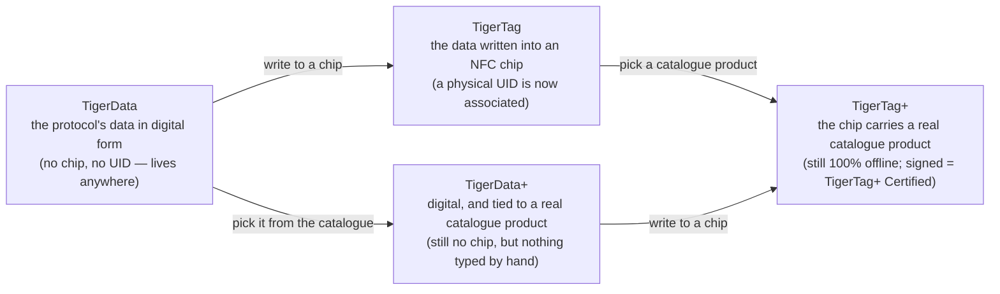

# Universele filamentidentiteit

## Eén identiteit, overal leesbaar

Een TigerTag-chip geeft een spoel een **universele identiteit**: één enkel, open record van
wat het filament *is*, los van wie het maakte, wie het verkoopt en welke
printer het smelt.

De identiteit omvat (niet uitputtend):

| Veldfamilie | Voorbeelden |
|---|---|
| **Merk** | elke filamentfabrikant, uit een gedeelde referentielijst |
| **Materiaal / type** | PLA, PETG, ABS, TPU… + subtype |
| **Uiterlijk / kleur** | kleurwaarde, afwerking |
| **Geometrie** | diameter (1,75 / 2,85 mm) |
| **Printinstellingen** | aanbevolen temperaturen |
| **Levenscyclus** | gewicht, productiedatum |

## De gedeelde referentiedatabase

Identiteiten zijn geen vrije tekst: merken, materialen, uiterlijken, typen, diameters en
eenheden komen uit een **gedeelde referentiedatabase** die wordt aangeboden op `cdn.tigertag.io`
(gehost in hetzelfde Firebase-project als de accounts). Elke app lost dezelfde id's op naar dezelfde betekenis, zodat een
chip die met de ene tool is gecodeerd, in elke andere identiek wordt gelezen.

De tabellen worden twee keer gepubliceerd, en het zijn dezelfde tabellen. Het
zijn JSON-bestanden in de map
[`database/`](https://github.com/TigerTag-Project/TigerTag-RFID-Guide/tree/main/database)
van de RFID-gids, vrij in te bouwen (CC0) en elke 6 uur vanuit de catalogus
gesynchroniseerd. De publieke API levert ze ook, elk via een eigen endpoint
([de lijst](https://github.com/TigerTag-Project/TigerTag-RFID-Guide#reference-tables-ship-with-the-protocol--the-api-is-optional)).
De bestanden zijn wat het protocol garandeert: ze lossen elke id op die een
chip kan dragen, zonder netwerk en zonder account. Tiger Studio levert ze mee
(`assets/db/tigertag/`) en ververst ze via het CDN.

## Eén identiteit, vier toestanden

De identiteit is het *record*, niet de *chip* — en ze doorloopt vier
toestanden:

- **TigerData** is het protocol *vóór* de chip: dezelfde identiteit, digitaal
 opgeslagen — in een inventaris, een database, een bestand, overal. Het TigerTag-
 protocol kan volledig buiten een RFID-chip bestaan. Dit idee van een **virtuele
 chip is een innovatie van TigerSystem — het bestaat nergens anders**: beheer een volledige
 inventaris zonder enige NFC-chip, stuur een identiteit later of nooit naar een chip,
 en de interoperabiliteit van het protocol blijft in beide gevallen behouden.
- **TigerData+** is een TigerData die *precies weet welk product het is*. Nog steeds
 geen chip, nog steeds niets te kopen — maar in plaats van wat de eigenaar zelf typte, bevat het
 een echt product uit de officiële catalogus: het exacte merk, de kleur,
 het materiaal, de temperaturen, de diameter, SKU en EAN, rechtstreeks van de bron. Het is
 wat je krijgt door een product te kiezen in plaats van er een te beschrijven.
 >Het is **geen** TigerTag+ en beweert dat ook nooit: geen chip, geen UID. De `+`
 >betekent *geïdentificeerd*, niet *gecertificeerd*. Voor ontwikkelaars: een spoel is een TigerData+
 >wanneer hij zonder chip is **en** een echte product-id bevat — dat paar is de
 >definitie, en het wordt op het record gespiegeld als `protocol: "TigerData+"`, zodat
 >je het rechtstreeks kunt lezen. Zie de
 >[Firestore-datastructuur](https://github.com/TigerTag-Project/TigerTag_Firebase_Backend#-firestore-data-structure).
- Op het moment dat die gegevens **in een NFC-chip worden geschreven**, wordt het een
 **TigerTag**: er wordt eindelijk een fysieke **UID aan de identiteit gekoppeld**.
- Schrijf een **catalogusproduct** in die chip in plaats van met de hand getypte waarden
 en het is een [**TigerTag+**](../products/tigertag-plus.md) — dezelfde `+` als
 bij TigerData+, dezelfde betekenis: *geïdentificeerd*. Ondertekend door een gecertificeerde fabrikant
 wordt het een **TigerTag+ Certified**. In beide gevallen blijft de chip 100 %
 offline leesbaar.

Een TigerData kan voor altijd digitaal blijven, of **atomair worden gepromoveerd naar een echte chip**
zodra je er klaar voor bent (Tiger Studio doet dit in één stap). En
alle vier de toestanden reizen als bestanden: het
[**`.ttag`-uitwisselingsformaat**](../developers/ttag-format.md) bevat een of
meer inventarismaterialen — TigerData, TigerData+, TigerTag of TigerTag+ — op een USB-
stick, in een e-mail, tussen tools.

## Het record en de chip

De vier toestanden hierboven zijn toestanden van het **record**. De
[RFID-gids](https://github.com/TigerTag-Project/TigerTag-RFID-Guide#three-tag-types)
somt in plaats daarvan tagtypes op, en die beschrijven de **chip**: wat er op
het silicium staat, offline gelezen, zonder account. Het zijn twee assen, geen
twee versies van één lijst, en geen van beide is fout.

Wat een lezer voor elke toestand op de chip vindt:

| Toestand van het record | Op de chip |
|---|---|
| **TigerData**, **TigerData+** | niets: er is nog geen chip |
| **TigerTag** | `ID TigerTag` `0x5BF59264`, en `ID Product` `0xFFFFFFFF` (geen) |
| **TigerTag+** | `ID TigerTag` `0xBC0FCB97`, en een `ID Product` uit de catalogus |
| **TigerTag+ Certified** | hetzelfde als een TigerTag+, plus een geldige handtekening in de pagina's `0x18`–`0x27` |

Een TigerTag+ draagt dezelfde type-id, of hij nu ondertekend is of niet. Of een
chip een TigerTag+ Certified is, controleert een lezer aan de handtekening; de
type-id kan het niet zeggen.

De chip-as heeft één waarde zonder record erachter: **TigerTag Init**
(`0x6C41A2E1`). Die markeert een lege chip die klaar is om beschreven te
worden. Over het filament is nog niets beslist, dus er is geen record dat in
een toestand kan zijn, en het is geen vijfde.

## Promotie: van een record naar een chip

Een spoel *promoveren* is de stap van links in het diagram naar rechts: een
bestaand TigerData- of TigerData+-record wordt op een lege NTAG-chip geschreven,
en de spoel draagt zijn identiteit voortaan zelf, offline.

Wat eruit komt, hangt alleen af van wat erin ging:

| Je promoveert… | Je krijgt… | Omdat |
|---|---|---|
| een **TigerData** — waarden die de eigenaar koos | een **TigerTag** | er nu een fysieke UID aan de identiteit gekoppeld is |
| een **TigerData+** — een echt catalogusproduct | een **TigerTag+** | de chip nu het product-ID uit de catalogus draagt: *nog steeds geïdentificeerd, nog steeds niet ondertekend* |

Die tweede rij is de hele `+`-woordenschat in één regel. Promotie verandert de
*toestand* — digitaal naar chip — en nooit de betekenis van de `+`. Alleen de
handtekening van een gecertificeerde fabrikant maakt van een chip een
[TigerTag+ Certified](../products/tigertag-plus.md), en geen enkele promotie
levert er een op.

Promotie is ook geen deur die maar één kant op gaat. Chips worden nooit tegen
schrijven vergrendeld: een gepromoveerde chip kan vanuit
[Tiger NFC Connect](../products/tiger-nfc-connect.md) of Tiger Studio worden
gewist en opnieuw beschreven ([de TigerTag-chip](./tigertag-chip.md)). De
identiteit is het record; de chip is alleen de plek waar ze nu woont.

---

**◀ Vorige:** [Second Life-werkwijze](../philosophy/second-life.md) · **▲ [Documentatie-index](../../README.md)** · **Volgende ▶** [De TigerTag-chip](./tigertag-chip.md)

**Zie ook:** [Productpagina TigerTag](../products/tigertag.md), [Inventaris en cloudsynchronisatie](./inventory-and-cloud-sync.md)
