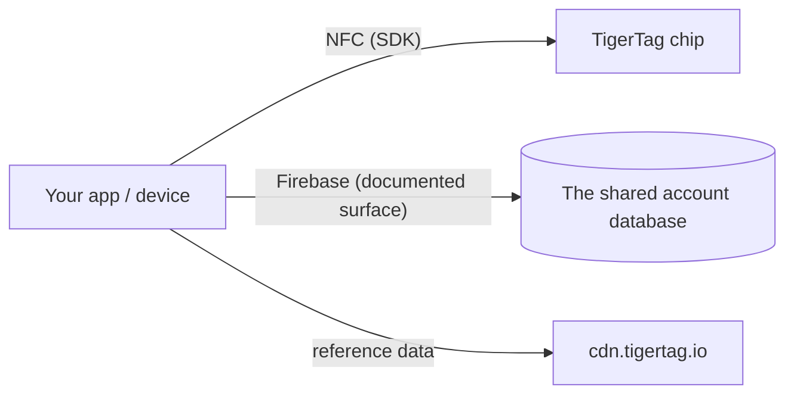

# Documentatie voor ontwikkelaars

Bouw voort op TigerSystem: lees chips, praat met de cloud, of integreer je eigen
hardware en software. Er is nergens toestemming voor nodig — het protocol is open.

## Wat kun je bouwen?

Een TigerTag lezen kan met **elke NFC-smartphone**, een **ACR122U USB-lezer**
aan een computer, of een **doe-het-zelfapparaat — een simpele ESP32 met een PN532- of
RC522-lezermodule** (de aanpak van TigerScale). Gewone hardware, geen
eigen apparatuur. Vanuit die ene scan integreer je overal waar een identiteit
nuttig is:

- **ERP / voorraadbeheer** — koppel spoelidentiteit en hoeveelheden aan het
 bestaande inventarissysteem van je bedrijf.
- **Gebruiksregistratie** — leg vast welk materiaal naar welke opdracht, machine of
 klantbestelling ging.
- **Eigen dashboards en automatisering** — monitoring van printfarms, meldingen bij lage
 voorraad, triggers voor nabestellen.
- **Uitleensystemen** — fablabs, scholen en makerspaces die materiaal in- en uitchecken.
- **R&D-projecten, privé of openbaar** — een open, herschrijfbare, gedocumenteerde
 identiteitsdrager om mee te experimenteren.

Niets hiervan heeft onze apps of onze cloud nodig: de chip + een SDK volstaat. Voeg het
[accountoppervlak](./account-api.md) alleen toe als je accounts en synchronisatie wilt.

Bouw het en het is **TigerTag Compatible**: gratis, op eigen verklaring, zonder audit en
zonder toestemming. Laat het de audit doorlopen en het kan **TigerTag
Certified** worden — open voor alles wat een derde bouwt, hardware of software, in
twee reikwijdtes (**TigerTag** en **TigerTag+**). De scheidslijn tussen de niveaus is niet
wat je product is; het is of iemand het heeft gecontroleerd. Compatible zegt *“het
werkt”* op jouw woord, Certified zegt *“we hebben het getest”* op het onze
([criteria](https://github.com/TigerTag-Project/TigerTag-RFID-Guide/blob/main/CERTIFICATION.md), neem contact op via de
[GitHub-organisatie](https://github.com/TigerTag-Project)).

Het bestuur is bewust tweeledig: **iedereen** mag het protocol implementeren en
“compatibel met TigerTag” zeggen — nooit toestemming nodig — en het
TigerTag-logo, ongewijzigd, tonen om dat te zeggen: in je app, je documentatie, je
winkelvermelding. Dat verwijzende gebruik is gratis. Alleen **gecertificeerde partners**
(vermeld in het register van gecertificeerden) mogen het merk — logo **of naam** — plaatsen **op een
chip van elk formaat (chip, inlay, sticker, label, drager), een spoel of de
verpakking**, waar het ophoudt compatibiliteit te beschrijven en herkomst begint te beweren;
de platte tekst *“Compatible with TigerTag”* op de doos van een compatibele
lezer, printer of app blijft vrij, en alleen zij mogen **TigerTag+-handtekeningen** uitgeven (TigerTag
beheert de privésleutel). De merkpoort is marketing; de handtekeningpoort
is technisch; **geen van beide beperkt het protocol met één regel** — een niet-gecertificeerde
chip werkt perfect, hij kan alleen zijn herkomst niet bewijzen.

Twee details die precies goed moeten zijn. De compatibiliteitsclaim geldt ook voor
**het `+`-niveau**: een TigerTag+-handtekening controleren is gratis, offline en
onbeperkt — de openbare sleutels zijn gepubliceerd — dus een lezer die ze controleert mag
*“compatibel met TigerTag+”* zeggen. Wat hij niet mag, is **een tag** een
TigerTag+ noemen tenzij die tag echt een door TigerTag uitgegeven handtekening draagt. En
het woord **“gecertificeerd” past nooit iemand zichzelf toe**: TigerSystem verleent het, niemand
eigent het zich toe.

Dit is bewust het model van Zigbee en Matter — een gratis *Compatible*-
niveau dat iedereen mag betreden, en een toegekend *Certified*-niveau dat voor een koper
iets betekent juist omdat het wordt toegekend. Volledig beleid, certificeringsniveaus
en merkmiddelen: [TRADEMARK.md](https://github.com/TigerTag-Project/TigerTag-RFID-Guide/blob/main/TRADEMARK.md) en
[CERTIFICATION.md](https://github.com/TigerTag-Project/TigerTag-RFID-Guide/blob/main/CERTIFICATION.md).

## Begin hier

| Ik wil… | Lees |
|---|---|
| Zien wie er al op TigerTag heeft gebouwd | [Integraties van derden](./integrations.md) |
| De onderdelen begrijpen | [Architectuuroverzicht](../architecture/overview.md) |
| Weten welke repo wat doet | [Repositories](./repositories.md) |
| TigerTag-chips lezen/schrijven | [SDK's](./sdks.md) |
| Inventarissen als bestanden uitwisselen | [Het `.ttag`-formaat](./ttag-format.md) |
| De kleur van een spoel tonen zoals elke andere app dat doet | [De materiaalswatch](./material-swatch.md) — en de bijbehorende [live referentierenderer](./material-swatch-playground.html) |
| Een spoel-id zonder chip aanmaken, het QR-label van een spoel printen of het teruglezen | [Spoel-id's en QR-links](./spool-ids-and-qr-links.md) |
| Synchroniseren met de cloudinventaris van de gebruiker | [Account-API en integratie](./account-api.md) |
| De chippayload begrijpen | [De TigerTag-chip](../concepts/tigertag-chip.md) |

## Integratiepaden

1. **Alleen chip** — parseer en codeer chips met een SDK. Geen account, geen netwerk.
2. **Met cloud** — authenticeer het *eigen account van de gebruiker* en lees/schrijf
 zijn gegevens binnen de beveiligingsregels op de server
 ([integratiecontract](./account-api.md)).
3. **Hardware** — er bestaan werkende voorbeelden voor ESP32/Arduino, Home Assistant en
 een Spoolman-brug (zie de
 [voorbeelden in de integratierepository](https://github.com/TigerTag-Project/TigerTag_Firebase_Integration/tree/main/examples)).

## Conventies

- **Versiebeheer** — productreleases gebruiken SemVer; de chippayload bevat een
 eigen formaatversie voor achterwaartse compatibiliteit.
- **Naamgeving** — zelfbeschrijvende namen boven gecodeerde of slimme; geen
 magische waarden met meerdere toestanden.
- **ID's, nooit labels** — elke logica die afhangt van een waarde uit de
 referentietabellen (`id_aspect`, `id_brand`, `id_material`, `id_type`,
 `id_diameter`, `id_measure_unit`, `id_version`…) vergelijkt het **numerieke ID**,
 nooit het label als tekenreeks. Een label is weergavetekst: het wordt vertaald, het
 kan in de referentiedatabase worden hernoemd of gecorrigeerd, en het leest
 in elke taal anders — een ID verandert nooit. Houd het ID naast het
 label, geef de ID's waarop je vertakt een naam (bijv. uiterlijk `Tricolor 24`, `Rainbow 145`,
 `Bicolor 252`), en gebruik labels alleen voor weergave.
- **Kleur** — de kleur van een spoel wordt als gegevens opgeslagen, niet als afbeelding, dus elk
 oppervlak moet die gegevens in hetzelfde beeld omzetten:
 [de conventie voor de materiaalswatch](./material-swatch.md) is normatief, en
 wordt geleverd met een [referentierenderer](./material-swatch-playground.html) waartegen je je
 eigen implementatie kunt controleren.
- **Bijdragen** — elke repo heeft zijn eigen gids; documentatiebijdragen volgen
 hier [CONTRIBUTING.md](../../CONTRIBUTING.md).

---

**◀ Vorige:** [OpenSpool](../compatibility/openspool.md) · **▲ [Documentatie-index](../../README.md)** · **Volgende ▶** [Repositories](./repositories.md)
