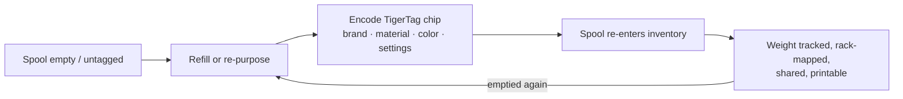

# De Second Life-workflow

## Het probleem met "slimme" spoelen vandaag

Wanneer een gelabelde spoel van een fabrikant leeg is, sterft de tag mee: hij beschreef
één in de fabriek gevulde spoel, in het formaat van één fabrikant, en kan niet hergebruikt worden. De
spoelhouder wordt weggegooid of "dom" bijgevuld.

## Second Life: opnieuw identificeren, niet weggooien

Een TigerTag-chip is **beschrijfbaar en herschrijfbaar**. Wanneer een spoel leeg is en
opnieuw wordt gevuld — of wanneer een spoel van welk merk ook helemaal geen bruikbare tag heeft —
codeert de gebruiker een TigerTag-chip met het echte profiel van het nieuwe filament en plakt hem erop.
De spoel krijgt een *tweede leven* als volwaardig, zelfidentificerend object:

*Zelfs een refill zonder spoel draagt zijn identiteit — de chip zit op de rol zelf.*

## Hoe het coderen verloopt

- **Tiger NFC Connect** (mobiel) — chips programmeren met een NFC-tik.
- **Tiger Studio** (desktop) — begeleide chipupdate met een ACR122U- of
 [TigerPOD](../products/tigerpod.md)-lezer: leg de chip neer, UID-controle,
 geverifieerd schrijven.
- **Digitaal eerst** — met *TigerData* van Tiger Studio maak je nu een volledig digitale
 (chiploze) spoel en **upgrade je die later atomair naar een echte chip**.

> **Let op:** de catalogus van merken, materialen en kleuren die bij het coderen wordt gebruikt,
> komt uit de gedeelde [referentiedatabase](../concepts/universal-filament-identity.md), zodat
> een opnieuw gecodeerde chip even nauwkeurig is als een fabrieks-chip.

## Het tweede leven van de chip zelf — nul e-waste

De spoel is niet het enige dat een tweede leven krijgt: **de chips ook.**
Elke spoel draagt [twee chips](../concepts/tigertag-chip.md) — dus elk kilo
filament dat je print, levert je **twee standaard NTAG-chips** op om te oogsten. Pel
ze eraf en codeer ze opnieuw als gewone NDEF voor van alles: een slimme sleutelhanger, een
NFC-visitekaartje, een eigen verbonden object — de editor zit in
de app. Hij kan een chip zelfs herschrijven **in het formaat dat Elegoo-printers verwachten**:
jouw chip, jouw keuze.

Precies daarom is de officiële productie van chips met merknaam overgestapt op **NTAG215**:
meer geheugenruimte betekent meer hergebruiksmogelijkheden zodra de spoel leeg is.
Het doel is simpel — **de chip van een spoel mag nooit elektronisch afval worden.**

---

**◀ Vorige:** [Smartphonebrug](./smartphone-bridge.md) · **▲ [Documentatie-index](../../README.md)** · **Volgende ▶** [Universele filamentidentiteit](../concepts/universal-filament-identity.md)

**Zie ook:** [TigerTag](../products/tigertag.md), [TigerTag+](../products/tigertag-plus.md)
