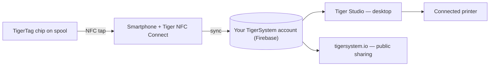

# Het concept van de smartphonebrug

## Het inzicht

> In China bleven we vragen: *“Waar zijn de RFID-lezers?”* Iedereen antwoordde:
> *“In de Bambu Labs.”* Onjuist — de lezers van Bambu zitten in de AMS, niet in de
> printer; de machine kan een spoel van een derde helemaal niet detecteren. **De RFID-
> lezers zitten in je broekzak** — in elke telefoon, klaar voor gebruik, zonder dat je
> het zelfs maar weet.

Elke moderne smartphone bevat een NFC-lezer. Dat betekent dat **elke 3D-print-
gebruiker al TigerTag-hardware bezit** — geen eigen lezer, geen printerupgrade, geen aankoop nodig om te beginnen.

De telefoon fungeert als **brug** tussen de fysieke spoel en de digitale
inventaris:

1. **Tikken** — het profiel van de chip (merk, materiaal, kleur, instellingen) wordt met één gebaar gelezen.
2. **Synchroniseren** — de spoel verschijnt direct in de cloudinventaris van de gebruiker.
3. **Overal** — de desktopapp, het web en verbonden printers kennen de spoel nu.

## Native RFID versus de brug

Sommige printers lezen tags native — meestal hun eigen, gesloten formaat,
soms TigerTag zelf; de meeste lezen helemaal niets. De brug maakt de
mogelijkheden van de printer irrelevant:

| Pad | Vereist | Werkt met |
|---|---|---|
| **Native RFID — tag van de fabrikant** | Een printer die de vergrendelde tag van die fabrikant leest | Slechts één merk |
| **Native RFID — TigerTag** | Een machine waarvan de eigen firmware TigerTag leest — zeldzaam, en tot nu toe door de community gebouwd | Elk merk, zonder app ertussen |
| **Smartphonebrug** | Elke NFC-telefoon | **Elke printer**, elk merk, zelfs volledig offline machines |

De middelste rij is niet van ons, en hij is nieuw. De uitgebreide firmware van de
community maakt van de [Snapmaker U1](../compatibility/snapmaker.md) de eerste
printer die een TigerTag op de machine zelf leest; en de **BT-AMS-C**, een lezer
met vier slots die op een AMS van Bambu Lab wordt gemonteerd, stuurt
TigerTag-gegevens rechtstreeks naar de BMCU van de printer
([hardware van derden](../compatibility/third-party-hardware.md)). Beide blijven
uitzonderingen — en dat is een argument voor de brug, niet ertegen: die hoefde
er nooit op te wachten.

Met de brug bereikt de filamentdata de printer via
[de printerintegraties van Tiger Studio](../compatibility/README.md) (zes merken
vandaag live) — de spoel identificeert zich bij het *systeem*, en het systeem praat
met de machine.

Het bewijs aan de hand van een voorbeeld: **FlashForge-printers hebben helemaal geen RFID-lezer**
— en via de brug werken ze nu toch met NFC-geïdentificeerd filament. Een
volledig nieuwe mogelijkheid, toegevoegd aan andermans machines, **helemaal gratis voor
de gebruiker** ([het FlashForge-geval](../compatibility/flashforge.md)).

---

**◀ Vorige:** [Open ecosysteem](./open-ecosystem.md) · **▲ [Documentatie-index](../../README.md)** · **Volgende ▶** [Second Life-workflow](./second-life.md)

**Zie ook:** [Tiger NFC Connect](../products/tiger-nfc-connect.md), [Architectuuroverzicht](../architecture/overview.md)
