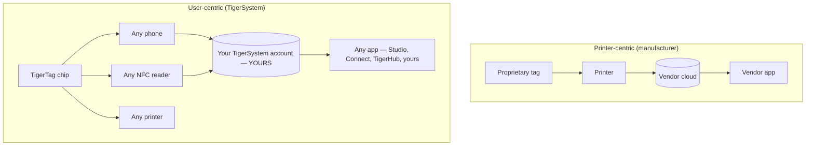

# Gebruikersgericht versus printergericht

> **Intelligentie die de gebruiker dient — niet alleen de printer.**

## Twee tegengestelde architecturen

In een printergerichte wereld is de **printer** het middelpunt: de tag bestaat om
de machine te dienen, en de data stroomt naar het silo van de fabrikant.

In TigerSystem staat de **gebruiker** centraal. De gebruiker bezit:

- **het filament** — elk merk, elke leverancier;
- **de metadata** — materiaal, kleur, printinstellingen, gecodeerd op een chip die hij beheert;
- **de inventaris** — opgeslagen onder zijn eigen cloudaccount, exporteerbaar;
- **de geschiedenis** — gewichten, locaties, gebruik in de loop van de tijd;
- **de synchronisatie** — hetzelfde account voedt elke app en elk apparaat.

TigerSystem **verbindt simpelweg alle onderdelen met elkaar**.

## Waarom fabrikanten RFID vergrendelen

Tags van fabrikanten zijn meestal cryptografisch vergrendeld (zie de
[compatibiliteitssectie](../compatibility/README.md) voor details per fabrikant:
UID-afgeleide sleutels, AES-versleutelde sectoren, RSA-handtekeningen). Vergrendelen dient de
fabrikant: het koppelt de aankoop van verbruiksartikelen aan de machine en houdt de datastroom
gesloten. Het betekent ook dat **je eigen spoelinventaris niet van jou is**.

TigerTag-chips kiezen de tegenovergestelde houding: een open NDEF-payload op een standaard
NTAG-chip, openbaar gedocumenteerd, met open SDK's om hem te lezen en te schrijven.

---

**◀ Vorige:** [Waarom TigerSystem bestaat](../vision/why-tigersystem.md) · **▲ [Documentatie-index](../../README.md)** · **Volgende ▶** [Open ecosysteem](./open-ecosystem.md)

**Zie ook:** [Universele filamentidentiteit](../concepts/universal-filament-identity.md), [Compatibiliteit](../compatibility/README.md)
