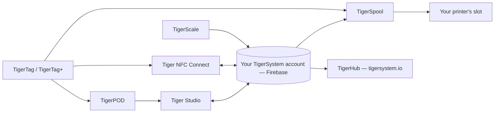

# Producten

Het TigerSystem-ecosysteem, één pagina per product.

**Dit zijn de officiële producten** — ontworpen en gepubliceerd door TigerSystem.
“Officieel” betekent hier *wij hebben het gemaakt*, niet *je hebt het nodig*: elk ervan
is open source en forkbaar, en hun namen (Tiger Studio, TigerHub, TigerScale,
TigerPOD, Tiger NFC Connect) worden bewust **niet als handelsmerk geclaimd**.
Alleen het **TigerTag**-merk zelf is voorbehouden, en alleen voor de chip.

Iedereen mag een alternatief bouwen en verkopen — een lezer, een app, een weegschaal, een heel
inventarissysteem. Zie [hardware van derden](../compatibility/third-party-hardware.md)
en [software gebouwd op TigerTag](../developers/integrations.md) voor wat er
al bestaat. Een product van een derde partij is **TigerTag Compatible** door simpelweg
te werken; het wordt pas **TigerTag Certified** als TigerSystem dat toekent
([merkenbeleid](../../TRADEMARK.md)).

> **Let op:** elk product hieronder aan **gebruikerskant** — en elk toekomstig product — is een
> werkend **proof of concept**. Hun enige doel is het potentieel te tonen van een
> open-source, standaard, agnostisch, platformonafhankelijk protocol, en te inspireren
> wat anderen ermee zullen bouwen. (De chipprogrammeertoolchain aan fabriekskant
> is een ander verhaal: industrieel, in productie.) Zie
> [Een zandbak, met opzet](../vision/why-tigersystem.md).

| Product | Wat het is | Type |
|---|---|---|
|  [TigerData](../concepts/universal-filament-identity.md) | De virtuele chip — de identiteit in digitale vorm, geen chip nodig, op elk moment te upgraden | Concept |
|  [TigerTag](./tigertag.md) | Open RFID/NFC-chip + standaard voor spoelidentiteit | Hardware + specificatie |
|  [TigerTag+](./tigertag-plus.md) | Een TigerTag met een catalogusproduct-ID en optionele verrijking — nog steeds 100% offline; ondertekend is het TigerTag+ Certified | Hardware + specificatie |
|  [Tiger NFC Connect](./tigertag-connect.md) | Mobiele app (iOS/Android) — scannen, coderen, bladeren | App |
|  [Tiger Studio](./tiger-studio.md) | Desktop-app — inventaris, racks, sensoren, printers | App |
|  [TigerHub](./tigerhub.md) | De webthuis van het ecosysteem — etalage, verlanglijsten, vrienden en delen op `tigersystem.io` | Web |
|  [TigerPOD](./tigerpod.md) | 3D-printbare lezerstandaard met dubbele NFC | Hardware |
|  [TigerScale](./tigerscale.md) | Open-source ESP32-filamentweegschaal | Hardware |
|  [TigerSpool](./tigerspool.md) | Open-source ESP32-kastje naast de printer — tik een spoel aan, kies een slot, elk merk | Hardware |
|  [Tiger Touch](./tigertouch.md) | Open-source firmware voor het BIGTREETECH Panda Touch / K-Touch-scherm — elk printermerk, live, op één scherm | Firmware |
|  [TigerTag Factory & Manager](./factory-suite.md) | Industriële tools voor chipprogrammering en filamentdatabases voor fabrieken — **niet openbaar**, productiewaardig | Industrieel |

---

**◀ Vorige:** [Gegevensstroom](../architecture/data-flow.md) · **▲ [Documentatie-index](../../README.md)** · **Volgende ▶** [TigerTag](./tigertag.md)
