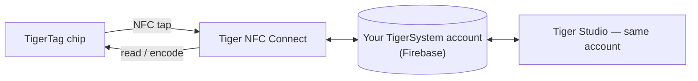

# Tiger NFC Connect (mobiele app)

## Doel

**Je telefoon is al een TigerTag-lezer — Connect zet hem aan.** De
iOS/Android-app leest elke spoel met een tik, schrijft net zo makkelijk chips en
houdt je hele collectie op zak. Het is de dagelijkse toegang tot het
ecosysteem en de belichaming van de
[smartphonebrug](../philosophy/smartphone-bridge.md).

<strong>iPhone · iPad</strong>
<a class="ts-cta-primary" href="https://apps.apple.com/app/id6745437963">App Store</a>
Scan met de camera, of tik op de knop

<strong>Android</strong>
<a class="ts-cta-primary" href="https://play.google.com/store/apps/details?id=com.tigertag.connect">Google Play</a>
Scan met de camera, of tik op de knop

<a href="https://tigersystem.io/download">Alle downloads op tigersystem.io</a>
<a href="https://testflight.apple.com/join/jVHhmK4C">TestFlight-bèta (iOS)</a>
<a href="https://play.google.com/apps/testing/com.tigertag.connect">Google Play-bèta</a>

Gratis, in beide winkels. De app leest een chip met de eigen NFC van de telefoon — niets
te kopen, geen lezer, geen account nodig om te lezen.

## Waar het past

## Functies

- **NFC-scannen onderweg** — tik een spoel aan, zie het volledige profiel.
- **Chips programmeren** — TigerTag-chips coderen en opnieuw coderen vanaf de telefoon.
- **Catalogus doorbladeren** — de gedeelde referentiedatabase van merken, materialen en kleuren.
- **Gedeeld account** — dezelfde Firebase-backend als Tiger Studio: inventaris,
 vrienden en racks blijven in realtime gesynchroniseerd over apparaten.
- **USB-C-accessoires** — ondersteunt de AJAX-3D **TD-1 / TD1s**-filamentanalyzer
 via USB-C: meet de Transmission Distance (en
 kleur) van een filament rechtstreeks met de telefoon
 ([compatibele hardware van derden](../compatibility/third-party-hardware.md)).

## Downloaden

- **Uitgebracht** in de **App Store (iOS)** en **Google Play (Android)** —
 vandaag versie 1.0.2.
- **Openbare bèta’s** zijn er ook (TestFlight op iOS, open bèta op Android).
- Alle downloadlinks: **[tigersystem.io/download](https://tigersystem.io/download)**
 — een QR-code staat ook altijd in de zijbalk van Tiger Studio.

> **Opmerking over de naam:** eerder gepubliceerd als *“TigerTag RFID Connect”* — hernoemd
> naar **Tiger NFC Connect** als knipoog naar de NFC-lezer die al in elke telefoon zit.
> De app is **gratis te gebruiken maar gesloten** (voorlopig niet open source) —
> anders dan Tiger Studio, de SDK’s en de hardware, die open zijn.

## Architectuur

Flutter-app die met Firebase (Auth + Firestore) praat — de ene gedeelde
accountdatabase achter alle apps. Printerconnectiviteit op mobiel is cloudgericht waar fabrikanten
dat toelaten.

## Interacties

| Met | Hoe |
|---|---|
| TigerTag-chips | Lezen en schrijven met een NFC-tik |
| Firebase (accountdatabase) | Realtime synchronisatie van inventaris / vrienden / voorkeuren |
| Tiger Studio | Desktopcompagnon — hetzelfde account, aanvullende functies |

## In beeld

|| | | |
|---|---|---|---|
|  |  |  |  |

---

**◀ Vorige:** [TigerTag+ Certified](./tigertag-plus-certified.md) · **▲ [Documentatie-index](../../README.md)** · **Volgende ▶** [Tiger Studio](./tiger-studio.md)

**Zie ook:** [Smartphonebrug](../philosophy/smartphone-bridge.md), [Inventaris en cloudsynchronisatie](../concepts/inventory-and-cloud-sync.md)
