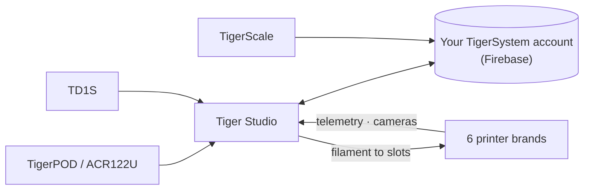

# Tiger Studio (desktop-app)

## Doel

**Tiger Studio is de controlekamer voor je filament.** Elke spoel, elk
rack, elke printer op één scherm — scan een chip en de bijbehorende spoel gaat open,
pas een gewicht aan en het synchroniseert overal, kijk naar een printer en zie wat hij
nu aan het doen is. Open source, voor Windows / macOS / Linux.

*Tiger Studio op het bureau, de app op zak, een lezer ernaast — dezelfde
inventaris, waar je hem ook aanraakt.*

<a class="ts-cta-primary" href="https://tigersystem.io/download">Download Tiger Studio — gratis</a>

<a href="https://github.com/TigerTag-Project/TigerTag-Studio-Manager"> Bronnen</a>

Het is bewust **een laboratorium, niet de bestemming** — een demonstratie van
wat het open protocol mogelijk maakt, leesbaar, forkbaar en vrij te kopiëren
([filosofie](../philosophy/open-ecosystem.md)).

## Waar het past

## Functies (hoogtepunten)

- **Inventaris** — realtime Firestore-synchronisatie, tabel- en rasterweergaven, detailpaneel,
 gewichtsregistratie, containerkalibratie, digitale spoelen (TigerData) met
 atomaire chippromotie.
- **Printers** — live integraties voor **6 merken** (telemetrie, filament per
 slot, voortgang van de taak, camera’s, en voor sommige merken volledige bedieningspanelen). Zie
 [compatibiliteit](../compatibility/README.md).
- **Racks** — fysieke opslag in kaart brengen met slepen en neerzetten.
- **Vrienden en delen** — ontdekkingscodes, alleen-lezen inventarissen van vrienden.
- **Apparaten** — eigen: [TigerPOD](./tigerpod.md) en
 [TigerScale](./tigerscale.md); van derden: de NFC-lezer ACR122U, de
 **AJAX-3D TD-1 & TD1s**-analyzers (TD + kleur rechtstreeks in het profiel van de spoel)
 en **USB HID-weegschalen** (DYMO M-serie en elke compatibele weegschaal) —
 volledige lijst: [compatibele hardware van derden](../compatibility/third-party-hardware.md).
- **11 talen** — EN · FR · DE · ES · IT · NL · PL · PT-BR · PT-PT · RU · 中文.

De complete, altijd actuele catalogus staat in
[FEATURES.md](https://github.com/TigerTag-Project/TigerTag-Studio-Manager/blob/main/FEATURES.md) in de app-repository.

## Architectuur

Electron + vanilla JS, geen bundler. Printerverbindingen spreken rechtstreeks het **eigen
LAN-protocol** van elke fabrikant (MQTT / WebSocket / HTTP) — de protocolnotities per merk
staan in de app-repository (`renderer/printers/<brand>/PROTOCOL.md`).

## In beeld

## Links

- Repository + downloads: [TigerTag-Studio-Manager](https://github.com/TigerTag-Project/TigerTag-Studio-Manager) (MIT)
- Volledige functiecatalogus: [FEATURES.md](https://github.com/TigerTag-Project/TigerTag-Studio-Manager/blob/main/FEATURES.md)

---

**◀ Vorige:** [Tiger NFC Connect](./tigertag-connect.md) · **▲ [Documentatie-index](../../README.md)** · **Volgende ▶** [TigerHub](./tigerhub.md)

**Zie ook:** [Compatibiliteit](../compatibility/README.md), [Architectuur](../architecture/overview.md)
