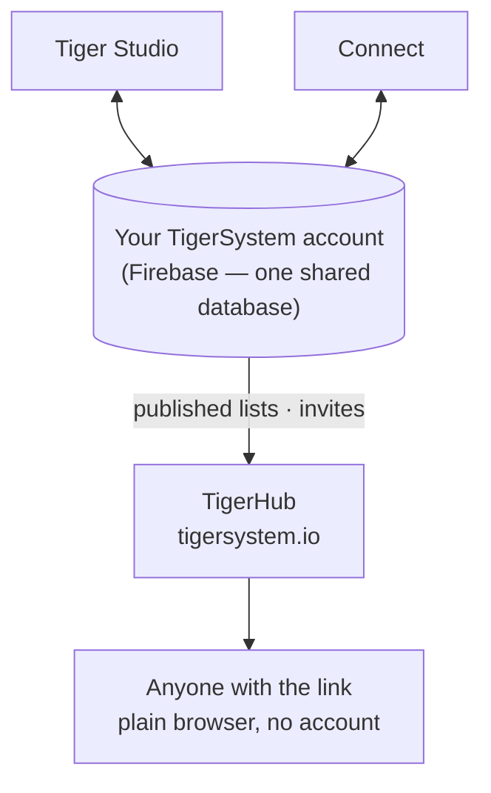

# TigerHub

## Doel

**TigerHub is het thuis van het ecosysteem op het web** — de site op
**[tigersystem.io](https://tigersystem.io)**. Hij presenteert de TigerSystem-zandbak
en wat het open TigerTag-protocol mogelijk maakt, en hij host de
**sociale kant** van de zandbak: deel een verlanglijst, nodig iemand uit om
vriend te worden, publiceer een alleen-lezen lijst die iedereen in een browser kan openen.

## Waar het past

## Functies — allemaal vandaag live

- **Etalage van het ecosysteem** — de homepage vertelt het hele verhaal: hoe het werkt,
 de zes printermerken, de componenten en de drie niveaus (TigerData —
 alleen-software-tracking · TigerTag — de offline chip · TigerTag+ — geverifieerde
 echtheid).
- **Je account op het web** (`/account`) — log in op je TigerSystem-account
 vanuit een browser.
- **Verlanglijsten** — openbare en alleen-voor-vrienden, beide in gebruik.
- **Vriendcodes en uitnodigingen** — voeg elkaar toe als vrienden vanaf het web.
- **Links naar openbare lijsten** — deel een alleen-lezen inventaris of verlanglijst als
 `https://tigersystem.io/list/<token>`; wie kijkt heeft geen app en geen
 account nodig.
- **Materiaalcatalogus en referentiedatabase** (`/materials`, `/database`) —
 blader door de gedeelde catalogus waartegen elke app oplost.
- **Printers en functies** (`/printers`, `/features`) — wat met wat werkt.
- **3D-modellen** (`/models`) — printbare modellen (TigerPOD en vrienden).
- **Voor fabrikanten, ontwikkelaars en pers** (`/manufacturers`, `/developers`,
 `/press`) — het B2B-verhaal, verwijzingen voor integratie, mediamateriaal.
- **Goodies** (`/goodies`) — de officiële pet en polo. Er een kopen is een van
 de manieren om [het project te steunen](../support.md).

## TigerHub is niet de database

De gebruikersaccounts en de gegevens achter alle apps leven in **gewoon Firebase**
(Auth + Firestore) — bewust merkloze infrastructuur: **één gedeelde
database, op één plek**, zodat Tiger Studio, Tiger NFC Connect, TigerScale
en het TigerSystem-account allemaal op dezelfde gegevens samenwerken. TigerHub is het
**weboppervlak** dat erbovenop is gebouwd. Zie
[Inventaris en cloudsynchronisatie](../concepts/inventory-and-cloud-sync.md).

## Interacties

| Met | Hoe |
|---|---|
| Tiger Studio / Connect | Deellinks genereren en intrekken, vriendenuitnodigingen versturen |
| Firebase (accountdatabase) | Bron van de gepubliceerde gegevens |
| Bezoekers | Gewone browser, geen account nodig |

---

**◀ Vorige:** [Tiger Studio](./tiger-studio.md) · **▲ [Documentatie-index](../../README.md)** · **Volgende ▶** [TigerPOD](./tigerpod.md)

**Zie ook:** [Inventaris en cloudsynchronisatie](../concepts/inventory-and-cloud-sync.md), [Architectuur](../architecture/overview.md)
