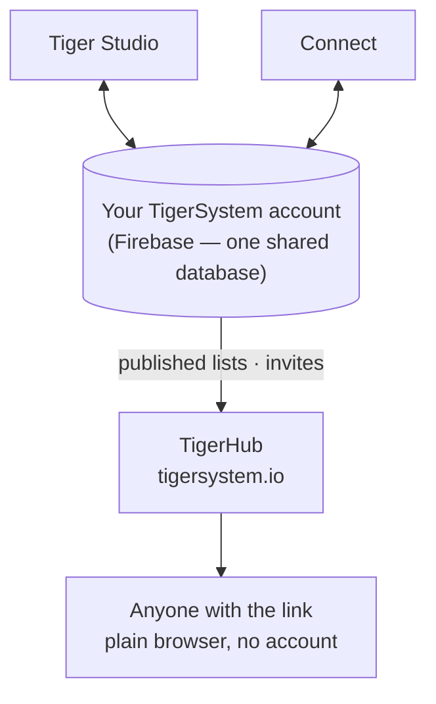

# TigerHub

## Doel

**TigerHub is het thuis van het ecosysteem op het web** — de site op
**[tigersystem.io](https://tigersystem.io)**. Hij presenteert de TigerSystem-zandbak
en wat het open TigerTag-protocol mogelijk maakt, en hij host de
**sociale kant** van de zandbak: deel een verlanglijst, nodig iemand uit om
vriend te worden, publiceer een alleen-lezen lijst die iedereen in een browser kan openen.

## Waar het past

## Functies — allemaal vandaag live

- **Etalage van het ecosysteem** — de homepage vertelt het hele verhaal: hoe het werkt,
 de zes printermerken, de componenten en de drie niveaus (TigerData —
 alleen-software-tracking · TigerTag — de offline chip · TigerTag+ — geverifieerde
 echtheid).
- **Je account op het web** (`/account`) — log in op je TigerSystem-account
 vanuit een browser.
- **Verlanglijsten** — openbare en alleen-voor-vrienden, beide in gebruik.
- **Vriendcodes en uitnodigingen** — voeg elkaar toe als vrienden vanaf het web.
- **Links naar openbare lijsten** — deel een lijst alleen-lezen als
 `https://tigersystem.io/wishlist/<token>`; wie kijkt heeft geen app en geen
 account nodig.
- **Materiaalcatalogus en referentiedatabase** (`/materials`, `/database`) —
 blader door de gedeelde catalogus waartegen elke app oplost.
- **Printers en functies** (`/printers`, `/features`) — wat met wat werkt.
- **3D-modellen** (`/models`) — printbare modellen (TigerPOD en vrienden).
- **Voor fabrikanten, ontwikkelaars en pers** (`/manufacturers`, `/developers`,
 `/press`) — het B2B-verhaal, verwijzingen voor integratie, mediamateriaal.
- **Goodies** (`/goodies`) — de officiële pet en polo. Er een kopen is een van
 de manieren om [het project te steunen](../support.md).

## Een link naar een openbare lijst, in de praktijk

Een link naar een openbare lijst is `https://tigersystem.io/wishlist/<token>`.
Drie dingen om te weten voordat je er ergens een plakt:

- **Het token is de hele sleutel.** Iedereen die de link heeft, opent de lijst —
  geen account, geen app, niets te bewijzen. Behandel hem als een wachtwoord dat
  je bewust deelt: prima voor een forumbericht of een vriend, niet voor een lijst
  waarvan je het erg zou vinden als hij verder wordt gekopieerd.
- **Een lijst openbaar maken is wat de link aanmaakt.** In de app maakt het op
  *openbaar* zetten van een lijst het token aan en publiceert het een kopie van
  de lijst; hem weer op privé zetten verwijdert die kopie en het token. Maak je
  hem opnieuw openbaar, dan krijgt hij een **nieuw** token, dus een eerder
  uitgedeelde link komt niet terug tot leven. TigerHub toont alleen wat de app
  publiceert.
- **Alleen-lezen, en de pagina zegt wie de lijst deelde.** Wie kijkt, ziet die
  ene lijst — de items, en de gelegenheid of het bericht als je er een hebt
  ingesteld — nooit je inventaris of je andere lijsten. De pagina toont wel je
  **weergavenaam**, je **links naar sociale media** en een knop *toevoegen als
  vriend* die je **ontdekkingscode** bevat.

Een link is een van twee manieren om te delen; de andere is een vriend:

| | Link naar openbare lijst | Vriend |
|---|---|---|
| Wie ziet het | iedereen met de link | één persoon die je hebt geaccepteerd |
| Account nodig | nee | ja |
| Hoe | een lijst openbaar maken | ontdekkingscodes uitwisselen |
| Ongedaan maken | de lijst privé maken | de vriend verwijderen |

De vriendenkant wordt hier alleen samengevat om naast de link te staan; de
regels voor verzoeken en verwijderen, en de handhaving van beide op de server,
horen bij [Inventaris en cloudsynchronisatie](../concepts/inventory-and-cloud-sync.md).

## TigerHub is niet de database

De gebruikersaccounts en de gegevens achter alle apps leven in **gewoon Firebase**
(Auth + Firestore) — bewust merkloze infrastructuur: **één gedeelde
database, op één plek**, zodat Tiger Studio, Tiger NFC Connect, TigerScale
en het TigerSystem-account allemaal op dezelfde gegevens samenwerken. TigerHub is het
**weboppervlak** dat erbovenop is gebouwd. Zie
[Inventaris en cloudsynchronisatie](../concepts/inventory-and-cloud-sync.md).

## Interacties

| Met | Hoe |
|---|---|
| Tiger Studio / Connect | Een lijst openbaar of privé maken — wat de link aanmaakt of verwijdert — en vriendenuitnodigingen versturen |
| Firebase (accountdatabase) | Bron van de gepubliceerde gegevens |
| Bezoekers | Gewone browser, geen account nodig |

---

**◀ Vorige:** [Tiger Studio](./tiger-studio.md) · **▲ [Documentatie-index](../../README.md)** · **Volgende ▶** [TigerPOD](./tigerpod.md)

**Zie ook:** [Inventaris en cloudsynchronisatie](../concepts/inventory-and-cloud-sync.md), [Architectuur](../architecture/overview.md)
