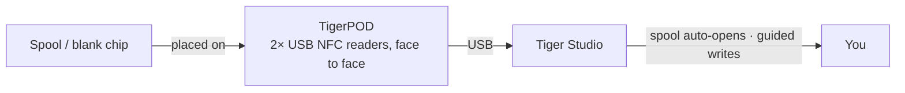

# TigerPOD

## Doel

**De eerste “cd-speler” voor slimme filamentspoelen.** TigerPOD zet een spoelscanner
op je bureau — en je print hem zelf.
Een gratis, open-source, 3D-printbare standaard met **twee** USB-NFC-lezers die **naar
elkaar toe wijzen**: leg een spoel neer en hij identificeert zichzelf in Tiger Studio; leg een blanco
chip neer en codeer hem. Net zo natuurlijk als een telefoon aantikken, maar handsfree op het bureau.

*Leg de spoel neer; hij stelt zichzelf voor.*

<a class="ts-cta-primary" href="https://tigersystem.io/tigerpod">Een TigerPOD kopen</a>
<a href="https://makerworld.com/fr/models/1289152-tigerpod-for-openspool-tigertag-rfid-filament#profileId-1318958">Print hem zelf — gratis STL</a>

<a href="https://github.com/TigerTag-Project/TigerPOD"> Bronnen</a>

## Waarom twee lezers, naar elkaar toe gericht

Dit is het hele punt van de behuizing, en het ene dat je goed moet doen. **We
raden altijd twee lezers aan.** Eén lezer werkt technisch, maar hij verslechtert
de ervaring op twee concrete manieren:

- **Lezen.** Een spoel draagt
 [**twee chips, op tegenoverliggende zijden**](../concepts/tigertag-chip.md). Met één
 lezer moet een spoel die “verkeerd” om terechtkomt eerst worden opgepakt en
 omgedraaid voordat hij wordt gezien. Met een lezer aan elke kant staat, hoe je de
 spoel er ook in laat vallen, altijd een chip al voor een lezer. Niets om te draaien, niets
 om te richten.
- **Schrijven.** Als je zelf een spoel tagt, schrijf je **beide** chips. Eén
 lezer betekent twee rondes, en twee kansen om ze niet op elkaar te laten aansluiten. Twee lezers schrijven
 het paar **in één keer**, en Tiger Studio kan ze tegen elkaar controleren.

De Pod bestaat om die geometrie vast te houden: twee lezers, rechtop, tegenover elkaar, op
spoelafstand. Al het andere is een behuizing eromheen.

## Waar het past

## Twee behuizingen om te printen — beide gratis

| | **TigerPOD Mini** — *aanbevolen* | **TigerPOD (origineel)** |
|---|---|---|
| |  |  |
| Printen | Sneller, minder filament | Langer, meer filament |
| Bureauruimte | Minder | Meer |
| Kabels | Binnen de behuizing geleid | Extern |
| Tags | TigerTag **en** OpenSpool (NDEF) | TigerTag **en** OpenSpool (NDEF) |
| Download | **[MakerWorld — TigerPOD Mini](https://makerworld.com/fr/models/3190348-tigerpod-mini-for-openspool-tigertag-rfid-filament#profileId-3609236)** | **[MakerWorld — TigerPOD origineel](https://makerworld.com/fr/models/1289152-tigerpod-for-openspool-tigertag-rfid-filament#profileId-1318958)** |

Beide bevatten dezelfde twee lezers van het type ACR122U die naar elkaar toe wijzen. De Mini is een
herontwerp van het origineel en is gewoon de betere Pod: begin daar, tenzij je
specifiek de grotere houder wilt.

Gelicentieerd onder **CC BY 4.0** — remix en pas vrij aan.

## Waar hij van gemaakt is

De STL is de behuizing; dit zijn de onderdelen die erin gaan. Niets hiervan is
exclusief — elke lezer van het type ACR122U en elke USB-C-splitter werkt — maar dit is
de combinatie waaromheen de behuizing is ontworpen:

| Onderdeel | Aantal | Wat het is |
|---|---|---|
| **TigerTag Player** | **2** | De USB-NFC-lezer — een apparaat van het type ACR122U. Eén per kant, zodat beide chips van de spoel in één ronde worden bereikt. |
| **TigerTag Spliter** | 1 | USB-C naar 2× USB-A, zodat de twee lezers de computer op één poort bereiken en parallel geprogrammeerd kunnen worden. |
| **De geprinte behuizing** | 1 | **Mini** of origineel — zie hierboven. |

### De onderdelen halen

De behuizing is een gratis download; de twee lezers en de splitter koop je.
Ze worden als bundel verkocht, de goedkoopste manier om aan
het juiste paar te komen:

- **[TigerTag Player Bundle — 2 lezers + Spliter](https://www.atome3d.com/products/tigertag-player-bundle-2pcs-spliter)** (Atome3D)
- Ook verkrijgbaar op **[tigertag.io](https://shop.tigertag.io/collections/tigertag-rfid-maker)**

> **Let op:** er zelf een in elkaar zetten en een kant-en-klare kopen leiden tot
> precies hetzelfde apparaat. Elke twee lezers van het type ACR122U voldoen — de bundel
> bespaart je alleen het apart zoeken.

## Bouw er een

1. **Print een behuizing** — de Mini of het origineel, zie hierboven.
2. **Haal twee ACR122U-compatibele lezers**, bij elke winkel die je wilt, en een pakje
 blanco NTAG 213 / 215 / 216-chips om op te schrijven.
3. **Schuif een lezer in elke sleuf** — geen schroeven, geen lijm, geen bedrading.
4. **Sluit beide aan op je computer.** Met een splitter wordt het één kabel; twee USB-poorten
 werken net zo goed.
5. **Installeer [Tiger Studio](./tiger-studio.md)** — hij pikt de lezers vanzelf
 op.

Grof budget, apart aangeschaft — prijzen verschillen per winkel en regio:

| Onderdeel | Aantal | Ca. | Waar |
|---|---|---|---|
| ACR122U-compatibele NFC-lezer | 2 | €15–25 per stuk | [Amazon](https://amzn.to/4vok3d7) · of elke winkel |
| Blanco NTAG 213 / 215 / 216-chips | 1 pakje | €10–20 — twee chips per spoel, dus een pakje tagt er veel | [Amazon](https://amzn.to/3TzxGc7) · [officiële chips](./tigertag.md) |
| De geprinte behuizing | 1 | alleen filament | MakerWorld, zie hierboven |
| USB-splitter (2× USB-A female → 1× USB-A male) | 1 | €5–10, optioneel | [Amazon](https://amzn.to/4plgsv8) |

> Sommige links in deze tabel zijn **Amazon-affiliatelinks**: als Amazon
> Associate verdient TigerTag aan kwalificerende aankopen, **zonder extra kosten
> voor jou**. Het helpt het open protocol te financieren. Dezelfde onderdelen ergens anders kopen
> werkt precies zo goed.

De [kit](https://shop.tigertag.io/collections/tigertag-rfid-maker)
kopen kost minder dan dezelfde onderdelen één voor één aanschaffen, de lezers komen
met het officiële logo van het project, en het financiert de standaard — een van de
vele manieren om [het project te steunen](../support.md). Maar er een bouwen uit
generieke onderdelen is **geen mindere weg — het is dezelfde Pod**. Dat is wat een
open protocol betekent.

### Compatibiliteit van lezers

De ACR122U spreekt **PC/SC**, de smartcardstandaard op OS-niveau die elke lezer van
deze klasse implementeert. Omdat de Pod op PC/SC bouwt en niet op een driver van een fabrikant, draait dezelfde opstelling op **Windows, macOS en Linux**, en elke PC/SC-bibliotheek kan hem aansturen.

## Functies

- 3D-printbare behuizing — **gratis STL’s op MakerWorld**, in een **Mini**- en een
 **originele** maat.
- Biedt plaats aan twee USB-lezers van het type ACR122U, tegenover elkaar (lees- en schrijfstations).
- Plug-and-play met [Tiger Studio](./tiger-studio.md): een chip scannen opent
 automatisch de bijbehorende spoel; de begeleide chip-updateflow gebruikt hem voor
 schrijfacties met UID-controle.
- Niet vergrendeld op TigerTag: dezelfde twee lezers verwerken ook **OpenSpool**-tags
 (NDEF).

## Meer dan TigerTag — een universeel NFC-station

De Pod is **niet vergrendeld op het TigerTag-protocol**. Het zijn, letterlijk, twee
standaard PC/SC-lezers in een houder in de vorm van een spoel: **alles wat een ACR122U kan,
kan de Pod.**

Je hebt volledige controle over de chip — lees wat erop staat, schrijf iets nieuws,
wijzig wat er staat, wis hem terug naar blanco. Alle vier, in beide richtingen. Geen
eenmalig schrijven, geen eenrichtingsverkeer, geen vendor lock-in. En voor filament gebeurt dat in
**Dual NFC**, beide chips van een spoel samen verwerkt, op spoelen van elk merk.

De ACR122U kan veel meer dan NTAG: **ISO 14443 Type A en B**, **MIFARE**
(Classic 1K/4K, Ultralight, DESFire), **FeliCa**, **Topaz/Jewel** en **NFC
Forum-tagtypen 1–4**. Wat je ook met een ACR122U kunt lezen of schrijven, je kunt het
lezen of schrijven in de Pod — inclusief [OpenSpool](../compatibility/openspool.md)-tags.

Dat maakt ook het [tweede leven](../philosophy/second-life.md) echt. Een
TigerTag is nooit schrijfvergrendeld, dus als een spoel op is, kun je de chips wissen
en opnieuw schrijven als verse TigerTags — of er iets heel anders van maken: een gewone
**NDEF**-tag voor domotica, een Wi-Fi-overdracht, een URL, een visitekaartje. En weer terug naar een TigerTag wanneer je maar wilt. De chip is een
herbruikbaar goed, geen verpakking voor eenmalig gebruik.

## Interacties

| Met | Hoe |
|---|---|
| TigerTag-chips | Lezen / coderen / verifiëren — beide chips van een spoel tegelijk |
| Tiger Studio | Directe spoelidentificatie, chippromotie en -update |

## In beeld

## Links

- Repository: [TigerPOD](https://github.com/TigerTag-Project/TigerPOD)
- STL — **[TigerPOD Mini](https://makerworld.com/fr/models/3190348-tigerpod-mini-for-openspool-tigertag-rfid-filament#profileId-3609236)** · [TigerPOD origineel](https://makerworld.com/fr/models/1289152-tigerpod-for-openspool-tigertag-rfid-filament#profileId-1318958)
- Lezers: [TigerTag Player Bundle (2 stuks + Spliter)](https://www.atome3d.com/products/tigertag-player-bundle-2pcs-spliter)

---

**◀ Vorige:** [TigerHub](./tigerhub.md) · **▲ [Documentatie-index](../../README.md)** · **Volgende ▶** [TigerScale](./tigerscale.md)

**Zie ook:** [Workflow voor een tweede leven](../philosophy/second-life.md)
