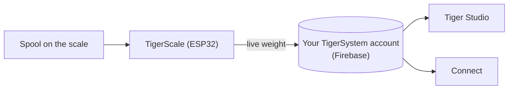

# TigerScale

## Doel

**TigerScale beantwoordt de eeuwige vraag: hoeveel filament is er nog?** Zet een
spoel op de open-source ESP32-weegschaal en het live gewicht stroomt rechtstreeks naar
je inventaris — geen handmatige invoer, geen spoel schudden naast je oor.

*De spoel gaat erop en de weegschaal weet al wat het is: de chip geeft het
merk, het materiaal en de kleur, de loadcell geeft de grammen. Niets
getypt, niets geraden.*

<a class="ts-cta-primary" href="https://tigertag-project.github.io/Tiger-Scale-V3/">Installeer vanuit je browser</a>

<a href="https://tigersystem.io/tigerscale">TigerScale op tigersystem.io</a>
<a href="https://makerworld.com/en/models/3161869-tigerscale-v3-best-smart-filament-scale-with-nfc#profileId-3573543">Print de behuizing</a>
<a href="https://github.com/TigerTag-Project/Tiger-Scale-V3"> Bronnen</a>

> **De chip weet wat het filament *is*; de weegschaal weet hoeveel er nog
> *over* is.** Samen maken ze de inventaris echt waar: identiteit van
> [TigerTag](./tigertag.md), live hoeveelheid van TigerScale.

## TigerScale V3 — de huidige generatie

[Tiger-Scale-V3](https://github.com/TigerTag-Project/Tiger-Scale-V3), MIT.
Dit is degene om te bouwen.

- **Hij weet welke spoel erop ligt**: **dubbele PN532-NFC-lezers**, een aan elke
 kant — een [spoel met twee tags](../concepts/tigertag-chip.md) wordt herkend
 hoe je hem ook neerlegt. De tag lezen, wegen, het gewicht van de lege
 spoel aftrekken, synchroniseren — niets typen, niets raden.
- **ESP32-S3** (16 MB flash, PSRAM), **3,5″ 480×320 kleurentouchscreen**
 (LVGL) met volledige instelling op het scherm: wifi-kiezer + toetsenbord, kalibratiewizard,
 hardware-zelftest, OTA-updates.
- **Op batterij** (AXP2101-PMIC, laadstatus op het scherm), audiocodec.
- Nauwkeurig wegen: HX711 + loadcell, mediaan + adaptieve EMA-filtering —
 afgestemd op het gevoel van een keukenweegschaal.
- **8 firmwaretalen**, webinterface in 9 talen.
- **Live gewichtsregistratie** — updates verschijnen in realtime in Tiger Studio en
  Tiger NFC Connect via Firestore.
- Werkt met de **kalibratie van containergewichten** van Tiger Studio, zodat het nettogewicht
 aan filament per containertype nauwkeurig blijft.
- **Hij werkt offline.** Identificatie van merk en materiaal komt uit een database
 in het eigen flashgeheugen van het apparaat, hooguit eens per dag ververst — een opzoeking van een tag
 wacht nooit op het netwerk.
- **Cloudsynchronisatie is optioneel.** De weegschaal is volledig bruikbaar zonder account.
- **Een eigen webinterface**, geserveerd vanaf het apparaat, mobielvriendelijk, live via
 WebSocket op 10 Hz — geen app te installeren om hem vanaf een telefoon te bedienen.
- **Geen binaire blobs**: alles compileert vanuit de broncode.

*Op de werkbank: zet de spoel neer, hij identificeert en weegt zichzelf.*

## Er een bouwen

> **Niet van elektronica?** Een USB-weegschaal en een [TigerPOD](./tigerpod.md) doen
> dezelfde taak zonder iets te bedraden of te flashen — het
> [officiële alternatief zonder elektronica](#een-usb-weegschaal-en-een-tigerpod-zonder-elektronica).

De weegschaal is een doe-het-zelfbouw, en de stappen waarvan mensen verwachten dat ze moeilijk zijn, zijn dat niet:

1. **Print de behuizing.** Eén `.3mf` Bambu Studio-project met de platen
 al ingedeeld — [op MakerWorld](https://makerworld.com/en/models/3161869-tigerscale-v3-best-smart-filament-scale-with-nfc#profileId-3573543).
 Open het in Bambu Studio of Orca en druk op Slice: niets te oriënteren, geen
 supports te plaatsen.
2. **Bedraad de componenten.** Verbind de loadcell, HX711, luidspreker en beide
 PN532-lezers met het bord volgens het [bedradingsschema](#bedradingsschema)
 hieronder — dezelfde pinout voor beide bordvarianten.
3. **Flash vanuit je browser.** De
 [webinstallatie](https://tigertag-project.github.io/Tiger-Scale-V3/) biedt altijd
 de huidige release aan; daarna werkt de weegschaal zichzelf bij via OTA.

De onderdelen zijn gangbaar:

| Aantal | Component | Waar |
|---|---|---|
| 1 | Waveshare **ESP32-S3-Touch-LCD-3.5B** — 480×320 IPS-touch (de **-3.5** zonder B werkt ook) | [-3.5B](https://link.amazon/B0gaANfF5) · [-3.5](https://link.amazon/B0dpgOlOQ) |
| 2 | **PN532 V3**-NFC-module — pinheader **en** modusschakelaar vereist | [Amazon](https://link.amazon/B0iTXrhjd) |
| 1 | Loadcell van 5 kg + HX711 | [Amazon](https://link.amazon/B09LOUuI1) |
| 1 | USB-C 4-pins kabel + connector | [kabel](https://link.amazon/B0aoW8qQx) · [connector](https://link.amazon/B0aiEyjLx) |
| 1 | Li-ionbatterij — **optioneel**, de weegschaal werkt op USB | [Amazon](https://link.amazon/B0etKlE1i) |
| — | Dupont-draden, zelftappende M3-schroeven | [draden](https://link.amazon/B0bl6jvMs) · [schroeven](https://link.amazon/B0ekzxx1E) |
| — | 2× M4×30 en 2× M5×30 (loadcell), 4× M2×6 (display) | elke bouwmarkt |
| 1 | Een kleine luidspreker | wordt met het ESP32-S3-bord meegeleverd |

<figure>

<figcaption><strong>Beide varianten werken, maar ze hebben verschillende firmware nodig.</strong> Lees de zeefdruk: <strong>-3.5B</strong> of <strong>-3.5</strong>. De webinstallatie vraagt welke je hebt; de bedrading en de behuizing zijn in beide gevallen hetzelfde. Flash je de verkeerde build, dan start de weegschaal perfect op maar ziet hij nooit een tag, zonder dat iets op het scherm zegt waarom.</figcaption>
</figure>
<figure>

<figcaption><strong>Waarschuwing:</strong> de loadcell moet 2× M4- en 2× M5-draadgaten hebben, en het HX711-bord moet identiek zijn aan het getoonde — anders past het niet in zijn bestemde sleuf.</figcaption>
</figure>

> Sommige links in deze tabel zijn **Amazon-affiliatelinks**: als Amazon
> Associate verdient TigerTag aan kwalificerende aankopen, **zonder extra kosten
> voor jou**. Het helpt het open protocol te financieren. Dezelfde onderdelen ergens anders kopen
> werkt precies zo goed.

De volledige stuklijst met kosten staat in de
[repository](https://github.com/TigerTag-Project/Tiger-Scale-V3).

### Montage

<figure>

<figcaption>Driekwart voor</figcaption>
</figure>
<figure>

<figcaption>Driekwart achter</figcaption>
</figure>
<figure>

<figcaption>Driekwart achter, dichtbij</figcaption>
</figure>
<figure>

<figcaption>Zijaanzicht</figcaption>
</figure>

<figure>

<figcaption>Positie en oriëntatie van de weegschaal</figcaption>
</figure>
<figure>

<figcaption>PN532 op zijn plek in de sleuf</figcaption>
</figure>

### Bedradingsschema

*[Interactief schema in Cirkit Designer](https://app.cirkitdesigner.com/project/c6aa6c0a-9462-498f-8923-9ad4454e0e69)*

### Probleemoplossing

**Geen COM-poort gedetecteerd voor de ESP32-S3 in de [webinstallatie](https://tigertag-project.github.io/Tiger-Scale-V3/)?**

Mogelijk ontbreekt er een driver voor je systeem. [Volg de installatiehandleiding voor de driver](../tutorials/tigerscale-serial-port-driver.md).

## Aan jou om te maken en te verkopen

**Iedereen mag TigerScale-hardware produceren en verkopen. Geen licentiekosten, geen
royalty’s, geen registratie.** Bouw hem, flash de officiële firmware, lever hem.

De enige voorwaarde om je product een **TigerScale** te noemen is dat het die
officiële firmware **ongewijzigd** draait, zodat elke eenheid zich binnen het
ecosysteem identiek gedraagt. Fork hem als je iets wilt wijzigen — en geef de fork een andere
naam. Dat is de hele deal.

## Waar het past

## Het verhaal tot nu toe

Drie generaties, en de vorm van het ding veranderde bij elke:

| | Lezen | Scherm | Bord | Vormfactor |
|---|---|---|---|---|
| **V1** — nooit openbaar uitgebracht | **één** PN532 | mini-OLED | ESP32 | een **spoelhouder**: een centrale steun die door het midden van de spoel loopt |
| **V2** — [Tiger-Scale](https://github.com/TigerTag-Project/Tiger-Scale), MIT | 2× RC522 | 0,96″ OLED | ESP32-WROOM, USB-gevoed | een platte weegschaal |
| **V3** — [Tiger-Scale-V3](https://github.com/TigerTag-Project/Tiger-Scale-V3), MIT | 2× PN532 | 3,5″ kleurentouchscreen | ESP32-S3, batterij | een platte weegschaal, zelfstandig |

De V1 had in wezen al de elektronica van de V2 — ESP32, mini-OLED,
een HX711-bord met een loadcell van 5 kg — maar **één** lezer, en een
totaal andere behuizing.

> **V3 is andere hardware, geen firmware-update.** De twee zijn niet
> uitwisselbaar: een V2 die je al hebt gebouwd houdt zijn eigen repository en blijft
> werken. Hij wordt alleen niet meer ontwikkeld.

Alle drie zijn volledig open source (MIT) op gangbare onderdelen — het levende bewijs
dat een ESP32 en een NFC-lezermodule (klasse PN532 / RC522) volstaan om
een apparaat te bouwen dat TigerTag leest.

## Een USB-weegschaal en een TigerPOD, zonder elektronica

Het **officiële alternatief voor wie geen weegschaal wil bouwen**. Een
standaard USB-weegschaal en een [TigerPOD](./tigerpod.md), beide op de
computer aangesloten, en Tiger Studio doet de rest — niets te solderen, bedraden of flashen.

1. **Sluit de weegschaal via USB aan** op je computer.
2. **Zet de TigerPOD erbovenop** — de Mini of het origineel.
3. **Tarreer de weegschaal**, met de TigerPOD erop.
4. **Open Tiger Studio.**
5. **Leg een spoel op de TigerPOD.** Hij leest de chips van de spoel en Tiger
 Studio opent zijn kaart.
6. **De weegschaal weegt hem**, en Tiger Studio werkt het gewicht van de spoel
 vanzelf bij.

### Welke weegschalen werken

Tiger Studio leest standaard **USB-“HID Scale”-apparaten** (HID usage page
`0x8D`, usage `0x20`): te beginnen met de **DYMO M5** en de rest van de DYMO M-serie
(M10, M25… hetzelfde protocol), en **elke compatibele HID Scale**, welk
merk ook. De weegschaal is hardware van een derde partij, geen Tiger-product; de opstelling eromheen
is officieel en ondersteund.

Protocol, gevalideerd op echte hardware — *Scale Data Reports* van 6 bytes op ~1 Hz:

| Byte | Betekenis |
|---|---|
| `[0]` | report-id `0x03` |
| `[1]` | status: 1 storing · 2 stabiel op nul · 3 in beweging · 4 stabiel · 5 negatief · 6 boven capaciteit |
| `[2]` | eenheid (HID PoS-codes): `0x02` gram · `0x0B` ons · `0x0C` pond |
| `[3]` | exponent van tien met teken, toegepast op de ruwe waarde |
| `[4..5]` | gewicht, LE16 (LSB, MSB) |

DYMO-vendor-id `0x0922`; de M5 is pid `0x8009`. Eigenaardigheid: het allereerste frame
direct na een tarra meldt eenheid `0x00`.

> **De DYMO M2 wordt niet ondersteund** — hij heeft helemaal geen USB-poort, dus er is
> niets om op een computer aan te sluiten. Het protocol doet er niet toe.

## Interacties

| Met | Hoe |
|---|---|
| Firebase (accountdatabase) | Schrijft het live gewicht naar het account van de gebruiker |
| Tiger Studio / Connect | Tonen het live gewicht; statusbewaking |

## Links

- **V3 (actueel)**: [Tiger-Scale-V3](https://github.com/TigerTag-Project/Tiger-Scale-V3) (MIT)
- Flash hem vanuit je browser: [webinstallatie](https://tigertag-project.github.io/Tiger-Scale-V3/)
- Print de behuizing: [MakerWorld](https://makerworld.com/en/models/3161869-tigerscale-v3-best-smart-filament-scale-with-nfc#profileId-3573543)
- V2, niet meer in ontwikkeling: [Tiger-Scale](https://github.com/TigerTag-Project/Tiger-Scale) (MIT)

---

**◀ Vorige:** [TigerPOD](./tigerpod.md) · **▲ [Documentatie-index](../../README.md)** · **Volgende ▶** [Compatibiliteit](../compatibility/README.md)

**Zie ook:** [Inventaris en cloudsynchronisatie](../concepts/inventory-and-cloud-sync.md)
