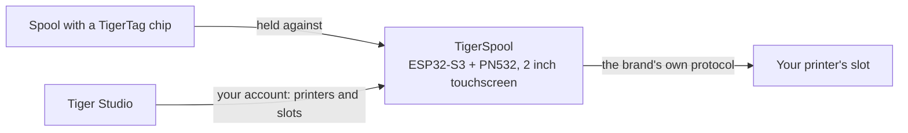

# TigerSpool

**Een klein kastje naast de printer. Tik een slot aan, houd een spoel ertegenaan, en het
filament wordt in dat slot geschreven — op elk merk printer.**

*Het kastje, een spoel en de eigen slots van de printer op het scherm — elk toont
wat erin geladen is. Kies een slot, houd de spoel tegen het kastje, klaar.*

<a class="ts-cta-primary" href="https://tigertag-project.github.io/TigerSpool-RFID/">Installeer vanuit je browser</a>

<a href="https://github.com/TigerTag-Project/TigerSpool-RFID"> Bronnen</a>

Je printer houdt al een lijst met slots bij. Je spoel draagt al zijn eigen
[identiteit](../concepts/universal-filament-identity.md). TigerSpool is de dertig
centimeter ertussen: geen app om te openen, geen toetsenbord, niets opnieuw getypt wat
de chip al weet.

Open source onder **MIT**, ESP32-S3, ongeveer **40 €** aan gangbare onderdelen.

## Wat het doet

1. **Tik het slot aan** dat je wilt op het touchscreen — dezelfde slotnamen als die
 de printer zelf gebruikt.
2. **Houd de spoel tegen het kastje.** De [TigerTag-chip](../concepts/tigertag-chip.md)
 wordt bij contact gelezen, en de toewijzing vertrekt meteen naar de printer, via
 het eigen protocol van dat merk: materiaal, merk, kleur en temperaturen, in het
 juiste slot. Er is niets te bevestigen.
3. **Laad de spoel.** Het kastje vertelt je in welk slot hij terechtkwam.

Het spreekt negen talen, vraagt eerst welke, en werkt zichzelf
bij via OTA.

:::caution[Waarschuwing]
Een TigerTag op een slot op het scherm scannen laadt
niets — het vertelt de printer alleen wat de spoel *is*. **Je moet de spoel nog steeds
zelf fysiek in dat slot plaatsen** — de CFS, de AMS, de
ACE-eenheid, of hoe die printer zijn eigen lade ook noemt. Sla je dat over, dan meldt de
printer geen filament, omdat er echt geen geladen is.
:::

## Waar het past

TigerSpool is geen chipschrijver — dat is de taak van de [TigerPOD](./tigerpod.md),
op het bureau. TigerSpool neemt een identiteit die al bestaat en zet haar waar
de printer haar verwacht.

## Wat er eerst moet bestaan

**Hier lopen mensen tegenaan, dus het komt vóór de hardware.**

Het kastje heeft bewust geen toetsenbord en geen manier om het adres van een printer te typen.
Het leest je printers **uit je TigerSystem-account**, wat betekent dat twee
dingen moeten bestaan voordat het nuttig is:

1. **Een account, aangemaakt in [Tiger Studio](./tiger-studio.md).** Het kastje logt
 erop in — met e-mail, of met Google via een QR-code, zodat er nooit een wachtwoord
 op een scherm van twee inch wordt getypt.
2. **Je printers, toegevoegd in Tiger Studio.** Adres, toegangscode, merk en
 model staan daar.

Sla je dit over, dan is de printerlijst op het kastje **leeg**. Dat is geen
storing en er valt niets te repareren aan het apparaat: het toont precies
wat je account bevat. Voeg de printer toe in Tiger Studio en hij verschijnt bij de
volgende synchronisatie.

> **Kort gezegd:** Tiger Studio → maak een account → voeg je printers toe →
> *dan* stel je het kastje in.

## Welke printers

**De zes merken die Tiger Studio integreert zijn gedekt** — geschreven en getest
op hardware. Dat is niet elke printer op de markt, en *“elke printer”*
blijft het doel; het is elk merk waarmee dit ecosysteem vandaag praat:

| Merk | Firmware | Transport |
|---|---|---|
| [Creality](../compatibility/creality.md) | geïmplementeerd, bewezen | WebSocket |
| [FlashForge](../compatibility/flashforge.md) | geïmplementeerd, bewezen | HTTP |
| [Bambu Lab](../compatibility/bambu-lab.md) | geïmplementeerd, bewezen | MQTT over TLS |
| [Snapmaker](../compatibility/snapmaker.md) | geïmplementeerd, bewezen | Moonraker over WebSocket |
| [Elegoo](../compatibility/elegoo.md) | geïmplementeerd, lezen bewezen — schrijven nog niet bevestigd op een printer | MQTT |
| [Anycubic](../compatibility/anycubic.md) | geïmplementeerd, lezen bewezen — schrijven nog niet bevestigd; alleen LAN-modus | MQTT over TLS |

Slotnamen volgen die van de printer zelf: `Ext.` en `1A`–`1D` bij Creality en
FlashForge, `A1`–`A4` dan `B1`–`B4` bij Bambu Lab, `E1`–`E4` bij Snapmaker, `S1`–`S4` bij
Canvas van Elegoo, en één letter per ACE-eenheid bij Anycubic — `A1`, `A2`… dan
`B1`… voor een tweede kastje.

Bekijk de [status per merk](https://github.com/TigerTag-Project/TigerSpool-RFID/blob/main/docs/PRINTER-COMPATIBILITY.md)
voordat je onderdelen koopt voor een specifieke machine.

## Bouw er een

Drie dingen om te kopen, vier draden, één geprinte behuizing — plus twee extra’s die het overwegen waard zijn. **De elektronica is identiek voor elk printermerk** — alleen
de behuizing verandert, en dat houdt het bij één firmware en één onderdelenlijst.

| Aantal | Component | Waar |
|---|---|---|
| 1 | Waveshare **ESP32-S3-Touch-LCD-2**-ontwikkelbord — 2,0″ 240×320 IPS capacitieve touch, ESP32-S3**R8**, 16 MB flash, 8 MB octal PSRAM. Scherm, touchpaneel en MCU op één bord, en de 16 MB maakt twee OTA-slots comfortabel | [Amazon](https://link.amazon/B0c5hr3uf) |
| 1 | **PN532 V3**-NFC-module — DIP-schakelaars, moet **HSU/UART** ondersteunen, beide schakelaars op `0` / OFF. Een tweepak kost nauwelijks meer dan één | [Amazon](https://link.amazon/B0dyEfwKa) |
| 1 | Een USB-C-kabel **die data draagt** — snelheid is irrelevant, elke USB 2.0-datakabel voldoet | [Amazon](https://link.amazon/B00Xg3WT4) |
| 1 | Magnetische USB-C-connector — **aanbevolen**: de poort is het onderdeel dat dagelijks wordt aangeraakt, en de kabel laat los in plaats van de aansluiting | [Amazon](https://link.amazon/B0bWVIBa0) |
| 1 | 3,7 V 1000 mAh LiPo-cel, PH1.25 — **optioneel**, opgeladen via USB; het kastje draait dan zonder kabel. Het bord kan geen cel detecteren, dus je geeft hem aan in Instellingen › Batterij. Controleer de polariteit | [Amazon](https://link.amazon/B0fL0jjf3) |

> Sommige links in deze tabel zijn **Amazon-affiliatelinks**: als Amazon
> Associate verdient TigerTag aan kwalificerende aankopen, **zonder extra kosten
> voor jou**. Het helpt het open protocol te financieren. Dezelfde onderdelen ergens anders kopen
> werkt precies zo goed.

De **vier jumperdraden worden met de PN532 meegeleverd** — 3V3, GND, TX, RX, en dat is
het hele bedradingsbundeltje. Geen niveauomzetters: de PN532 draait op 3V3, net als het bord.
Een batterij is **optioneel** — het kastje staat normaal naast een printer die al
is aangesloten, en de cel hierboven is voor de keren dat dat niet zo is.

*Het hele bedradingsbundeltje. Op de PN532 staan de twee datapinnen op de zeefdruk als `SDA` en
`SCL` — in HSU-modus voeren ze de UART: de **TX van het bord gaat naar `SCL`**, zijn
**RX naar `SDA`**, en beide DIP-schakelaars staan op `0` / OFF.
[Interactief schema](https://app.cirkitdesigner.com/project/5b546f4e-70b8-4735-afff-be6bd36bc10c).*

**Flashen gebeurt vanuit de browser** — sluit het bord aan, klik op Install, wacht
een minuut. Chrome, Edge of Opera op een desktop; Safari en Firefox
implementeren WebSerial niet, en geen enkele mobiele browser doet dat.

**[Installeer vanuit je browser →](https://tigertag-project.github.io/TigerSpool-RFID/)**

### Drie valkuilen om te kennen voordat je bestelt

- **De lezer gaat op GPIO43/44, nooit op GPIO6/7.** Dat paar is een I²C-bus
 met pull-ups op dit bord: een PN532 die daar is aangesloten start op, antwoordt, en
 geeft willekeurige UID’s terug met mislukkende leesacties. Het lijkt op een slechte tag. Dat is het niet,
 en het kost een dag.
- **`TXD` kruist naar de RX van het bord, `RXD` naar zijn TX.** Zenden praat met
 ontvangen. Als de lezer bij het opstarten firmwareversie 0 meldt, wissel die twee
 voordat je iets anders aanpast.
- **Een kabel die alleen laadt laat een werkend bord dood lijken.** Het scherm
 gaat aan en er verschijnt nooit een seriële poort, dus de webinstallatie vindt niets
 om naartoe te installeren. Gebruik een kabel waarvan je weet dat hij bestanden overdraagt.

Waveshare verkoopt meerdere vergelijkbare borden; die van 1,28″, 1,69″ en 3,5″ in dezelfde
familie hebben andere paneelcontrollers en pinouts, en deze firmware
draait er niet goed op. Controleer de zeefdruk, niet de titel van de advertentie.

Volledige onderdelenlijst, bedradingsschema en checklist voor de ingebruikname:
[TigerSpool-RFID](https://github.com/TigerTag-Project/TigerSpool-RFID).

## Waar het nu staat

Opgeschreven in plaats van ontdekt:

- **De eerste geprinte behuizing is gepubliceerd**: een vrijstaande bureaustandaard,
 met de spoel links of rechts, in
 [Model3D/](https://github.com/TigerTag-Project/TigerSpool-RFID/tree/main/Model3D).
 Behuizingen die op een bepaalde printer worden gemonteerd volgen dezelfde regel — hetzelfde bord, dezelfde
 lezer, dezelfde vier draden, dezelfde USB-C-ingang — zodat één firmware-image op
 elk model draait en iedereen er een kan bijdragen zonder code aan te raken.
- **De firmware is niet ondertekend.** De updateverbinding wordt geverifieerd tegen de
 root-certificaatopslag, dus het kastje weet met wie het praat — maar niet wie
 de image heeft geproduceerd.
- **Maximaal tien printers tegelijk verbonden** — van de 24 die een account
 kan aanleveren — en niet meer dan drie die TLS spreken (Bambu Lab, Anycubic), die het
 meeste geheugen kosten.

---

**▲ [Documentatie-index](../../README.md)** · **Zie ook:** [TigerPOD](./tigerpod.md), [Tiger Studio](./tiger-studio.md), [De TigerTag-chip](../concepts/tigertag-chip.md), [Printercompatibiliteit](../compatibility/README.md)
