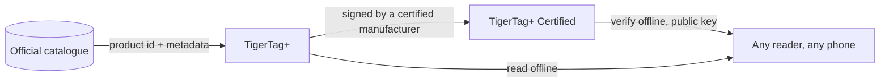

# TigerTag+ Certified

## Doel

**Certified is het niveau dat kan bewijzen waar een chip vandaan komt.** Een
[TigerTag+](./tigertag-plus.md) die bovendien een **cryptografische
handtekening** draagt, is een **TigerTag+ Certified**. De handtekening wordt gezet door een
fabrikant met [TigerTag+-certificering](../developers/README.md), die daarbij
de ondertekeningstools krijgt; TigerTag beheert de privésleutel.

Het is het enige van de drie niveaus dat niet voor iedereen openstaat, en het enige
dat een vraag beantwoordt die de andere twee niet kunnen: *is deze spoel echt?*

## De drie niveaus naast elkaar

| | TigerTag | TigerTag+ | TigerTag+ Certified |
|---|---|---|---|
| Printgegevens, **op de chip** | ✅ | ✅ | ✅ |
| Werkt volledig offline | ✅ | ✅ | ✅ |
| Product-ID uit de catalogus, **op de chip** | — | ✅ | ✅ |
| Verrijkingsmetadata, **via de Web API, optioneel** | — | ✅ | ✅ |
| Herkomsthandtekening, **op de chip** | — | — | ✅ |
| Wie er een kan maken | iedereen | iedereen | **een gecertificeerde fabrikant** |

Lees de linkerkolom zorgvuldig: de verrijkingsmetadata is de enige rij die
**niet** op de chip staat. Ze wordt uit de catalogus opgehaald wanneer je toevallig
online bent, en kan verbeteren nadat de chip is geschreven — en precies daarom kan ze nooit
iets zijn wat de chip nodig heeft. Alles wat de printer
nodig heeft staat in de rijen met *op de chip*, en dat houdt alle drie de
niveaus 100 % offline.

## Verifiëren is gratis — uitgeven is wat certificering toekent

Een handtekening **verifiëren** is gratis, offline en onbeperkt: de publieke sleutels
zijn gepubliceerd en elke lezer kan er een controleren zonder account of netwerk.
Er een **uitgeven** is wat certificering toekent.

Het ondertekende bericht omvat bewust de **eigen UID** van de chip, zodat een ondertekende
payload die naar een andere chip is gekopieerd er niet meer mee overeenkomt: een gekloonde tag
faalt bij de verificatie, op de eigen telefoon van de klant. Dezelfde eigenschap is de reden dat de twee
chips van één spoel twee *verschillende* handtekeningen dragen
([hoe de twee chips aan elkaar gekoppeld zijn](../concepts/tigertag-chip.md)).

## Waar het past

De indeling op bytemiveau — type-id’s van chips, het handtekeninggebied van 64 bytes op pagina’s
`0x18`–`0x27` — staat gespecificeerd in
[TigerTag-RFID-Guide](https://github.com/TigerTag-Project/TigerTag-RFID-Guide).

## Wie is gecertificeerd

De gezaghebbende lijst van fabrikanten die het merkteken op een product mogen zetten is
het [register van gecertificeerde partners](../certified-partners.md). Het TigerTag-logo
of de naam op een chip van welk formaat dan ook, een drager, een spoel of de verpakking is alleen
toegestaan voor de makers op die pagina.

---

**◀ Vorige:** [TigerTag+](./tigertag-plus.md) · **▲ [Documentatie-index](../../README.md)** · **Volgende ▶** [Tiger NFC Connect](./tigertag-connect.md)

**Zie ook:** [De TigerTag-chip](../concepts/tigertag-chip.md), [Gecertificeerde partners](../certified-partners.md), [Documentatie voor ontwikkelaars](../developers/README.md)
