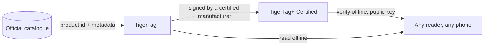

# TigerTag+

## Doel

**De `+` betekent geïdentificeerd.** Een TigerTag+ is een TigerTag waarvan de identiteit een
**product-ID uit de officiële catalogus** draagt — geen waarden die iemand heeft getypt, maar het
exacte product: merk, kleur, materiaal, temperaturen, diameter, SKU, EAN,
rechtstreeks van de bron. Daarbovenop kan hij **optionele verrijkingsmetadata**
dragen, aangeboden door de Web API en te verbeteren nadat de chip is geschreven.

De chip zelf blijft **100 % offline**. Alles wat nodig is om te printen staat erop,
precies als op een standaard TigerTag — de catalogus-ID voegt de mogelijkheid toe om
rijkere, actuelere gegevens op te zoeken *wanneer je toevallig online bent*, en neemt niets weg
wanneer je dat niet bent. Een TigerTag+ die in vliegtuigmodus wordt gelezen, gedraagt zich als elke andere
TigerTag.

En *“online”* is ook geen vereiste. De hele referentie wordt gepubliceerd als
één bestand — elke id van elk filament in de database, vrij te kopiëren
en te spiegelen — dus een lezer die het heeft, lost een catalogus-ID op zonder enig
netwerk. Zie [de Web API](../developers/web-api.md).

Dit is dezelfde `+` als in [TigerData+](../concepts/universal-filament-identity.md):
in beide gevallen betekent het *deze identiteit is een echt catalogusproduct*, en in
geen van beide betekent het *gecertificeerd*.

> **Opmerking over de naam:** eerder verkocht als **“TigerTag Pro”** — de naam is nu
> **TigerTag+**.

## Wat de `+` toevoegt

| | TigerTag | TigerTag+ |
|---|---|---|
| Printgegevens, **op de chip** | ✅ | ✅ |
| Werkt volledig offline | ✅ | ✅ |
| Product-ID uit de catalogus, **op de chip** | — | ✅ |
| Verrijkingsmetadata, **via de Web API, optioneel** | — | ✅ |
| Wie er een kan maken | iedereen | iedereen |

De verrijkingsmetadata is de enige rij die **niet** op de chip staat. Ze
wordt uit de catalogus opgehaald wanneer je toevallig online bent, en kan
verbeteren nadat de chip is geschreven — en precies daarom kan ze nooit
iets zijn wat de chip nodig heeft. Alles wat de printer nodig heeft staat op de chip, en dat
houdt elk niveau 100 % offline.

## De ondertekende variant

Een TigerTag+ die bovendien een cryptografische handtekening draagt, is een
**[TigerTag+ Certified](./tigertag-plus-certified.md)** — het niveau dat de
herkomst van een spoel kan bewijzen, en het enige dat beperkt is tot gecertificeerde
fabrikanten. Een handtekening verifiëren blijft voor iedereen gratis en offline.

## Waar het past

## Een chip back-uppen — een aparte functie

Tiger Studio kan de **exacte inhoud van een chip back-uppen** in je account, gekoppeld aan
zijn fysieke UID, en hem later weer in die staat herprogrammeren. Dat is nuttig en
staat los van de `+`: het geldt voor elke chip die je kunt scannen, en een back-up
maakt van een chip geen TigerTag+.

- **Herstel naar fabrieksstaat**: als een chip per ongeluk wordt herschreven of beschadigd raakt,
 zet je hem precies terug zoals hij was — handtekening inbegrepen, als hij die had.
- **Alleen dezelfde chip**: het herstel is geldig op de oorspronkelijke chip, omdat de
 back-up aan zijn UID is gekoppeld. Een vangnet voor *die* chip, nooit een manier om te klonen.
- **Bewijs van bezit**: een scan die met de back-up overeenkomt, toont dat de oorspronkelijke chip
 fysiek in jouw handen is.

> **Let op:** een back-up maken vereist momenteel **Tiger Studio + een USB-lezer
> (TigerPOD / ACR122U)**; ondersteuning op mobiel is gepland.

## Interacties

| Met | Hoe |
|---|---|
| Tiger Studio + TigerPOD/ACR122U | Leest en verifieert handtekeningen; maakt en herstelt chipback-ups |
| Tiger NFC Connect | Leest en verifieert; ondersteuning voor back-ups volgt |
| SDK’s | `tigertag[verify]` controleert een handtekening offline, in Python of JS |
| Firebase (accountdatabase) | Bevat de catalogus, de verrijkingsmetadata en chipback-ups per account |

## Links

- Officiële chips: **[tigertag.io](https://tigertag.io)** (winkel)

---

**◀ Vorige:** [TigerTag](./tigertag.md) · **▲ [Documentatie-index](../../README.md)** · **Volgende ▶** [TigerTag+ Certified](./tigertag-plus-certified.md)

**Zie ook:** [Universele filamentidentiteit](../concepts/universal-filament-identity.md), [De TigerTag-chip](../concepts/tigertag-chip.md), [Documentatie voor ontwikkelaars](../developers/README.md)
