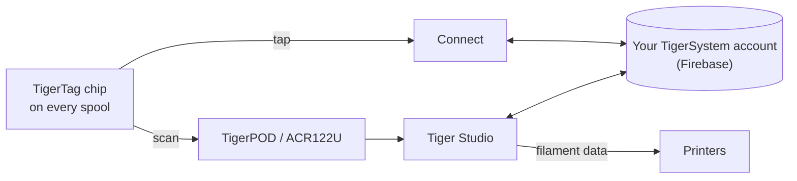

# TigerTag

## Doel

**TigerTag geeft elke spoel een eigen geheugen.** Een kleine NFC-chip bevat
alles over het filament — merk, materiaal, kleur, hoe het geprint wil worden — zodat je
nooit hoeft te gokken, te labelen of te onthouden. Tik hem aan met je
telefoon en de spoel vertelt het zelf.

<a class="ts-cta-primary" href="https://tigersystem.io/tigertag">Wat is TigerTag — op tigersystem.io</a>

<a href="https://github.com/TigerTag-Project/TigerTag-RFID-Guide"> De open chipspecificatie</a>

Technisch gezien is het het hart van het ecosysteem: een open RFID-standaard, leesbaar
door elke compatibele app of lezer — geen vendor lock-in, geen geheim formaat.

## Waar het past

## Functies

- Standaard **NTAG213 / 215 / 216**-chip (rond van 25 mm aanbevolen), open NDEF-payload van
 144 bytes — zo gedimensioneerd dat hij in de kleinste NTAG213 past; geen sleutels, geen lock-in.
- **Twee chips per spoel, aan tegenoverliggende zijden** — er kijkt er altijd een naar de lezer
 (printerslot, AMS, telefoon in de hand) en elk dient als back-up voor de ander
 ([waarom](../concepts/tigertag-chip.md)).
- Identiteit opgelost tegen de gedeelde [referentiedatabase](../concepts/universal-filament-identity.md).
- Beschrijfbaar en **herschrijfbaar** — maakt de [workflow voor een tweede leven](../philosophy/second-life.md) mogelijk;
 officiële chips met opdruk worden als NTAG215 geleverd, zodat de chip zelf als gewoon
 NDEF-object kan worden hergebruikt (sleutelhanger, visitekaartje…) zodra de spoel leeg is —
 nooit e-waste.
- Leesbaar met elke NFC-smartphone, ACR122U-lezers en [TigerPOD](./tigerpod.md).
- Een gereserveerd **gebied van 64 bytes** (pagina’s `0x18`–`0x27`, waarmee 80 bytes aan gegevens overblijven):
 vrij voor **communityfuncties als add-on** op een standaard TigerTag; bevat de
 herkomsthandtekening — 32 bytes `R`, 32 `S` — op een
 [TigerTag+](./tigertag-plus.md).

## Architectuur

Zie [De TigerTag-chip](../concepts/tigertag-chip.md) voor de samenvatting van het formaat en
[TigerTag-RFID-Guide](https://github.com/TigerTag-Project/TigerTag-RFID-Guide)
voor de canonieke specificatie op bytemiveau.

## Interacties

| Met | Hoe |
|---|---|
| Tiger NFC Connect | NFC-tik: lezen, coderen |
| Tiger Studio | Lezerscan opent de spoel automatisch; begeleide chip-update |
| SDK’s | Parsen / verifiëren / coderen vanuit JS of Python |
| Printers | Indirect — via de [smartphonebrug](../philosophy/smartphone-bridge.md) en de printerkoppelingen van Studio |

## In beeld

> **Opmerking over de naam:** standaardchips werden eerder verkocht als **“TigerTag Maker”**
> — de naam is nu gewoon **TigerTag**.

## De officiële chips, en die van alle anderen

**TigerSystem produceert de officiële chips** en zet er het TigerTag-logo op.
Ze komen in twee vormfactoren, en beide worden **blanco** geleverd:

| Vormfactor | Voor |
|---|---|
| **Sticker** | elke spoel die je al hebt — een aan elke kant ([waarom twee](../concepts/tigertag-chip.md)) |
| **Refilldrager** | filament-[refills](../philosophy/second-life.md) met een kartonnen kern: een drager draagt al **beide chips**, hij zit in de kern voordat de refill op een herbruikbare masterspoel gaat, zodat de chip met het filament meereist en niet met de haspel |

Wie wat mag zeggen wanneer een chip te koop is:

| Wie | Wat ze verkopen | Mag het noemen | Logo |
|---|---|---|---|
| **TigerSystem** | de chips die het produceert | **officieel** — door ons gemaakt | ja — het brengt het merkteken aan |
| **Elke wederverkoper of distributeur** | diezelfde echte chips | **officieel** — de goederen zijn het | ja — het merkteken staat er al op |
| **Een derde partij die TigerSystem heeft geauditeerd** | alles wat het bouwde — chips, inlays, dragers, een apparaat, een app | **gecertificeerd** — verleend, geauditeerd, vermeld, intrekbaar | ja, op het product |
| **Iedereen die een eigen chip maakt** | hun eigen compatibele chip | *“compatible with TigerTag”* — en met **TigerTag+** als hij handtekeningen verifieert. Nooit *“certified”*, dat verleent alleen TigerSystem | in hun app, documentatie en winkelvermelding; *“Compatible with TigerTag”* als gewone tekst op de doos van een compatibel apparaat — **nooit het logo of de naam op de chip (elk formaat), drager, spoel of verpakking** |

Dat laatste onderscheid is het hele merkenbeleid, en het is smaller dan het
lijkt. Zeggen dat je product met TigerTag *praat* is een feit over je product,
en daarvoor het logo tonen is gratis. Het merkteken — logo of naam —
**op** een chip van welk formaat dan ook zetten is een uitspraak over **wie hem maakte** — het houdt op te betekenen “dit werkt met TigerTag”
en gaat betekenen “dit *is* een TigerTag”. Alleen dat tweede gebruik heeft schriftelijke
toestemming nodig. Zie [TRADEMARK.md](../../TRADEMARK.md).

Er zijn meer dan **2,5 miljoen TigerTag-chips** geproduceerd — de meeste
in de fabriek geïntegreerd door filamentmerken (Rosa3D, eSun, Sunlu, Landu, Jamg He, R3D —
met Filforme, Nanovia en meer in integratie). Allemaal zijn het
[gecertificeerde partners](../certified-partners.md); die pagina is het register, en
de enige gezaghebbende manier om te controleren of een merkteken op een doos legitiem is.

|| | |
|---|---|---|
|  |  |  |

|| | | |
|---|---|---|---|
|  |  |  |  |

*De dozen en de spoelen erin — gekocht in een winkel, niet in scène gezet voor een
foto. Zo ziet “meest ingezet” eruit.* Maar het protocol is bewust
**niet gebonden aan officiële chips**: elke goedkope, blanco NTAG-chip die overal is gekocht
(Amazon, AliExpress, lokaal) werkt identiek, en niets blokkeert dat. Chips met opdruk
helpen het R&D te steunen; adoptie van het protocol is de eerste
beloning. Andere manieren om te helpen — ook de manieren die niets kosten — staan op
[Het project steunen](../support.md).

De vrijheid werkt twee kanten op: **chips zijn nooit schrijfvergrendeld**. TigerTag is
gewoon het basisprotocol waarmee filamentfabrieken spoelen leveren — als je liever een
ander NFC/RFID-protocol hebt (eigen of bestaand), kun je de chip herschrijven en
zijn gegevens ernaartoe migreren. Jouw spoel, jouw chip, jouw formaat.

## Waar ze te koop zijn

Beide vormfactoren worden **blanco** geleverd en worden verkocht door TigerSystem en door zijn
wederverkopers:

| | **Sticker** | **Refilldrager** |
|---|---|---|
| Wat je krijgt | ronde zelfklevende chips van 25 mm — **twee per spoel**, een aan elke kant | één drager = **twee chips die al gekoppeld zijn**, een per gevouwen uiteinde, voor de kartonnen kern |
| Voor | elke spoel met flenzen | filamentrefills gemonteerd op een masterspoel |
| Officiële winkel | [tigertag.io](https://shop.tigertag.io/collections/tigertag-rfid-maker) | [tigertag.io](https://shop.tigertag.io/collections/tigertag-rfid-maker) |
| Wederverkoper (FR) | [TigerTag Officiel, Atome3D](https://www.atome3d.com/products/tigertag) | [TigerTag Refill Officiel, Atome3D](https://www.atome3d.com/products/tigertag-pro-for-refill-1000-pcs) |

Beide zijn er in meerdere verpakkingsgroottes, tot professionele hoeveelheden. En niets daarvan
is vereist: **elke blanco NTAG-chip die overal is gekocht werkt identiek** — officiële
kopen financiert het protocol, verder niets.

## Links

- Officiële chips: **[tigertag.io](https://tigertag.io)** (winkel — steunt het R&D)
- Chipformaat: [TigerTag-RFID-Guide](https://github.com/TigerTag-Project/TigerTag-RFID-Guide)

---

**◀ Vorige:** [Producten](./README.md) · **▲ [Documentatie-index](../../README.md)** · **Volgende ▶** [TigerTag+](./tigertag-plus.md)

**Zie ook:** [Universele filamentidentiteit](../concepts/universal-filament-identity.md), [Tweede leven](../philosophy/second-life.md)
