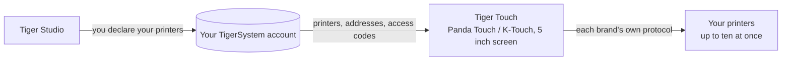

# Tiger Touch

**Je Panda Touch ligt in een la. Geef hem elke printer die je hebt.** Een gratis,
open-source firmware die de BIGTREETECH Panda Touch en K-Touch verandert in één
live touchscreen voor al je 3D-printers — geen solderen, geen computer.

*Twee live printerkaarten op één scherm: een FlashForge AD5X en een Bambu Lab X1C.*

<a class="ts-cta-primary" href="https://tigertag-project.github.io/Tiger-Touch/">Installeer vanuit je browser</a>

<a href="https://github.com/TigerTag-Project/Tiger-Touch"> Bronnen</a>

BIGTREETECH verkoopt één klein touchscreen van 5″ onder twee namen: de **Panda Touch**,
gemaakt voor Bambu Lab-printers, en de **K-Touch**, gemaakt voor Klipper-printers. Hetzelfde
bord, twee firmwares, elk gebonden aan één familie machines. Verander van printer, en
het scherm gaat de la in.

**Tiger Touch is een nieuwe firmware voor datzelfde scherm**, van de grond af geschreven. Hij
logt in op je gratis TigerTag-account, vindt elke printer die je daar hebt opgegeven,
en praat tegelijk met elk ervan rechtstreeks, via zijn eigen protocol. Als je
een Panda Touch of K-Touch hebt die niet meer bij je printers past, is dit de
hardware waarvoor Tiger Touch is gemaakt.

Open source onder **MIT**. Niets te solderen, niets te printen, geen Raspberry Pi,
geen server ertussen: je steekt het scherm in een USB-poort, drukt in je
browser op **Install**, en twee minuten later toont het je printers.

## Wat het doet

- **Elk merk op één scherm** — Bambu Lab, Creality, Elegoo, Anycubic,
  Snapmaker, FlashForge, Prusa, plus elke Klipper- (Moonraker) of OctoPrint-machine.
- **Cloud en LAN** — Bambu Lab via de Bambu-cloud of in LAN-modus, Anycubic
  via de Anycubic-cloud of op het LAN, de rest op je lokale netwerk.
- **Live, allemaal** — status, voortgang, bestand, resterende tijd en eindtijd,
  nozzles, bed, kamer en filamenteenheden (AMS, CFS, Station, ACE, MMU / AFC-banen),
  met tot **tien printers** tegelijk gevolgd.
- **Veilige bediening** — pauze, hervatten, stoppen (1,5 s ingedrukt houden, zodat een
  verdwaalde vinger nooit een print beëindigt) en het licht van de printer. **Er wordt nooit iets anders verstuurd**: geen
  verwarmen, geen bewegen, geen print starten.
- **Werkt zichzelf bij** — nieuwe versies komen via wifi binnen, voor de installatie geverifieerd,
  en worden vanzelf teruggedraaid als ze niet starten.
- **Elf talen** — Engels, Frans, Duits, Spaans, Italiaans, Chinees,
  Portugees (Brazilië en Portugal), Pools, Russisch, Nederlands.

<figure>

<figcaption><strong>Kaarten</strong>: één live kaart per printer, schuif voor meer.</figcaption>
</figure>
<figure>

<figcaption><strong>Lijst</strong>: elke printer in één oogopslag. Eén tik wisselt van weergave.</figcaption>
</figure>
<figure>

<figcaption><strong>Snapmaker U1</strong>: vier toolheads, de actieve omcirkeld.</figcaption>
</figure>
<figure>

<figcaption><strong>FlashForge AD5X</strong>: externe spoel en materiaalstation.</figcaption>
</figure>

## Waar het past

## Wat er eerst moet bestaan

Tiger Touch leest je printers **uit je TigerSystem-account**, dus hij vraagt nooit
om een adres of toegangscode op een scherm van 5″. Maak het account aan en voeg
je printers toe in de **desktop**-versie van [Tiger Studio](./tiger-studio.md) (Windows,
macOS, Linux), die ze op je netwerk vindt — de webversie kan geen
printers toevoegen.

> **Kort gezegd:** Tiger Studio → maak een account → voeg je printers toe →
> *dan* stel je het scherm in.

## Welke printers

Tiger Touch kiest de verbinding op basis van het **merk**, niet het model: elke printer
van deze families die Tiger Studio kan toevoegen, kan Tiger Touch tonen. De catalogus van Tiger Studio
telt meer dan 400 modellen van ongeveer 60 makers.

| Merk | Verbinding | Gezien op een echte machine |
|---|---|---|
| [Bambu Lab](../compatibility/bambu-lab.md) (X1, P1, P2S, A1, H2…) | Bambu-cloud, of LAN (MQTT over TLS) | **Ja** — printend via de cloud (P2S), inactief in LAN-modus (X1C, A1) |
| [Creality](../compatibility/creality.md) (K2, K1, Hi, Ender-3 V4…) | WebSocket op het LAN | **Ja** — printend (K2), inactief met zijn CFS (Ender-3 V4) |
| [Snapmaker](../compatibility/snapmaker.md) U1 | Moonraker-WebSocket | **Ja** — inactief, vier toolheads |
| [FlashForge](../compatibility/flashforge.md) (AD5X, Adventurer 5M, Creator 5, Creator 5 Pro) | HTTP op het LAN | **Ja** — AD5X: pauze, stop en het licht |
| [Anycubic](../compatibility/anycubic.md) (Kobra 3, Kobra X, Kobra S1…) | Anycubic-cloud, of LAN (MQTT over TLS) | **Ja** — via de cloud (Kobra X), met zijn ACE: het licht, pauze, hervatten en stop |
| [Elegoo](../compatibility/elegoo.md) Centauri Carbon 1 en 2 | MQTT (CC2), SDCP (CC1) | **Ja** — Centauri Carbon 2 en Centauri Carbon: pauze, hervatten, stop, en het licht op de CC2 |
| **Prusa** (MK4, Core One, XL, MINI) | PrusaLink | **Ja** — voortgang, temperaturen, pauze, hervatten, stop |
| [Klipper](../compatibility/klipper.md) — Voron, Qidi, Sovol, RatRig… | Moonraker-HTTP | **Ja** — op een echte Klipper-printer: pauze, hervatten, stop en het licht |
| **OctoPrint** — elke Marlin-printer erachter | OctoPrint REST-API | Alleen tegen de testprinter van Tiger Studio |

OctoPrint heeft tot nu toe alleen de testprinter van Tiger Studio ontmoet, en elk merk heeft
modellen die nog niemand heeft geprobeerd: **een melding vanaf jouw printer is het nuttigste
wat je kunt sturen.** Pauze, hervatten en stop werken overal waar de verbinding
opdrachten aanneemt (niet via de Bambu-cloud); het licht werkt overal behalve bij Prusa,
OctoPrint en de Centauri Carbon 1. Elk merk heeft een eigen pagina, met installatie
en vragen, op de [installatiesite](https://tigertag-project.github.io/Tiger-Touch/).
Elk veld en elke test staat in de
[status per merk](https://github.com/TigerTag-Project/Tiger-Touch/blob/main/docs/PRINTER-COMPATIBILITY.md).

**Staat een printer op “offline”?** Controleer eerst zijn LAN-modus: die staat standaard uit bij
Creality, FlashForge en Bambu Lab.

## Eén scherm, elk merk

De firmwares waarmee het scherm wordt geleverd kennen elk **één** familie printers.

| | **Tiger Touch** | Firmware van de Panda Touch | Firmware van de K-Touch |
|---|---|---|---|
| Printerfamilies op één scherm | **9** | 1 (Bambu Lab) | 1 (Klipper) |
| Printers tegelijk live | **tot 10**, allemaal tegelijk bijgewerkt | meerdere Bambu Lab, wordt trager vanaf ongeveer 3 in ons gebruik | **1** tegelijk (50 opgeslagen, wissel ertussen) |
| Printers ingesteld | vanuit je TigerTag-account, niets getypt op het scherm | IP, serienummer, toegangscode | IP en poort, of een scan |
| Updates via OTA | Ja, geverifieerd, met automatisch terugdraaien | Nee | Nee |

De firmwares van BIGTREETECH geven volledige controle over hun ene familie — prints starten,
temperaturen, bewegingen — wat Tiger Touch bewust niet doet. Je kunt er
op elk moment naar terug.

*De kolommen over de Panda Touch en K-Touch komen uit de eigen wiki van BIGTREETECH (gelezen
2026-10-16); “wordt trager vanaf ongeveer 3” is de eigen ervaring van het TigerTag-team, geen
cijfer van BIGTREETECH.*

## Installeren in twee minuten

1. **Geef je printers op** in Tiger Studio, zoals hierboven.
2. **Flash het scherm vanuit je browser.** Open
   **<https://tigertag-project.github.io/Tiger-Touch/>** in **Chrome of Edge** op
   een computer (WebSerial: niet Safari, niet Firefox, geen telefoon), sluit het scherm
   aan met een USB-C-**datakabel**, druk op **Install** en kies de poort. Als je
   de firmware van BIGTREETECH vervangt: vink **Erase device** aan. Een Tiger Touch via
   USB bijwerken: laat het uitgevinkt, je wifi en account blijven behouden.
3. **Volg het scherm.** Taal, wifi, dan je TigerTag-account — e-mail
   en wachtwoord, of **Continue with Google** met een QR-code die je telefoon scant. Zet de printers aan die je wilt volgen, en dat is alles. *Later* is
   altijd een antwoord: het scherm start meteen en verbindt op de achtergrond.

Daarna hoef je niets meer te doen: het scherm controleert eens per dag op een nieuwe versie
en installeert hem in twee tikken.

De eerste keer? De [installatiehandleiding](https://github.com/TigerTag-Project/Tiger-Touch/blob/main/docs/INSTALL.md)
behandelt de USB-driver (vereist op macOS), een kopie bewaren van de firmware van BIGTREETECH
zodat je terug kunt, en het ene vakje om aan te vinken.

## De hardware

De **BIGTREETECH Panda Touch** en **K-Touch** zijn ontworpen en gemaakt door
**BIGTREETECH** (BIQU): een IPS-touchscreen van 5″ 800×480 rond een ESP32-S3 met 8 MB
PSRAM en 16 MB flash, wifi, USB-C en een batterij. Tiger Touch draait er
ongewijzigd op, en bouwt voort op de boardondersteuning die BIGTREETECH ervoor publiceerde onder
de MIT-licentie. De K-Touch is hetzelfde bord als de Panda Touch, dus dezelfde
image is ook voor hem bedoeld — maar Tiger Touch is tot nu toe alleen op een Panda Touch
gedraaid: een melding vanaf een K-Touch is welkom.

Tiger Touch is een onafhankelijk project, niet gemaakt of onderschreven door BIGTREETECH, BIQU,
of een van de hier genoemde printermakers.

Bouw hem zelf met ESP-IDF 5.5 — de stappen staan in de
[repository](https://github.com/TigerTag-Project/Tiger-Touch#build-it-yourself).

---

**▲ [Documentatie-index](../../README.md)** · **Zie ook:** [Tiger Studio](./tiger-studio.md), [TigerSpool](./tigerspool.md), [Printercompatibiliteit](../compatibility/README.md)
