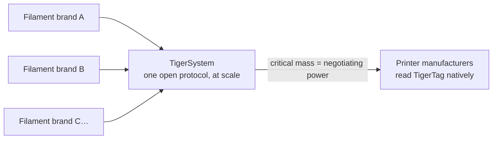

# Voor filamentfabrikanten

> **Maak je spoelen slim en verbonden.**

## De slimme spoel komt eraan — de enige open manier om het te doen is hier

Printers verwachten steeds vaker intelligent filament: systemen van AMS-klasse, materiaaldetectie
per slot, automatische instellingen. Elke printerfabrikant antwoordt met een
**gesloten tag, vergrendeld op zijn machines, die zijn cloud voedt** — nul
interoperabiliteit, nul waarde voor jouw merk buiten hun muren. En elke
vergrendelde tag dient een tweede doel: **je klanten sturen naar het eigen
filament van de printerfabrikant.** TigerTag is in 2023 juist gemaakt zodat
merken van derden een beter antwoord zouden hebben — spoelen die slimmer zijn dan de
propriëtaire, zonder de ommuurde tuin.

**TigerTag is het meest ingezette RFID-protocol van derden ter wereld** —
en vandaag de enige haalbare open slimme-spoeloplossing die op schaal wordt geleverd: een
open, standaard, agnostisch, platformonafhankelijk protocol met meer dan
**2,5 miljoen chips al geproduceerd** en in de fabriek geïntegreerd door merken
als Rosa3D, eSun, Sunlu, Landu, Jamg He en R3D — met Filforme en
Nanovia in integratie.

## Integratie in de fabriek: dagen, geen maanden

We hebben de ervaring en de technologie om TigerTag-chips **snel, eenvoudig en tegen zeer lage kosten** in je
productielijn te krijgen — **in slechts 5 dagen operationeel**, met **elke chip in ongeveer 1 seconde**
geschreven (duizenden spoelen per dag, met één klik):

- Standaard NTAG-hardware (geen propriëtaire componenten, geen lock-in op gereedschap),
 ingekocht op een schaal en tegen kosten die voor één niet-onderhandelbaar doel zijn gekozen: **de
 technologie toevoegen zonder één cent toe te voegen aan de prijs voor de eindgebruiker van de spoel.**
- Een beproefd integratiedraaiboek dat al in meerdere fabrieken is uitgerold,
 aangedreven door de industriële suite [TigerTag Factory & Manager](../products/factory-suite.md):
 aan de ene kant je filamentdatabase, aan de andere kant massaal schrijven op lijnsnelheid in elke spoel — met de **fabriekshandtekening
 die de herkomst van elk product bewijst**.
- De gedeelde referentiedatabase geeft je producten een precieze, universele
 identiteit die elke compatibele app identiek oplost.

Merken die TigerTags in hun producten leveren, mogen het merkteken **TigerTag
Certified** voeren — een zichtbaar signaal aan klanten dat de spoel slim en
open is.

> Neem contact op via **[tigertag@tigertag.io](mailto:tigertag@tigertag.io)** (of
> via de [GitHub-organisatie](https://github.com/TigerTag-Project)) om
> het gesprek te beginnen.

## Dank, integrators

De merken hieronder maakten de open spoel werkelijkheid — elk op zijn eigen niveau van
toewijding, en elk van hen verdient de eer. De niveaus zijn een
**ladder**: hoe verder een merk zich vastlegt, hoe prominenter het verschijnt —
hier en op elk oppervlak van het ecosysteem. De besten staan het hoogst.

### Platina — de top

**TigerTag+ over de hele productie**: elk spoelformaat, ondertekende chips
als standaard op elke spoel die de fabriek verlaat. Niets optioneel,
niets gedeeltelijk — de volledige open-spoelervaring, voor elke klant, standaard. Platina-integrators krijgen **overal de hoofdrol**: als eerste genoemd,
grootste logo, hun verhaal verteld.

**[Rosa3D](https://rosa3d.pl)** — de **wereldwijd eerste** integrator die
TigerTag+ over zijn hele productie zette. De referentie die alle anderen
najagen.

### Goud — toegewijd, op schaal

**Integratie op verzoek tijdens de productie**, met grote aantallen al
geproduceerd, een hoog integratieniveau en een **officiële publieke
toezegging**. Eén stap van de top: maak de ondertekende chips standaard
over de hele lijn, en sluit je aan bij Platina.

&nbsp;&nbsp;&nbsp;&nbsp;

**[R3D](https://r3dprint.com)** · **[eSun](https://www.esun3d.com)**

### Zilver — aan boord

**De technologie op verzoek geïntegreerd** — de eerste stap, al een echte:
hun klanten kunnen vandaag met TigerTag uitgeruste spoelen kopen. De volgende trede
is Goud: de volumes opschalen en de toezegging openbaar maken.

&nbsp;&nbsp;&nbsp;&nbsp;&nbsp;&nbsp;&nbsp;&nbsp;

**[Sunlu](https://www.sunlu.com)** · **[Landu](https://www.landustore.com)** · **[Jamg He](https://www.jamghe.com)**

…en meer in integratie —
[Filforme](https://www.filforme.com), [Nanovia](https://nanovia.tech), en
anderen onderweg.

**Wil je je logo op deze ladder — en groter?** Een productielijn draait
TigerTag in slechts 5 dagen:
[tigertag@tigertag.io](mailto:tigertag@tigertag.io).

## Ze kondigden het zelf aan

Openbare berichten op de eigen kanalen van de merken — niet ons persbericht
(bronnen en volledige aankondigingen:
[tigersystem.io/en/manufacturers](https://tigersystem.io/en/manufacturers)).
**Klik op een afbeelding om het originele bericht te openen:**

|| | |
|---|---|---|
|  |  |  |

> **ROSA 3D FILAMENTS** — *“heeft het open TigerTag-RFID-protocol officieel
> geïntegreerd in 100 % van onze filamentproductie.”* (*"officially integrated the open TigerTag RFID
> protocol across 100 % of our filament production."*) Meer dan 250 000
> spoelen al geproduceerd met TigerTag.
> ([oorspronkelijk bericht](https://www.instagram.com/p/DVyeOZajZSm/))

> **R3D Filament** — *“is officieel begonnen met de grootschalige uitrol van het open
> TigerTag-RFID-protocol in zijn filamentproductie in Europa.”* (*"officially begun large-scale deployment of the open
> TigerTag RFID protocol across its filament production in Europe."*)
> ([oorspronkelijk bericht](https://www.instagram.com/reel/DVoAMqTk5ck/))

> **eSUN** — *“heeft TigerTag-RFID-technologie officieel geïntegreerd!”* (*"officially integrated TigerTag RFID technology!"*) — pilot
> op de Franse markt, uitbreiding over Europa.
> ([oorspronkelijk bericht](https://www.instagram.com/p/DUjydNXkc1W/))

## Hoe de tags in je spoelen komen

<table>
<tr>
<td align="center" width="55%">
<strong>Voorkant</strong> 
 
<strong>Achterkant</strong> 

</td>
<td align="center">

</td>
</tr>
</table>

*Voorkant — de twee chips met opdruk, met het industriële 3M-plakmiddel
(468MP / 200MP) in het midden. Achterkant — de twee onafhankelijke NFC-antennes, een
per uiteinde. Aangebracht op de refill: één chip per kant, je operator trekt de folie los en
plakt — niets anders op de lijn verandert.*

## Al in de winkelschappen

|| | |
|---|---|---|
|  |  |  |

*Rosa3D, eSun, Sunlu — echte dozen, geleverd met TigerTag erin.*

|| | | |
|---|---|---|---|
|  |  |  |  |

*Het filament zelf: Rosa3D, eSUN, Sunlu, R3D — elk van deze wordt geleverd
met TigerTag-chips op de spoel.*

## Wat je klanten op dag één krijgen

Een spoel die zichzelf identificeert bij **elke NFC-telefoon**, een volledig inventaris-
ecosysteem (mobiel, desktop, web), live integratie met zes printermerken,
gewichtsregistratie, delen — een ervaring die **ver boven wat een gesloten
omgeving van één fabrikant biedt** uitstijgt, en die werkt met elke printer die je
klanten bezitten, niet alleen met die van één merk.

## Werk de gegevens bij, ook nadat ze je fabriek hebben verlaten

Een gedrukt etiket ligt vast vanaf de dag dat het gedrukt is. Een TigerTag-spoel niet:
omdat chips hun identiteit oplossen tegen de **gedeelde referentie-
database**, kun je de gegevens van een product verfijnen of corrigeren — instellingen,
beschrijvingen, beeldmateriaal — **zelfs voor spoelen die al verkocht zijn en bij je
klanten thuis liggen**. TigerTag is de enige technologie op deze markt die
de gegevens van je product bijwerkbaar houdt nadat het de fabriek heeft verlaten.

## Het collectieve spel

Elk filamentmerk dat zich bij TigerSystem aansluit, versterkt alle andere:

Alleen kan geen filamentmerk printerfabrikanten overtuigen zijn tags te lezen.
**Samen, achter één open protocol, kunnen wij dat wel.** En de vraag is klein: een
printerfabrikant kan TigerTag-lezen in **minder dan 3 dagen** aan zijn firmware toevoegen. Hoe meer merken TigerTag
leveren, hoe sterker het pleidooi voor native TigerTag-ondersteuning op firmwareniveau
in de printers zelf — en elke deelnemer profiteert van die
hefboom.

---

**▲ [Documentatie-index](../../README.md)** · **Zie ook:** [Waarom TigerSystem bestaat](./why-tigersystem.md), [Compatibiliteit](../compatibility/README.md), [FAQ — Fabrikanten](../faq/README.md)
