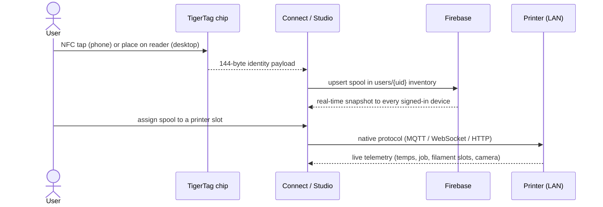
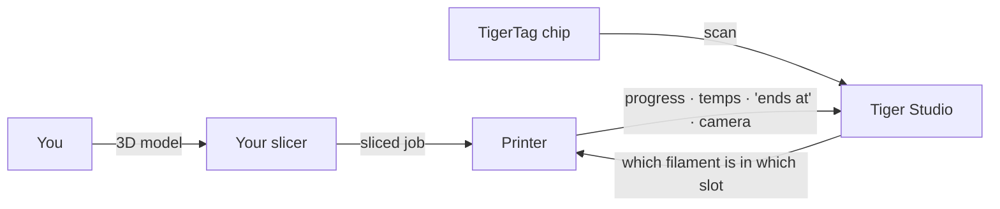

# Przepływ danych

## Od dotknięcia do wydruku

Pełna droga jednej szpuli przez system:

## Gdzie znajduje się każdy rodzaj danych

| Dane | Przechowywane w | Uwagi |
|---|---|---|
| Tożsamość szpuli | Chip + magazyn użytkownika w chmurze | Chip jest nadrzędnym źródłem do użytku offline |
| Baza referencyjna (marki, materiały…) | `cdn.tigertag.io` (ten sam projekt Firebase) | Dołączona do aplikacji, odświeżana z CDN |
| Obrazy szpul (w tym zdjęcia produktów TigerTag+) | `cdn.tigertag.io` (ten sam projekt Firebase) | Udostępniane wszystkim aplikacjom |
| Magazyn, regały, znajomi, preferencje | Firestore `users/{uid}/…` | Domyślnie tylko dla właściciela, egzekwowane regułami |
| Publiczne kody wyszukiwania | Firestore `publicKeys/{code}` | Wyszukiwanie znajomych w czasie O(1) |
| Dane logowania i telemetria drukarek | **Tylko lokalnie** (desktop) | Ruch LAN nigdy nie przechodzi przez chmurę |
| Waga na żywo (TigerScale) | Urządzenie → Firestore | Widoczna na żywo we wszystkich klientach |

## Miejsce twojego slicera

TigerSystem **nie zastępuje slicera** — uzupełnia obraz wokół niego:

- Tniesz model i uruchamiasz zadania dokładnie tak jak dotąd, dowolnym slicerem.
- Tiger Studio informuje drukarkę, **który filament jest w którym slocie**
 (AMS / CFS / Canvas / ACE / IFS), dzięki czemu informacje po stronie maszyny
 zgadzają się z rzeczywistością.
- Niezależnie od tego, co rozpoczęło wydruk, zadanie pojawia się na żywo
 w Tiger Studio — postęp, temperatury, czas zakończenia, kamera.
- Chip zawiera zalecane ustawienia druku filamentu; **obecnie nie ma
 automatycznego importu profili slicera** — ustawienia odtwarzasz w profilu
 slicera samodzielnie.

## Dwie płaszczyzny, celowo oddzielone

- **Płaszczyzna chmury** — tożsamość, magazyn, udostępnianie. Internet, Firebase,
 egzekwowane regułami.
- **Płaszczyzna LAN** — sterowanie drukarkami i kamery. Wyłącznie sieć lokalna,
 natywne protokoły producentów, zero zależności od chmury (aplikacja desktopowa
 nadal współpracuje z drukarkami, gdy jest offline).

> **Uwaga:** wyjątkiem jest **tryb chmury** Anycubic, w którym samo połączenie
> z drukarką przechodzi przez chmurowy MQTT producenta — zobacz
> [zgodność z Anycubic](../compatibility/anycubic.md).

---

**◀ Poprzednia:** [Przegląd architektury](./overview.md) · **▲ [Spis dokumentacji](../../README.md)** · **Następna ▶** [Produkty](../products/README.md)

**Zobacz też:** [Magazyn i synchronizacja z chmurą](../concepts/inventory-and-cloud-sync.md), [Zgodność](../compatibility/README.md)
