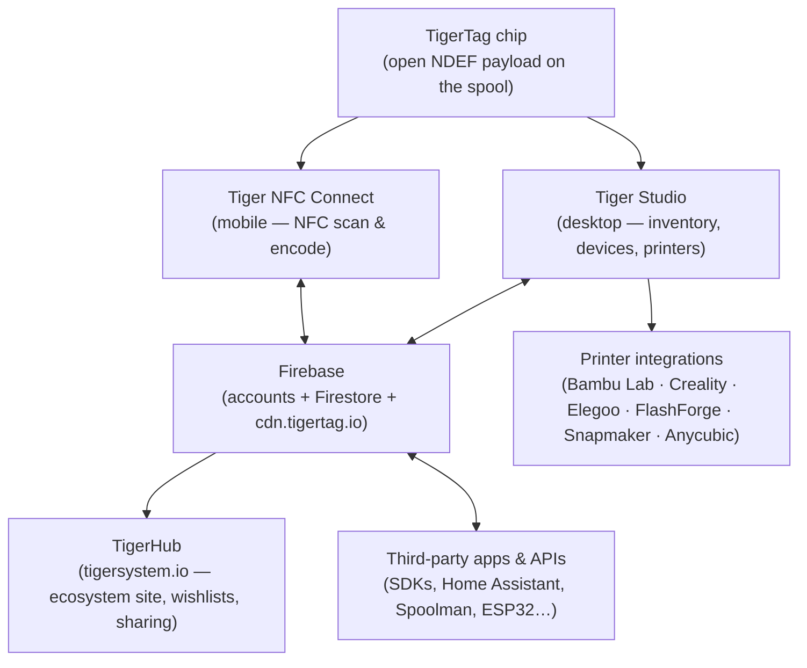
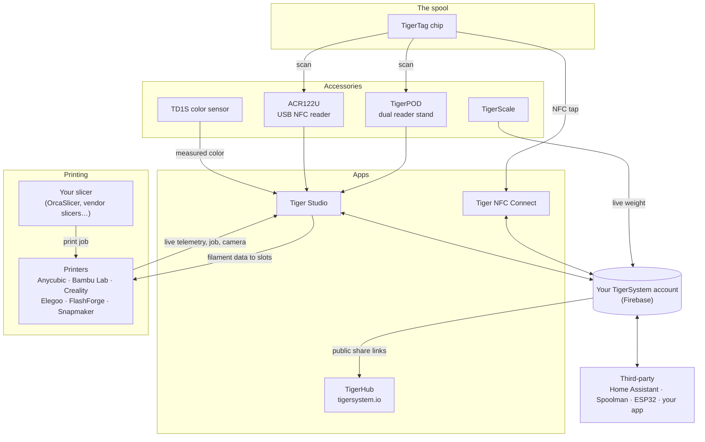

# Przegląd architektury

## Stos od góry do dołu

## Warstwy

| Warstwa | Rola | Dokumentacja źródłowa |
|---|---|---|
| **Chip TigerTag** | Przenośna, otwarta tożsamość fizycznej szpuli | [Format chipa](../concepts/tigertag-chip.md) |
| **Tiger NFC Connect** | Most ze smartfonem: skanowanie, kodowanie, przeglądanie | [Strona produktu](../products/tiger-nfc-connect.md) |
| **Firebase** | Jedna wspólna baza danych — konta, magazyn, synchronizacja; punkt interoperacyjności piaskownicy | [Magazyn i synchronizacja z chmurą](../concepts/inventory-and-cloud-sync.md) |
| **TigerHub** | Webowy dom ekosystemu: wizytówka, listy życzeń, znajomi, udostępnianie | [Strona produktu](../products/tigerhub.md) |
| **Tiger Studio** | Stanowisko desktopowe: magazyn, regały, czujniki, drukarki | [Strona produktu](../products/tiger-studio.md) |
| **Integracje drukarek** | Bezpośrednie połączenia LAN z sześcioma markami drukarek | [Zgodność](../compatibility/README.md) |
| **API firm trzecich** | SDK + udokumentowana powierzchnia Firestore dla każdego | [Dla deweloperów](../developers/README.md) |

## Pełna mapa — każdy element i jego połączenia

Akcesoria, aplikacje, chmura, drukarki, slicery i integracje firm trzecich
na jednym rysunku:

Czytaj od lewej do prawej: **chip** identyfikuje szpulę; **akcesoria**
rejestrują rzeczywistość (skany, wagę, kolor); **aplikacje** i **chmura**
utrzymują całość w synchronizacji; **drukarka** odbiera dane filamentu
i na bieżąco raportuje stan. Twój **slicer zachowuje swoje zadanie** —
TigerSystem nie tnie modeli, tylko dba o to, by wszyscy (ty, maszyna, aplikacje)
dokładnie wiedzieli, który filament jest gdzie.

## Zasady projektowe

1. **Chip jest samowystarczalny.** Szpula identyfikuje się bez chmury, bez
 konta, bez sieci — dane są kompletne i otwarte.
2. **Chmura należy do użytkownika, a nie do systemu.** Cały stan znajduje się
 pod kontem użytkownika; dostęp egzekwują reguły bezpieczeństwa po stronie
 serwera, a nie kod klienta.
3. **Każda warstwa jest opcjonalna.** Działa użycie wyłącznie z telefonem,
 wyłącznie z desktopem, wyłącznie z chipem lub wyłącznie przez API; komponenty
 dodają wartość, ale nigdy nie blokują się nawzajem.
4. **Integracje mówią natywnym protokołem drukarki.** Bez modyfikacji
 firmware'u, bez objazdów przez chmurę: Tiger Studio komunikuje się przez
 MQTT/WebSocket/HTTP bezpośrednio w sieci LAN
 (zobacz [przepływ danych](./data-flow.md)).

---

**◀ Poprzednia:** [Magazyn i synchronizacja z chmurą](../concepts/inventory-and-cloud-sync.md) · **▲ [Spis dokumentacji](../../README.md)** · **Następna ▶** [Przepływ danych](./data-flow.md)

**Zobacz też:** [Produkty](../products/README.md), [Dla deweloperów](../developers/README.md)
