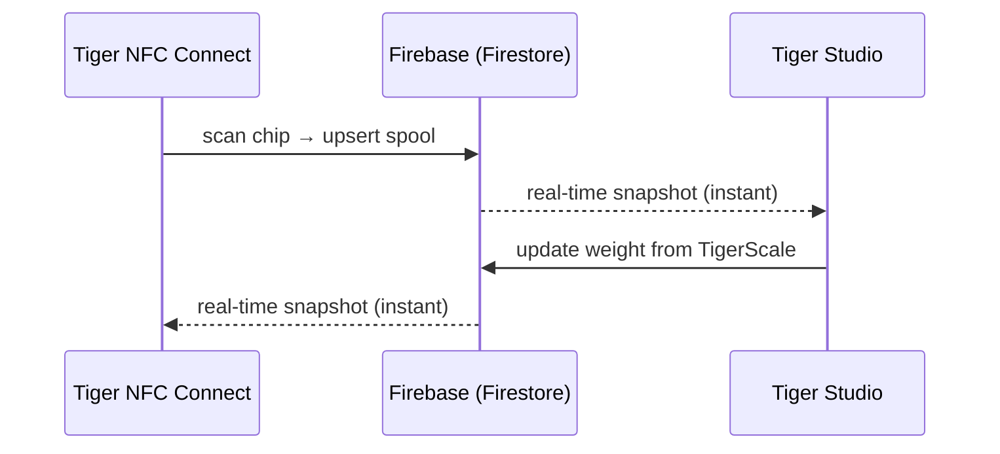

# Magazyn i synchronizacja z chmurą

## Jedno konto, każde urządzenie

Magazyn użytkownika znajduje się na **jego koncie TigerSystem**, opartym na
zwykłym **Firebase** (Auth + Firestore) — celowo niemarkowej infrastrukturze,
której zadanie jest proste: **jedna wspólna baza danych, w jednym miejscu**, aby
każdy element piaskownicy (desktop, mobilna, waga, web) współpracował na tych
samych danych. Każdy klient — mobilny, desktopowy, webowy — subskrybuje te same
dokumenty w czasie rzeczywistym:

Nie ma „przycisku synchronizacji”: zmiany propagują się dzięki nasłuchom na żywo
Firestore, a klienci utrzymują lokalną pamięć podręczną do odczytów offline.

## Co się synchronizuje

- **Magazyn** — jeden dokument na szpulę (tożsamość, waga, pojemnik, obraz…).
- **Regały** — fizyczne układy półek i rozmieszczenie szpul.
- **Znajomi i udostępnianie** — powiązania ze znajomymi, przychodzące zaproszenia, powiadomienia.
- **Preferencje** — język, ustawienia poszczególnych kont.
- **Kopie zapasowe chipów** — rekordy chipów [TigerTag+](../products/tigertag-plus.md).

Wiążący model danych, pole po polu, jest udokumentowany w
[repozytorium integracji Firebase](https://github.com/TigerTag-Project/TigerTag_Firebase_Integration)
(`docs/03-data-model.md`) — to punkt odniesienia dla integratorów zewnętrznych.

## Co opuszcza twoje stanowisko, a co zostaje

Ekosystem wszędzie powtarza, że chmura jest opcjonalna. Oto, co to faktycznie
oznacza i ile kosztuje odmowa.

**Identyfikacja jest lokalna z założenia.** Urządzenie nie pyta serwera, czym
jest tag. Tabele marek i materiałów leżą w jego własnej pamięci i są odświeżane
z **publicznego** [repozytorium referencyjnego](https://github.com/TigerTag-Project/TigerTag-RFID-Guide)
najwyżej raz dziennie. Wyszukanie nigdy więc nie czeka na sieć i działa przy
wyłączonym internecie.

**Bez konta tracisz dokładnie jedną rzecz: synchronizację między urządzeniami.**
[TigerScale](../products/tigerscale.md) nadal waży, nadal odczytuje tagi, nadal
rozpoznaje markę i materiał, nadal serwuje własny interfejs webowy w twoim LAN.
Nic w samym chipie nie wymaga nas — na tym polega cały sens zapisywania danych
[na chipie](./tigertag-chip.md).

**Z kontem — oto, co urządzenie faktycznie wysyła.** Na przykładzie wagi: przy
każdym zakończonym ważeniu i w cyklicznym sygnale życia zapisuje ona, w twoim
własnym dokumencie użytkownika: UID-y tagów szpuli, wagę netto/brutto/pojemnika,
wersję firmware'u, sygnał WiFi i IP, współczynnik kalibracji, czas ostatniego
sygnału życia, stan baterii i stan ekranu. Diagnostyka i pomiary — nic więcej.
Każde pole jest udokumentowane w
[własnej dokumentacji wagi](https://github.com/TigerTag-Project/Tiger-Scale-V3/blob/main/docs/TELEMETRY.md).

**A oto, co przechowuje lokalnie, co ma większe znaczenie.** Zalogowane
urządzenie trzyma token odświeżania, twój identyfikator użytkownika i dane
logowania do WiFi. Nigdy nie przechowuje hasła — logowanie wymienia je na
tokeny. Traktuj jednak skonfigurowane urządzenie jako **przechowujące
poświadczenie**: zanim je pożyczysz, sprzedasz lub oddasz, wyloguj je *i*
zapomnij WiFi. Zwykłe ponowne wgranie firmware'u nie czyści żadnego z nich — ta
pamięć jest zachowywana celowo, aby aktualizacja firmware'u nie kosztowała cię
konfiguracji.

**Dwa świadome wybory, które warto znać.** API LAN urządzenia jest
**nieuwierzytelnione**: każdy, kto jest już w twojej sieci, może odczytać jego
stan i wywołać tarowanie. To uproszczenie dla sieci domowej — umieść je w
gościnnej sieci VLAN, jeśli nie ufasz swojej. A klucz Firebase widoczny w kodzie
źródłowym to **publiczny identyfikator projektu**, nie sekret; każdy klient
Firebase go dostarcza, a kontrolę dostępu egzekwują reguły po stronie serwera
wobec zalogowanego użytkownika, nie ukrywanie ciągu znaków.

W przypadku wagi wszystko to jest w pełni udokumentowane w
[`docs/CLOUD.md`](https://github.com/TigerTag-Project/Tiger-Scale-V3/blob/main/docs/CLOUD.md),
który jest dokumentem wiążącym.

## Model udostępniania (podsumowanie)

- Każdy użytkownik ma publiczny **kod wyszukiwania** (`XXX-XXX`) do wyszukiwania
  znajomych w czasie O(1).
- Znajomość jest **dwukierunkowa i oparta na zgodzie**: zaproszenie → akceptacja;
 każda strona może ją usunąć. Dostęp do odczytu magazynu znajomego jest
 egzekwowany po stronie serwera regułami bezpieczeństwa Firestore — nigdy przez klienta.
- Magazyn można też oznaczyć jako **publiczny** albo udostępnić jako listę webową
 tylko do odczytu przez linki [TigerHub](../products/tigerhub.md).

## Model bezpieczeństwa (podsumowanie)

- Wszystkie dane poszczególnych użytkowników są domyślnie tylko dla właściciela;
 dostęp między użytkownikami zawsze wymaga wcześniejszej relacji (znajomość,
 zaproszenie), egzekwowanej regułami po stronie serwera.
- Konfiguracja projektu Firebase jest celowo publiczna (standardowy wzorzec);
 **bezpieczeństwo leży w regułach, a nie w tajemnicy**. Zobacz
 [API konta i integracje](../developers/account-api.md).

---

**◀ Poprzednia:** [Chip TigerTag](./tigertag-chip.md) · **▲ [Spis dokumentacji](../../README.md)** · **Następna ▶** [Przegląd architektury](../architecture/overview.md)

**Zobacz też:** [TigerHub](../products/tigerhub.md), [Dla deweloperów — API konta](../developers/account-api.md)
