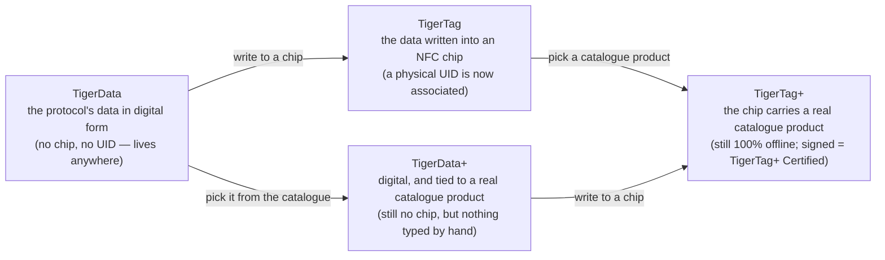

# Uniwersalna tożsamość filamentu

## Jedna tożsamość, czytelna wszędzie

Chip TigerTag nadaje szpuli **uniwersalną tożsamość**: jeden otwarty rekord
tego, czym filament *jest*, niezależny od tego, kto go wyprodukował, kto go
sprzedaje i która drukarka go stopi.

Tożsamość obejmuje (lista niewyczerpująca):

| Rodzina pól | Przykłady |
|---|---|
| **Marka** | dowolny producent filamentu, ze wspólnej listy referencyjnej |
| **Materiał / typ** | PLA, PETG, ABS, TPU… + podtyp |
| **Aspekt / kolor** | wartość koloru, wykończenie |
| **Geometria** | średnica (1,75 / 2,85 mm) |
| **Ustawienia druku** | zalecane temperatury |
| **Cykl życia** | waga, data produkcji |

## Wspólna baza referencyjna

Tożsamości nie są dowolnym tekstem: marki, materiały, aspekty, typy, średnice
i jednostki pochodzą ze **wspólnej bazy referencyjnej** udostępnianej pod
`cdn.tigertag.io` (hostowanej w tym samym projekcie Firebase co konta). Każda
aplikacja rozwiązuje te same identyfikatory do tego samego znaczenia, więc chip
zakodowany jednym narzędziem odczytuje się identycznie w każdym innym.

> **TODO:** podlinkować publiczny punkt przeglądania bazy / format zrzutu, gdy
> przewodnik RFID go udokumentuje. Dane referencyjne są dołączone do Tiger Studio
> (`assets/db/tigertag/`) i odświeżane z CDN.

## Jedna tożsamość, cztery stany

Tożsamość jest *rekordem*, a nie *chipem* — i przechodzi przez cztery stany:

- **TigerData** to protokół *przed* chipem: ta sama tożsamość przechowywana
 cyfrowo — w magazynie, bazie danych, pliku, gdziekolwiek. Protokół TigerTag
 może żyć całkowicie poza chipem RFID. Ta idea **wirtualnego chipa to
 innowacja TigerSystem — nie istnieje nigdzie indziej**: zarządzaj pełnym
 magazynem bez ani jednego chipa NFC, wyślij tożsamość do chipa później lub
 nigdy, a interoperacyjność protokołu zostaje zachowana w obu przypadkach.
- **TigerData+** to TigerData, które wie, *dokładnie jakim produktem jest*.
 Nadal bez chipa, nadal nic do kupienia — ale zamiast tego, co wpisał właściciel,
 niesie prawdziwy produkt z oficjalnego katalogu: dokładną markę, kolor,
 materiał, temperatury, średnicę, SKU i EAN, prosto ze źródła. Dostajesz je,
 wybierając produkt zamiast go opisywać.
 >To **nie jest** TigerTag+ i nigdy się za niego nie podaje: brak chipa, brak UID.
 >Znak `+` oznacza *zidentyfikowany*, a nie *certyfikowany*. Dla deweloperów: szpula
 >jest TigerData+, gdy jest bezchipowa **i** niesie prawdziwy identyfikator
 >produktu — ta para jest definicją i jest odzwierciedlona w rekordzie jako
 >`protocol: "TigerData+"`, abyś mógł ją odczytać bezpośrednio. Zobacz
 >[strukturę danych Firestore](https://github.com/TigerTag-Project/TigerTag_Firebase_Backend#-firestore-data-structure).
- W chwili, gdy te dane zostają **zapisane do chipa NFC**, stają się
 **TigerTag**: z tożsamością zostaje wreszcie **powiązany fizyczny UID**.
- Zapisz do tego chipa **produkt z katalogu** zamiast wartości wpisanych ręcznie,
 a będzie to [**TigerTag+**](../products/tigertag-plus.md) — ten sam `+` co w
 TigerData+, to samo znaczenie: *zidentyfikowany*. Podpisany przez certyfikowanego
 producenta staje się **TigerTag+ Certified**. W obu przypadkach chip pozostaje
 w 100 % odczytywalny offline.

TigerData może pozostać cyfrowe na zawsze albo zostać **atomowo awansowane do
prawdziwego chipa**, gdy będziesz gotów (Tiger Studio robi to jednym krokiem).
Wszystkie cztery stany podróżują też jako pliki:
[**format wymiany `.ttag`**](../developers/ttag-format.md) niesie jeden lub
więcej materiałów magazynowych — TigerData, TigerData+, TigerTag lub TigerTag+ —
na pendrive'ie, w e-mailu, między narzędziami.

## Promocja: od rekordu do chipa

*Promowanie* szpuli to przejście z lewej strony diagramu na prawą: istniejący
rekord TigerData lub TigerData+ zostaje zapisany na czystym chipie NTAG, a
szpula od tej pory sama niesie swoją tożsamość, offline.

To, co wychodzi, zależy wyłącznie od tego, co weszło:

| Promujesz… | Otrzymujesz… | Ponieważ |
|---|---|---|
| **TigerData** — wartości wybrane przez właściciela | **TigerTag** | z tożsamością powiązany jest teraz fizyczny UID |
| **TigerData+** — prawdziwy produkt z katalogu | **TigerTag+** | chip niesie teraz ID produktu z katalogu: *nadal zidentyfikowany, nadal niepodpisany* |

Ten drugi wiersz to całe słownictwo `+` w jednej linii. Promocja zmienia *stan*
— z cyfrowego na chip — i nigdy znaczenia `+`. Tylko podpis certyfikowanego
producenta czyni z chipa
[TigerTag+ Certified](../products/tigertag-plus.md), a żadna promocja go nie
wytwarza.

Promocja nie jest też drogą w jedną stronę. Chipy nigdy nie są blokowane przed
zapisem: promowany chip można wymazać z poziomu
[Tiger NFC Connect](../products/tigertag-connect.md) lub Tiger Studio i zapisać
ponownie ([chip TigerTag](./tigertag-chip.md)). Tożsamością jest rekord; chip to
tylko miejsce, w którym ona teraz mieszka.

---

**◀ Poprzednia:** [Przepływ pracy Second Life](../philosophy/second-life.md) · **▲ [Spis dokumentacji](../../README.md)** · **Następna ▶** [Chip TigerTag](./tigertag-chip.md)

**Zobacz też:** [Strona produktu TigerTag](../products/tigertag.md), [Magazyn i synchronizacja z chmurą](./inventory-and-cloud-sync.md)
