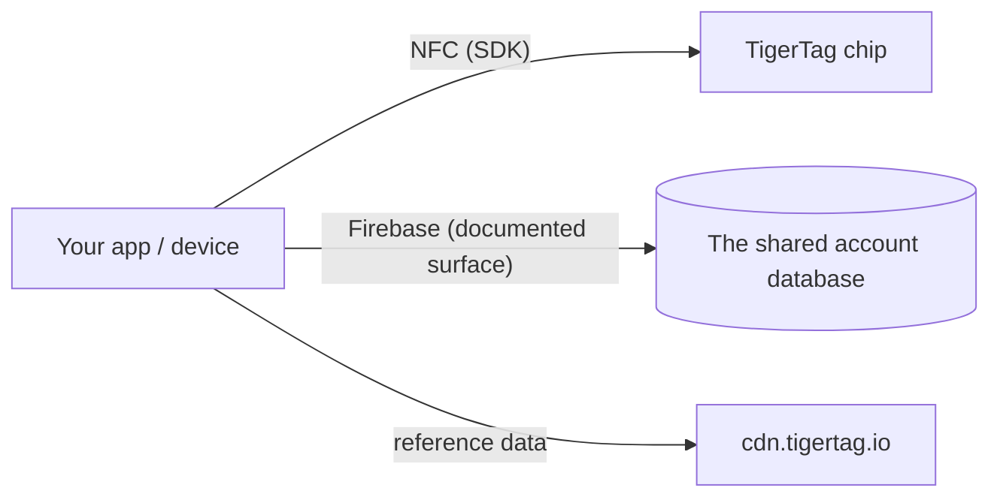

# Dokumentacja dla deweloperów

Buduj na TigerSystem: odczytuj chipy, komunikuj się z chmurą albo integruj
własny sprzęt i oprogramowanie. Niczego nie trzeba nikogo prosić — protokół jest otwarty.

## Co możesz zbudować?

Do odczytu TigerTag wystarczy **dowolny smartfon z NFC**, **czytnik USB
ACR122U** podłączony do komputera albo **urządzenie DIY — zwykłe ESP32 z modułem
czytnika PN532 lub RC522** (podejście używane przez TigerScale). Sprzęt ogólnodostępny,
bez własnościowych urządzeń. Z tego jednego skanu zintegrujesz wszędzie tam,
gdzie przydaje się tożsamość:

- **ERP / zarządzanie zapasami** — połącz tożsamość i ilości szpul z istniejącym
 systemem magazynowym firmy.
- **Śledzenie zużycia** — rejestruj, który materiał poszedł na jakie zadanie,
 maszynę lub zamówienie klienta.
- **Własne pulpity i automatyzacja** — monitorowanie farm druku, alerty o niskim
 stanie, wyzwalacze ponownego zamówienia.
- **Systemy wypożyczeń** — fablaby, szkoły, makerspace'y wydające i przyjmujące materiał.
- **Projekty badawczo-rozwojowe, prywatne lub publiczne** — otwarty, przepisywalny,
 udokumentowany nośnik tożsamości do eksperymentów.

Żadne z nich nie potrzebuje naszych aplikacji ani naszej chmury: wystarczy chip
+ SDK. [Powierzchnię konta](./account-api.md) dodaj tylko wtedy, gdy chcesz
kont i synchronizacji.

Zbuduj to, a będzie **TigerTag Compatible**: za darmo, na własną deklarację,
bez audytu i bez pozwolenia. Poddaj to audytowi, a może zostać **TigerTag
Certified** — otwarte dla wszystkiego, co zbuduje strona trzecia, sprzętu czy
oprogramowania, w dwóch zakresach (**TigerTag** i **TigerTag+**). Granica między
poziomami nie dotyczy tego, czym jest twój produkt, tylko tego, czy ktoś go
sprawdził. Compatible mówi *„działa”* na twoje słowo, Certified mówi *„przetestowaliśmy”*
na nasze
([kryteria](https://github.com/TigerTag-Project/TigerTag-RFID-Guide/blob/main/CERTIFICATION.md), skontaktuj się przez
[organizację GitHub](https://github.com/TigerTag-Project)).

Zarządzanie jest celowo dwustopniowe: **każdy** może zaimplementować protokół
i powiedzieć „zgodny z TigerTag” — bez pozwolenia, nigdy — oraz pokazać
niezmodyfikowane logo TigerTag, by to zaznaczyć: w swojej aplikacji,
dokumentacji, ofercie sklepu. To odniesienie jest darmowe. Tylko **certyfikowani
partnerzy** (wymienieni w rejestrze certyfikowanych) mogą umieścić znak — logo
**lub nazwę** — **na chipie dowolnego formatu (chip, inlay, naklejka, etykieta,
nośnik), szpuli lub jej opakowaniu**, gdzie przestaje on opisywać zgodność, a
zaczyna potwierdzać pochodzenie; tekstowe *„Compatible with TigerTag”* na pudełku
zgodnego czytnika, drukarki lub aplikacji pozostaje darmowe, i tylko oni mogą
wystawiać **podpisy TigerTag+** (klucz prywatny posiada TigerTag). Bramka znaku
towarowego jest marketingowa; bramka podpisu jest techniczna; **żadna nie ogranicza
protokołu ani jedną linijką** — niecertyfikowany chip działa doskonale, po prostu
nie potrafi udowodnić swojego pochodzenia.

Dwa szczegóły, które warto mieć dokładnie. Deklaracja zgodności obejmuje **także
poziom `+`**: weryfikacja podpisu TigerTag+ jest darmowa, offline i nieograniczona —
klucze publiczne są opublikowane — więc czytnik, który je sprawdza, może mówić
*„zgodny z TigerTag+”*. Nie wolno mu natomiast nazywać **tagu** TigerTag+, o ile
ten tag naprawdę nie niesie podpisu wystawionego przez TigerTag. A słowo
**„certyfikowany” nigdy nie jest nadawane samemu sobie**: przyznaje je
TigerSystem, nikt go sobie nie przypisuje.

To celowo model, którego używają Zigbee i Matter — darmowy poziom *Compatible*,
do którego każdy może wejść, oraz przyznawany poziom *Certified*, który coś
znaczy dla kupującego właśnie dlatego, że jest przyznawany. Pełna polityka,
poziomy certyfikacji i zasoby marki:
[TRADEMARK.md](https://github.com/TigerTag-Project/TigerTag-RFID-Guide/blob/main/TRADEMARK.md) i
[CERTIFICATION.md](https://github.com/TigerTag-Project/TigerTag-RFID-Guide/blob/main/CERTIFICATION.md).

## Zacznij tutaj

| Chcę… | Przeczytaj |
|---|---|
| Zobaczyć, kto już zbudował coś na TigerTag | [Integracje firm trzecich](./integrations.md) |
| Zrozumieć elementy | [Przegląd architektury](../architecture/overview.md) |
| Wiedzieć, które repozytorium za co odpowiada | [Repozytoria](./repositories.md) |
| Odczytywać/zapisywać chipy TigerTag | [SDK](./sdks.md) |
| Wymieniać magazyny jako pliki | [Format `.ttag`](./ttag-format.md) |
| Pokazywać kolor szpuli tak, jak robi to każda inna aplikacja | [Próbnik materiału](./material-swatch.md) — oraz jego [referencyjny renderer na żywo](./material-swatch-playground.html) |
| Nadać identyfikator szpuli bez chipa, wydrukować etykietę QR szpuli lub ją odczytać | [Identyfikatory szpul i linki QR](./spool-ids-and-qr-links.md) |
| Synchronizować z magazynem użytkownika w chmurze | [API konta i integracje](./account-api.md) |
| Zrozumieć ładunek chipa | [Chip TigerTag](../concepts/tigertag-chip.md) |

## Ścieżki integracji

1. **Tylko chip** — parsuj i koduj chipy za pomocą SDK. Bez konta, bez sieci.
2. **Połączenie z chmurą** — uwierzytelnij *własne konto użytkownika* i
 odczytuj/zapisuj jego dane w ramach reguł bezpieczeństwa po stronie serwera
 ([kontrakt integracji](./account-api.md)).
3. **Sprzęt** — istnieją działające przykłady dla ESP32/Arduino, Home Assistant
 i mostu do Spoolman (zobacz
 [przykłady w repozytorium integracji](https://github.com/TigerTag-Project/TigerTag_Firebase_Integration/tree/main/examples)).

## Konwencje

- **Wersjonowanie** — wydania produktów używają SemVer; ładunek chipa niesie
 własną wersję formatu dla zgodności wstecznej.
- **Nazewnictwo** — nazwy samoopisujące zamiast zakodowanych lub sprytnych; bez
 wielostanowych wartości magicznych.
- **Identyfikatory, nigdy etykiety** — każda logika zależna od wartości z tabel
 referencyjnych (`id_aspect`, `id_brand`, `id_material`, `id_type`,
 `id_diameter`, `id_measure_unit`, `id_version`…) porównuje jej **identyfikator
 liczbowy**, nigdy etykietę jako ciąg znaków. Etykieta to tekst do wyświetlania:
 jest tłumaczona, może zostać zmieniona lub poprawiona w bazie referencyjnej i
 brzmi inaczej w każdym języku — identyfikator nigdy się nie zmienia. Trzymaj
 identyfikator obok etykiety, nazywaj identyfikatory, według których
 rozgałęziasz (np. aspekt `Tricolor 24`, `Rainbow 145`, `Bicolor 252`), a
 etykiet używaj wyłącznie do wyświetlania.
- **Kolor** — kolor szpuli jest przechowywany jako dane, a nie jako obraz, więc
 każda powierzchnia musi zamienić te dane w ten sam obraz:
 [konwencja próbnika materiału](./material-swatch.md) jest normatywna i
 jest dostarczana z [renderem referencyjnym](./material-swatch-playground.html),
 względem którego możesz sprawdzić własną implementację.
- **Wkład** — każde repozytorium ma własny przewodnik; wkład w dokumentację
 przebiega według [CONTRIBUTING.md](../../CONTRIBUTING.md) tutaj.

---

**◀ Poprzednia:** [OpenSpool](../compatibility/openspool.md) · **▲ [Spis dokumentacji](../../README.md)** · **Następna ▶** [Repozytoria](./repositories.md)
