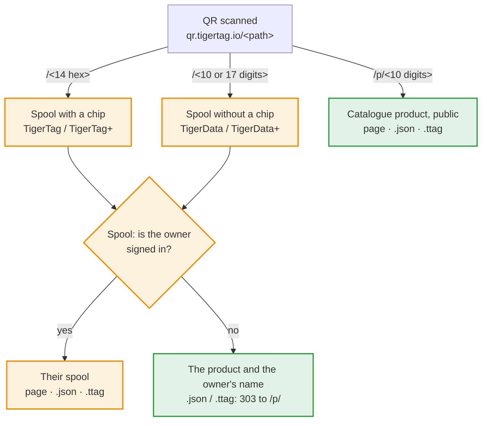

# Identyfikatory szpul i linki QR

> **Ratyfikowano 2026-11-05 — jeszcze niezaimplementowane.** Aplikacje opierają
> się na tej umowie. Punkty wciąż otwarte są wymienione na końcu; rozstrzygnięcie
> jednego zmienia tylko to, co on wskazuje. Sekcje oznaczone jako **Propozycja**
> nie są jeszcze ratyfikowane: nie należy na nich budować, zanim nie zostaną.

## W skrócie

Kod QR TigerTag zawiera jeden krótki link, `https://qr.tigertag.io/<path>`.
Ścieżka mówi, co otwiera:



Pomarańczowy oznacza prywatne, tylko dla właściciela szpuli; zielony —
publiczne.

| Kod QR na | Ścieżka | Przykład |
|---|---|---|
| szpuli z chipem (TigerTag / TigerTag+) | UID chipu szesnastkowo, 14 znaków, drukowany małymi literami; UID bliźniaczego chipu otwiera tę samą szpulę | [qr.tigertag.io/1d33dbda0d1080](https://qr.tigertag.io/1d33dbda0d1080) |
| szpuli bez chipu (TigerData / TigerData+) | id bez prefiksu `TigerData_`: 10 lub 17 cyfr; forma długa (`TigerData_6130922252`, `tigerdata-…`) też działa | [qr.tigertag.io/6130922252](https://qr.tigertag.io/6130922252) |
| produkcie (TigerQR+) | `p/` + `id_product` dziesiętnie, zawsze 10 cyfr, uzupełnione zerami (`p/0010303748`); starsze etykiety z 8 znakami szesnastkowymi (`p/9f5e0644`) nadal się otwierają | [qr.tigertag.io/p/2673739332](https://qr.tigertag.io/p/2673739332) |

- **Link do szpuli:** zalogowany właściciel widzi swoją szpulę; każdy inny
  widzi produkt i nazwę właściciela. `.json` i `.ttag` zwracają szpulę tylko
  właścicielowi; pozostali dostają `303` do `.json` / `.ttag` produktu.
- **Link do produktu** jest publiczny, bez logowania: strona katalogu, jego
  dane ([`p/2673739332.json`](https://qr.tigertag.io/p/2673739332.json)) i plik ([`p/2673739332.ttag`](https://qr.tigertag.io/p/2673739332.ttag)).
- Wielkość liter w linkach nie ma znaczenia.
- Aby udostępnić szpulę lub produkt, udostępnij ten krótki link: to on jest
  drukowany na etykietach i każda aplikacja go odczytuje. Udostępniony link może zaczynać się od języka (`qr.tigertag.io/fr/p/2673739332`): strona otwiera się wtedy w tym języku dla wszystkich. Drukowane etykiety nigdy go nie zawierają.

Reszta tej strony to sama umowa.

Zasady, których przestrzega każda aplikacja TigerSystem:

1. jak **szpula bez chipa** (TigerData / TigerData+) otrzymuje identyfikator;
2. jak szpula **zachowuje swój link**, gdy dostaje chip;
3. jak identyfikator szpuli jest zapisywany w **kodzie QR** wydrukowanej
   etykiety i jak jest odczytywany z powrotem;
4. jak aplikacja **wywołuje szpulę z wartościami** (waga, notatka) przez link;
5. jak **produkt** otrzymuje własny link;
6. jak link odpowiada w **JSON** lub jako **plik `.ttag`**.
7. co niesie **wydrukowana etykieta** i jakie są jej szablony.

## 1. Identyfikatory szpul

Szpula to dokument w magazynie konta, `users/{uid}/inventory/{spoolId}`.
Identyfikator dokumentu **jest** identyfikatorem szpuli: jedno konto nie może
zawierać dwóch szpul o tym samym identyfikatorze.

| Szpula | Identyfikator | Przykład |
|---|---|---|
| Chip (TigerTag / TigerTag+) | UID NFC chipa, szesnastkowo wielkimi literami, 14 znaków (7-bajtowy UID NTAG) | `04AB12CD3E4F80` |
| Bez chipa, nadawany od teraz | `TigerData_` + **milisekundy** epoki (13 cyfr) + liczba losowa **0000–9999** (zawsze 4 cyfry) | `TigerData_17623456789014213` |
| Bez chipa, nadany przed tą umową | `TigerData_` + 10 losowych cyfr | `TigerData_4480517985` |
| Bez chipa, dawny prefiks | `CLOUD_` + 10 losowych cyfr | `CLOUD_4480517985` |
| Dawny dziesiętny (stara aplikacja na Androida) | UID zapisany dziesiętnie, w trakcie migracji do szesnastkowego | `1234567890123456` |

Ta umowa **nigdy nie przepisuje** już nadanych identyfikatorów. Czytniki
sprawdzają tylko prefiks (`TigerData_` / `CLOUD_` → bez chipa); żaden z nich nie
zależy od liczby cyfr. Identyfikator jest identyfikatorem, niczym więcej: nigdy
nie należy wyprowadzać z niego daty utworzenia. 4-bajtowy UID (własnościowy chip
powiązany ze szpulą) nigdy nie jest nazwą dokumentu magazynu, więc nigdy nie
pojawia się w linku.

### Nadawanie identyfikatora bez chipa

Każda aplikacja, która tworzy szpule bez chipa (dziś Tiger Studio, później
aplikacja mobilna), nadaje identyfikator w ten sam sposób:

1. **Złożenie** `TigerData_<Date.now()><four random digits>`.
2. **Sprawdzenie lokalne** — jeśli identyfikator jest już w magazynie, który
   aplikacja przechowuje (kopia nasłuchu na żywo, łącznie z pamięcią podręczną
   offline), lub w jej `uidMigrationMap`, należy złożyć inny. Działa to offline.
3. **Zapis**
   - **online:** w transakcji, która najpierw odczytuje dokument i kończy się
     niepowodzeniem, jeśli on istnieje; po niepowodzeniu powrót do kroku 1;
   - **offline:** zwykły zapis, kolejkowany przez Firestore do czasu powrotu
     sieci. Kroki 1 i 2 są jedynym zabezpieczeniem.

Zwykłe `set()` na identyfikatorze, który już istnieje, **nadpisuje** szpulę,
która już tam jest, po cichu. Temu właśnie zapobiega krok 3.

Cztery losowe cyfry sprawiają też, że nowy identyfikator bez chipa jest
praktycznie unikalny **we wszystkich kontach** (mniej więcej jedna kolizja na 600
lat przy milionie szpul bez chipa rocznie), dzięki czemu serwer może później
rozwiązać link dla kogoś innego niż właściciel bez zmiany żadnej wydrukowanej
etykiety.

## 2. Zachowanie linku, gdy szpula dostaje chip

Zaprogramowanie chipa na szpuli bez chipa przenosi szpulę na UID chipa. W
**jednej partii (batch)**:

1. zapisanie szpuli pod UID chipa (i pod UID bliźniaczym, w przypadku pary
   bliźniaczej);
2. usunięcie dokumentu `TigerData_…`;
3. zapisanie przekierowania `users/{uid}/uidMigrationMap/{old id}` →
   `{ hex_uid, migrated_at }`.

Partia sprawia, że te trzy operacje zachodzą razem albo wcale. Przekierowanie
znajduje się w `uidMigrationMap` (kolekcji, która już mapuje dawne identyfikatory
dziesiętne na szesnastkowe), nigdy jako dokument-zaślepka w magazynie: wszystko,
co czyta magazyn, liczy jeden dokument jako jedną szpulę.

## 3. Linki QR

Wydrukowana etykieta szpuli niesie kod QR z linkiem do szpuli, **i nic poza
tym** (bez wagi, bez notatki — wydrukowane wartości się dezaktualizują):

```
https://qr.tigertag.io/<id>
```

Obok kodu nic nie jest drukowane jawnie: ani identyfikator, ani link. Kod QR jest
drogą powrotną do szpuli.

`<id>` to identyfikator szpuli **bez prefiksu**:

| Szpula | Link |
|---|---|
| Chip | `https://qr.tigertag.io/04ab12cd3e4f80` |
| Bez chipa (nowa) | `https://qr.tigertag.io/17623456789014213` |
| Bez chipa (sprzed tej umowy) | `https://qr.tigertag.io/4480517985` |
| `CLOUD_` | **brak linku QR** — etykieta jest drukowana bez kodu QR |
| Dawny dziesiętny | **brak linku QR** — najpierw należy zmigrować szpulę do szesnastkowego |

### Kodowanie

- Cały link jest zapisany **małymi literami**, łącznie z identyfikatorem: `https://qr.tigertag.io/04ab12cd3e4f80`.
  Przetestowano 2026-11-07: aparat iPhone'a otwiera link w obu wariantach, ale
  aparat Samsunga (Galaxy S24) pokazuje link `HTTPS://` pisany wielkimi literami
  jako zwykły tekst i otwiera tylko link pisany małymi.
- Jeden segment w trybie **bajtowym**. Schemat pisany małymi literami nie może
  używać trybu alfanumerycznego, a dzielenie linku na segmenty nic nie daje
  (zmierzono: każdy wariant ma 29 × 29).
- Korekcja błędów **M** (15 %): etykiety się rysują i zginają.
- Wynik: **29 × 29 modułów** dla każdego linku szpuli i produktu. Każdy moduł
  należy rysować na całkowitej liczbie punktów drukarki, ze standardową strefą
  ciszy o szerokości 4 modułów.

### Odczytywanie linku

Czytniki wyodrębniają identyfikator z linku **offline**: aplikacja skanująca
etykietę nigdy nie potrzebuje strony internetowej. Odczytują ścieżkę bez
rozróżniania wielkości liter, ignorują końcowe `/` i rozwiązują ją według jej
kształtu:

| Ścieżka | Identyfikator szpuli |
|---|---|
| 17 cyfr | `TigerData_<17 digits>` |
| 10 cyfr | `TigerData_<10 digits>` |
| 14 znaków szesnastkowych | UID, wielkimi literami |
| 13 znaków szesnastkowych zaczynających się od `4` | obcięty UID NTAG: `0` + 13 znaków ([reguła naprawy](https://github.com/TigerTag-Project/TigerTag-Studio-Manager/issues/146)) |
| `p/` + `id_product`: 10 cyfr dziesiętnych (postać drukowana) lub 8 znaków szesnastkowych (starsze etykiety) | produkt — [sekcja 5](#5-linki-produktów) |

Końcówka `.JSON` lub `.TTAG` prosi o odpowiedź dla narzędzi — [sekcja 6](#6-odpowiedzi-json-i-ttag).

Aplikacje **zapisują** powyższą formę krótką, ale czytniki **akceptują też formę
długą**: prefiks `TigerData` pisany dowolnie wielkimi lub małymi literami, po
nim `_` lub `-`, a potem 17 lub 10 cyfr — `TigerData_17623456789014213`,
`TigerData-17623456789014213`, `TIGERDATA-17623456789014213`,
`tigerdata_4480517985` prowadzą do tej samej szpuli. Link wpisany lub
udostępniony ręcznie nadal działa. Prefiks `CLOUD` nie jest akceptowany w
żadnej z form.

UID może składać się z samych cyfr, ale ma 14 znaków, nigdy 17 ani 10, więc
zawsze decyduje długość. Żaden dawny identyfikator dziesiętny nie dociera do
czytnika, bo żaden nigdy nie jest drukowany. Każdy **inny kształt** to etykieta z
nowszej wersji: czytnik to komunikuje („zaktualizuj aplikację”), zamiast zgłaszać
błąd. Każdy inny rodzaj obiektu dostaje własny folder, literę i `/` (`p/` dla
produktu, później `r/` dla regału), więc nigdy nie może kolidować z już
wydrukowanymi linkami szpul.

### Prefiks języka

Udostępniony link może nieść przed ścieżką język osoby, która go udostępnia.
*(2026-11-11.)*

```
https://qr.tigertag.io/<lang>/<spool id>
https://qr.tigertag.io/<lang>/p/<id_product>
```

`<lang>` to jeden z `en`, `fr`, `de`, `es`, `it`, `zh`, `pt`, `pt-pt`, `pl`,
`ru`, `nl`, zapisany małymi literami; wielkość liter przy odczycie nie ma
znaczenia.

- Strona otwiera się wtedy w tym języku dla wszystkich, łącznie z robotami
  podglądu linków: `/fr/p/2673739332` → `tigersystem.io/fr/catalog/2673739332`.
- Bez prefiksu decyduje język przeglądarki odwiedzającego.
- Nieznany prefiks daje `404`.
- **Drukowane etykiety nigdy nie mają prefiksu**: pozostają neutralne
  językowo. Dodają go tylko przyciski Udostępnij (dziś tigersystem.io, Tiger
  Studio w następnej wersji).

**Czytniki go usuwają.** Czytnik, który dostaje link (pole wklejania w Studio, skaner lub pole wklejania aplikacji mobilnej, dowolny czytnik zewnętrzny), najpierw usuwa jeden początkowy `<lang>/`, bez względu na wielkość liter, a potem odczytuje resztę jak wyżej: `qr.tigertag.io/fr/p/2673739332` otwiera ten sam produkt co `qr.tigertag.io/p/2673739332`. Czytnik nigdy nie drukuje ani nie zapisuje prefiksu: etykieta lub eksport z udostępnionego linku zawiera link bez prefiksu. Udostępniany link to `qr.tigertag.io/fr/p/2673739332`; kod QR zawsze zawiera `qr.tigertag.io/p/2673739332`. *(2026-11-11.)*

### Odnajdywanie szpuli

1. Wyszukanie identyfikatora **we własnym magazynie zalogowanego oglądającego**.
2. Brak → wyszukanie go w `uidMigrationMap` oglądającego i podążenie za
   przekierowaniem.
3. Para bliźniacza ma jedną etykietę, z głównym UID; każdy z obu UID otwiera
   szpulę.
4. Usunięta szpula (`deleted: true`) otwiera się jako „usunięta”, a nie jako
   błąd.

   **Właściciel widzi szpulę na samej stronie**, odczytaną w przeglądarce z
   własnego dokumentu magazynu (reguły ograniczają go do niego): produkt
   (zdjęcie na jego kolorze), markę, materiał, poziom, pozostałą wagę względem
   pojemności, temperatury dyszy, łoża i suszenia, średnicę, regał i slot, wagę
   pustej szpuli. Dwa przyciski: „Open in Tiger Studio”
   (`https://studio.tigersystem.io/?spool=<docId>`, z wartościami z linku) i
   „See the product page”. Właściciel zalogowany na urządzeniu do Studio Web,
   ale nie do witryny, jest kierowany do Studio Web: witryna nie może odczytać
   dokumentu bez własnej sesji. *(2026-11-07.)* Właściciel może tam zmienić wagę
   i notatkę, tym samym zapisem co Studio: `weight_available` lub `message`
   (najwyżej 28 bajtów UTF-8), `updatedAt` (czas serwera), `needUpdateAt` (czas
   serwera) w formacie z chipem, bliźniak w tej samej partii. Można tam też
   zmienić pojemnik (pustą szpulę), tak jak zapisuje go Studio: `container_id`,
   `container_weight` (z własną korektą konta), `updatedAt`, bliźniak w tej
   samej partii. Strona ma przycisk wylogowania. *(2026-11-08.)*

5. Każdy, kto **nie jest właścicielem** — niezalogowany, inne konto, łącznie z
   zaakceptowanym znajomym — jest **kierowany do produktu** szpuli i nigdy nie
   widzi szpuli: serwer znajduje szpulę po jej identyfikatorze we wszystkich
   kontach (indeks na identyfikatorze szpuli), odczytuje jej `id_product` i
   przekierowuje do linku produktu z [sekcji 5](#5-linki-produktów). Ten sam
   identyfikator w dwóch kontach z różnymi produktami (przepisany chip, którego
   stary dokument zachowało inne konto) → produkt dokumentu zaktualizowanego
   jako ostatni (`updatedAt`), poprawny praktycznie w każdym przypadku. Brak
   produktu lub brak dopasowania → strona informująca, że szpula jest prywatna,
   z „Start my inventory”. Wyszukiwanie działa tylko dla tych skanów, więc jego
   koszt idzie za nimi, a nie za liczbą kont. *(Ratyfikowano 2026-11-06; reguła
   konfliktu 2026-11-07.)*

   Odwiedzający **bez sesji** (na urządzeniu nie znaleziono logowania) nie jest
   przekierowywany: strona pozwala mu wybrać. Pokazuje kartę produktu szpuli
   (tylko publiczny produkt, nigdy dla prywatnej szpuli), loguje na miejscu (po
   zalogowaniu sprawdzenie właściciela uruchamia się ponownie i właściciel
   trafia na szpulę) albo przechodzi dalej do strony produktu. Ktoś zalogowany,
   kto nie jest właścicielem, jest kierowany do produktu jak wyżej.
   *(2026-11-07.)*

   **Czyja to szpula.** Każdy, kto skanuje szpulę, zalogowany czy nie, widzi jej
   właściciela: nazwę wyświetlaną i zdjęcie z `userProfiles` konta, którego
   dokument zaktualizowano jako ostatni, nawet gdy profil nie jest publiczny, i
   nawet dla szpuli bez produktu, aby ten, kto znajdzie szpulę, wiedział, do kogo
   należy. Nigdy uid ani adres e-mail. *(2026-11-08.)*

**Prywatność:** znajomość identyfikatora nigdy nie pokazuje szpuli. Zeskanowany
link otwiera szpulę tylko dla jej właściciela; wewnątrz aplikacji szpula jest
pokazywana tylko komuś, komu reguły Firestore już pozwalają ją odczytać
(właścicielowi, zaakceptowanemu znajomemu, publicznemu magazynowi).
Identyfikatory zawierają znacznik czasu i można je odgadnąć; to nigdy nie może
mieć znaczenia. Produkt szpuli nie jest prywatny: jest wydrukowany na etykiecie,
a chip TigerTag+ niesie go jawnie dla każdego telefonu z NFC. Waga, notatka i
regał nigdy nie wychodzą na zewnątrz; właściciel pojawia się tylko jako nazwa
wyświetlana i zdjęcie (wyżej). Skan jest liczony raz na kartę przeglądarki i
szpulę (przeładowanie nie jest nowym skanem), z produktem, marką, materiałem i
miejscem na poziomie miasta, nigdy z identyfikatorem szpuli. Raport ze skanu
zawiera też adres IP odwiedzającego, przechowywany na wypadek zalewu żądań i do
analiz: jest pokazywany tylko w historii administracyjnej, nigdy markom, i służy
do sprawdzenia miasta zgłoszonego przez edge. Jest przechowywany przez rok,
wyłącznie ze względów bezpieczeństwa. Skan wykonany przez zalogowanego
odwiedzającego jest powiązany z jego kontem.

## 4. Wywoływanie szpuli z wartościami

Aplikacja może zbudować link, który otwiera szpulę **i proponuje wartości**,
zwykłymi parametrami zapytania (te linki nigdy nie są drukowane, więc czytelność
wygrywa z rozmiarem QR):

```
https://qr.tigertag.io/04AB12CD3E4F80?weight=640&note=Opened%20in%20June
```

### Parametry

| Parametr | Wartość | Limit |
|---|---|---|
| `weight` | waga netto filamentu, w gramach | liczba całkowita, od 0 do pojemności szpuli |
| `note` | notatka szpuli (pole `message`) | zwykły tekst, najwyżej 28 bajtów UTF-8 (miejsce na chipie) |

Nazwy nie rozróżniają wielkości liter. Nieznany parametr jest ignorowany, nigdy
nie jest błędem. Wartość poza limitem jest odrzucana. Nowe parametry dodaje się
do tej tabeli, nigdy nie wymyśla ich jedna aplikacja na własną rękę.

### Kto może je zastosować

| Sytuacja | Co się dzieje |
|---|---|
| Niezalogowany | Wartości **odrzucone**. Link proponuje zalogowanie, a potem otwiera szpulę bez nich. |
| Zalogowany, nie właściciel (łącznie ze szpulą znajomego) | Wartości **odrzucone**. Szpula otwiera się, jeśli reguły na to pozwalają. |
| Zalogowany, właściciel | Studio: szpula otwiera się z wartościami **wstępnie wypełnionymi**, a **jeden gest** je zapisuje („Update: 640 g”). Strona Hub: waga, która mieści się w pojemności i różni się od zapisanej, jest **zapisywana od razu**, na szpuli i jej bliźniaku w jednej partii, po czym baner proponuje przywrócenie poprzedniej wagi („Revert to 772 g”), na wypadek ponownego zeskanowania starego linku. *(Hub, 2026-11-08.)* |

Link od kogokolwiek innego nigdy nie zapisuje: wartości dotyczą tylko własnej
szpuli właściciela. Aplikacja, która musi zapisywać bez potwierdzenia (waga
aktualizująca masę na bieżąco, integracja), nie używa linków: zapisuje przez
konto użytkownika zgodnie z regułami Firestore
([przewodnik integracji](https://github.com/TigerTag-Project/TigerTag_Firebase_Integration)).

## 5. Linki produktów

> **Ratyfikowano 2026-11-06.**

Produkt — filament z katalogu, niezależnie od tego, kto ma jego szpulę — ma
własny link, na opakowanie, półkę w sklepie, showroom lub drukowany katalog:

```
https://qr.tigertag.io/p/<id_product>
```

- `<id_product>` zapisuje się **dziesiętnie, zawsze na 10 cyfrach**, z zerami
  na początku: `id_product` nigdy nie ma więcej niż 10 cyfr (największy to
  `4294967295`). Przykłady: produkt `2855882328` →
  `https://qr.tigertag.io/p/2855882328`; produkt `10303748` →
  `https://qr.tigertag.io/p/0010303748`. **29 × 29** modułów.
- Etykiety wydrukowane wcześniej mają starszą postać, `id_product` w **8
  małych znakach szesnastkowych** (`p/aa394e58`); pozostaje ona czytelna na zawsze
  (patrz niżej).
- Identyfikator, którego nie ma lub już nie ma w katalogu — `p/0000000000` i
  `p/4294967295` („brak produktu”, nigdy nie drukowane), nieznany identyfikator,
  produkt zarchiwizowany, usunięty lub scalony — otwiera **jedną stronę
  „zapomnianego produktu”**: tego filamentu nie ma już w katalogu, z
  wyszukiwarką. Jeden status dla wszystkich, `404` (zarówno strona, jak i
  odpowiedzi `.json` / `.ttag`): dla odczytującego nie ma znaczenia, dlaczego
  produkt zniknął. `id_product` nigdy nie jest nadawany innemu produktowi: już
  naklejona etykieta nigdy nie otworzy niewłaściwego filamentu.
- Linki obsługuje **Hub** (`tigersystem.io`): `qr.tigertag.io` na niego
  wskazuje. Strona to strona katalogu Huba (poniżej); odpowiedzi `.JSON` i
  `.TTAG` to trasy API Huba, które czytają katalog (z pamięci podręcznej).
- Etykieta szpuli nigdy nie powtarza swojego produktu: link szpuli już do niego
  prowadzi ([sekcja 3](#odnajdywanie-szpuli)).

### Odczyt linku produktu

Poprawnie zbudowany link produktu ma jedną z dwóch długości, więc nigdy nie może
zostać źle odczytany:

1. **10 cyfr** → dziesiętnie (`p/2673739332`, `p/0010303748`).
2. **8 znaków** `0-9` / `a-f` → szesnastkowo, starsza postać drukowana, nadal
   akceptowana (`p/9f5e0644` otwiera ten sam produkt co `p/2673739332`).

W ramach tolerancji, bez gwarancji, liczba dziesiętna wpisana ręcznie o innej
długości jest odczytywana dziesiętnie, z wyjątkiem dokładnie 8 cyfr: te są
odczytywane najpierw szesnastkowo, potem dziesiętnie, jeśli taki produkt nie
istnieje. Wartość powyżej `4294967295` to nieznany link. `0` i `4294967295`
w dowolnej postaci oznaczają „brak produktu” (`404`). Końcówki `.json` i `.ttag`
działają w każdej postaci, bez względu na wielkość liter.

### Strona, którą otwiera

`p/…` przekierowuje (`302`) do **istniejącej strony katalogu** produktu,
`tigersystem.io/<lang>/catalog/<id_product in decimal>`, w języku linku ([prefiks języka](#prefiks-języka)), a bez niego w języku telefonu. Nie
ma osobnej strony skanu: strona katalogu jest budowana **z myślą przede
wszystkim o telefonie** (responsywna), bo większość jej odwiedzin pochodzi ze
skanu — zdjęcie i próbka koloru, marka, materiał i nazwa koloru na górze,
ustawienia druku czytelne na pierwszy rzut oka, potem reszta strony.

## 6. Odpowiedzi JSON i .TTAG

> **Ratyfikowano 2026-11-06.**

Link kończący się na `.JSON` (dowolną wielkością liter) — lub wysłany z
`Accept: application/json` — odpowiada w JSON zamiast stroną. Link kończący się
na `.TTAG` odpowiada tym samym rekordem jako
[plik `.ttag`](./ttag-format.md) do pobrania
(`Content-Disposition: attachment`). To adresy dla narzędzi, nigdy nie
drukowane.

Ta sama logika co przy skanie ([odnajdywanie szpuli](#odnajdywanie-szpuli)):
właściciel dostaje szpulę, każdy inny jej produkt.

| Link | Właściciel (`Authorization: Bearer <Firebase ID token>`) | Każdy inny (niezalogowany, inne konto, znajomy) |
|---|---|---|
| `…/p/2855882328.json` | rekord produktu | to samo |
| `…/p/2855882328.ttag` | produkt jako plik `.ttag` | to samo |
| `…/04ab12cd3e4f80.json` | szpula | `303` → `…/p/<id_product>.json`; brak produktu z katalogu (TigerData, TigerTag twórcy) → `404` |
| `…/04ab12cd3e4f80.ttag` | szpula jako plik `.ttag` | `303` → `…/p/<id_product>.ttag`; brak produktu z katalogu → `404` |

Bez produktu z katalogu nie jest zwracane nic ze szpuli, nawet jej materiał:
`404` odpowiada stronie „prywatnej szpuli” przy skanie.

- **Szpula:** [plik `.ttag`](./ttag-format.md) zawierający ten jeden rekord,
  dokument magazynu w postaci, w jakiej przechowuje go Firestore. Zawiera
  `id_product`; narzędzie, które chce produktu, wywołuje następnie
  `…/p/<id_product>.json`.
- **Produkt:** rekord katalogu w postaci zwracanej przez API produktów, w języku
  z `?lang=` (domyślnie angielski). W pamięci podręcznej serwera i dozwolony z
  dowolnej witryny.
- Odpowiedź dla szpuli nigdy nie trafia do pamięci podręcznej: zależy od tego,
  kto pyta.
- Otwarty w Tiger Studio plik `.ttag` szpuli jest importowany w trybie
  **Restore** (szpula w dotychczasowym stanie, łącznie z chipem i kopią
  zapasową); plik `.ttag` produktu jest importowany w trybie **Import**, jako
  nowy TigerData+ ze świeżym identyfikatorem.
- Żądanie JSON lub `.TTAG` nigdy nie zapisuje: wartości z linku (`?weight=`,
  `?note=`) są tam ignorowane.

## 7. Wydrukowane etykiety

Każda aplikacja drukuje te same etykiety: dwa rodzaje, jeden zestaw szablonów,
aby etykieta wydrukowana z Tiger Studio, aplikacji mobilnej lub witryny wyglądała
i skanowała się tak samo.

| Etykieta | Jej kod QR | Drukowana dla |
|---|---|---|
| **Szpula** | link szpuli ([sekcja 3](#3-linki-qr)) | każdej szpuli, która ma link QR (nie `CLOUD_`, nie dawny dziesiętny) |
| **Produkt** (karta próbnika) | link produktu ([sekcja 5](#5-linki-produktów)) | szpuli lub produktu z katalogu z prawdziwym `id_product` (TigerTag+, TigerData+) |

Właściciel skanujący etykietę szpuli dostaje szpulę; każdy inny jej produkt
([odnajdywanie szpuli](#odnajdywanie-szpuli)). Etykieta produktu otwiera produkt
dla wszystkich: to ona służy do próbnika, półki lub showroomu.

### Co niesie etykieta

- markę, tam gdzie byłoby logo producenta (logotypy producentów pojawią się później);
- serię białym tekstem na czarnym pasku (`PLA Rainbow`; materiał, gdy nie ma serii);
- nazwę koloru i jego kod(y) szesnastkowe (`#F2D066`, do trzech na szerokich szablonach);
- na etykiecie szpuli nazwa etykiety w prawym górnym rogu, jako obrysowana pigułka:
  `TigerQR+`, gdy jej odniesieniem jest produkt z katalogu (prawdziwy `id_product`) lub
  chip TigerTag+, w przeciwnym razie `TigerQR` (chip TigerTag bez produktu daje więc
  `TigerQR`); etykieta produktu (filamentu) zawsze niesie `TigerQR+`. Jak w TigerTag
  i TigerTag+, `+` oznacza powiązanie z katalogiem. Pigułka nie mówi, czy szpula ma chip;
- do **czterech pól wartości**, wybieranych przez użytkownika spośród: zakresu dyszy, zakresu łoża,
  suszenia (temperatura · czas), TD, średnicy;
- kod QR.

Tylko to, co się nie zmienia: nigdy pozostała waga, notatka, regał ani
właściciel. Nic jawnie obok kodu QR ([sekcja 3](#3-linki-qr)).

### Szablony

Dziewięć szablonów, w typowych rozmiarach i układach etykiet szpul:

| Szablon | Rozmiar (szerokość × wysokość) | Układ |
|---|---|---|
| Classic (domyślny) | 40 × 30 mm | marka, pasek, kolor + hex, cztery pola, QR w prawym dolnym rogu |
| Wide | 50 × 30 mm | Classic z szerszym paskiem |
| Compact | 40 × 25 mm | marka, QR po lewej, pasek, kolor, hex — bez pól |
| Slim | 40 × 12 mm | QR po lewej, marka, pasek, kolor — bez pól |
| Slicer-friendly | 40 × 30 mm | marka, seria, kolor ułożone jeden pod drugim dużym tekstem, duży QR po prawej — bez pól |
| Vertical | 30 × 40 mm | marka, pasek, duży kolor, hex, linia, pola ułożone po lewej, QR w prawym dolnym rogu |
| Vertical bold | 30 × 40 mm | marka, pasek na całą szerokość, kolor, linia, QR wyśrodkowany poniżej — bez pól |
| Vertical compact | 25 × 40 mm | marka, pasek, kolor, hex, linia, duży QR poniżej — bez pól |
| Tylko QR | 25 × 30 mm | pigułka TigerQR / TigerQR+ wyśrodkowana u góry, pod nią QR 20 mm — nic więcej, bez pól |

Tylko QR jest postanowiony (2026-11-11) i dostępny na tigersystem.io; do Tiger Studio trafi w jego następnej wersji.

Każdy szablon to jeden plik SVG rozplanowany w dziesiątych częściach milimetra i
skalowany do punktów drukarki. Kod QR wypełnia to samo pole co na typowych
etykietach szpul (≈ 14 mm na Classic), przy całkowitej liczbie punktów drukarki
na moduł: najbliższej, zaokrąglonej w górę, gdy mieści się to w 6 % pola. Białe
marginesy etykiety są jej strefą ciszy. Przy 203 dpi kod 29 × 29 ma na Classic 4
punkty na moduł (≈ 14,5 mm).

### Wyjście

- **PDF**, **PNG** (w rozdzielczości drukarki) i **SVG**, aby działała każda
  drukarka, w razie potrzeby przez własną aplikację;
- bezpośredni druk na drukarkach etykiet (Brother QL, Niimbot, Phomemo) pojawi
  się później, drukarka po drukarce, z tymi samymi szablonami.

## Punkty otwarte

- **Linki aplikacji.** iOS (`apple-app-site-association`) i Android (filtry
  intencji) domyślnie dopasowują ścieżki z rozróżnianiem wielkości liter: linki
  są drukowane małymi literami, ale link wpisany lub udostępniony ręcznie może
  taki nie być, więc aplikacja mobilna deklaruje dopasowanie bez rozróżniania
  wielkości liter (iOS) i filtruje ścieżkę w kodzie (Android).
- **Domena.** `qr.tigertag.io` jest drukowana na zawsze: domenę `tigertag.io`
  należy odnawiać na długi okres.

---

**▲ [Spis dokumentacji](../../README.md)** · **Zobacz też:** [Uniwersalna tożsamość filamentu](../concepts/universal-filament-identity.md), [Magazyn i synchronizacja z chmurą](../concepts/inventory-and-cloud-sync.md), [Przegląd dla deweloperów](./README.md)
