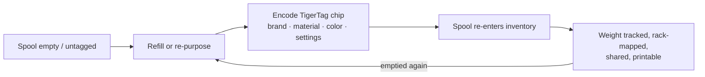

# Przepływ pracy Second Life

## Problem dzisiejszych „inteligentnych” szpul

Gdy szpula z tagiem producenta się kończy, tag umiera razem z nią: opisywał
jedną szpulę napełnioną w fabryce, w formacie jednego dostawcy, i nie da się
go użyć ponownie. Szpulę-nośnik wyrzuca się albo napełnia „na ślepo”.

## Second Life: zidentyfikuj na nowo, nie wyrzucaj

Chip TigerTag jest **zapisywalny i wielokrotnie przepisywalny**. Gdy szpula zostanie opróżniona
i napełniona ponownie — albo gdy szpula dowolnej marki nie ma żadnego użytecznego tagu —
użytkownik koduje chip TigerTag z prawdziwym profilem nowego filamentu i go nakleja.
Szpula dostaje *drugie życie* jako pełnoprawny, sama się identyfikujący obiekt:

*Nawet refill bez szpuli niesie swoją tożsamość — chip jedzie na samej zwojce.*

## Jak odbywa się kodowanie

- **Tiger NFC Connect** (mobilna) — chipy programuje się dotknięciem NFC.
- **Tiger Studio** (desktopowa) — prowadzona aktualizacja chipa z czytnikiem ACR122U /
 [TigerPOD](../products/tigerpod.md): połóż chip, sprawdzenie zgodności UID,
 zweryfikowany zapis.
- **Najpierw cyfrowo** — *TigerData* w Tiger Studio pozwala utworzyć w pełni cyfrową
 (bezchipową) szpulę już teraz i **później awansować ją do prawdziwego chipa, atomowo**.

> **Uwaga:** katalog marek, materiałów i kolorów używany przy kodowaniu
> jest udostępniany przez wspólną [bazę referencyjną](../concepts/universal-filament-identity.md), dzięki czemu
> ponownie zakodowany chip jest równie precyzyjny jak fabryczny.

## Drugie życie samego chipa — zero elektrośmieci

Szpula nie jest jedyną rzeczą, która dostaje drugie życie: **chipy też.**
Każda szpula niesie [dwa chipy](../concepts/tigertag-chip.md) — więc z każdego kilograma
wydrukowanego filamentu zostają ci **dwa standardowe chipy NTAG** do odzysku. Zdejmij
je i zakoduj ponownie jako zwykłe NDEF do czegokolwiek: inteligentnego breloka,
wizytówki NFC, własnego podłączonego przedmiotu — edytor jest wbudowany
w aplikację. Potrafi nawet przepisać chip **w formacie, którego oczekują drukarki Elegoo**:
twój chip, twój wybór.

Właśnie dlatego oficjalna produkcja markowych chipów przeszła na **NTAG215**:
większy zapas pamięci to więcej możliwości ponownego użycia, gdy szpula jest pusta.
Cel jest prosty — **chip szpuli nigdy nie powinien stać się elektrośmieciem.**

---

**◀ Poprzednia:** [Koncepcja mostu ze smartfonem](./smartphone-bridge.md) · **▲ [Spis dokumentacji](../../README.md)** · **Następna ▶** [Uniwersalna tożsamość filamentu](../concepts/universal-filament-identity.md)

**Zobacz też:** [TigerTag](../products/tigertag.md), [TigerTag+](../products/tigertag-plus.md)
