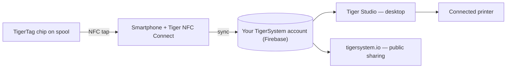

# Koncepcja mostu ze smartfonem

## Spostrzeżenie

> W Chinach wciąż pytaliśmy: *„Gdzie są czytniki RFID?”* Wszyscy odpowiadali:
> *„W Bambu Lab.”* Fałsz — czytniki Bambu są w AMS, nie w drukarce;
> maszyna w ogóle nie potrafi wykryć szpuli firmy trzeciej. **Czytniki RFID są
> w twoich kieszeniach** — w każdym telefonie, gotowe do użycia, choć nawet o tym nie wiesz.

Każdy współczesny smartfon zawiera czytnik NFC. To znaczy, że **każdy użytkownik druku 3D
już posiada sprzęt TigerTag** — bez własnościowego czytnika, bez modernizacji drukarki,
bez żadnego zakupu na start.

Telefon pełni rolę **mostu** między fizyczną szpulą a cyfrowym magazynem:

1. **Dotknij** — profil chipa (marka, materiał, kolor, ustawienia) jest odczytywany jednym gestem.
2. **Synchronizuj** — szpula natychmiast pojawia się w magazynie użytkownika w chmurze.
3. **Wszędzie** — aplikacja desktopowa, web i podłączone drukarki znają już tę szpulę.

## Natywny RFID a most

Niektóre drukarki odczytują tagi natywnie — zwykle we własnym, własnościowym
formacie, czasem sam TigerTag; większość nie odczytuje niczego. Most sprawia, że
możliwości drukarki przestają mieć znaczenie:

| Ścieżka | Wymaga | Działa z |
|---|---|---|
| **Natywny RFID — tag producenta** | Drukarki odczytującej zablokowany tag danego producenta | Tylko jedna marka |
| **Natywny RFID — TigerTag** | Maszyny, której własny firmware odczytuje TigerTag — rzadkość, jak dotąd tworzona przez społeczność | Każda marka, bez aplikacji po drodze |
| **Most ze smartfonem** | Dowolnego telefonu z NFC | **Każda drukarka**, każda marka, nawet maszyny w pełni offline |

Środkowy wiersz nie jest nasz i jest świeży. Rozszerzony firmware społeczności
czyni z [Snapmakera U1](../compatibility/snapmaker.md) pierwszą drukarkę, która
odczytuje TigerTag na samej maszynie; a **BT-AMS-C**, czterogniazdowy czytnik
montowany na AMS firmy Bambu Lab, wysyła dane TigerTag prosto do BMCU drukarki
([sprzęt firm trzecich](../compatibility/third-party-hardware.md)). Oba
przypadki pozostają wyjątkami — co jest argumentem za mostem, a nie przeciw
niemu: nigdy nie musiał na nie czekać.

Dzięki mostowi dane filamentu docierają do drukarki przez
[integracje drukarek Tiger Studio](../compatibility/README.md) (dziś działa
sześć marek) — szpula przedstawia się *systemowi*, a system rozmawia
z maszyną.

Dowód na przykładzie: **drukarki FlashForge w ogóle nie mają czytnika RFID** —
a dzięki mostowi mimo to współpracują z filamentem identyfikowanym przez NFC. Zupełnie
nowa funkcja, dodana do cudzych maszyn, **całkowicie za darmo dla użytkownika**
([przypadek FlashForge](../compatibility/flashforge.md)).

---

**◀ Poprzednia:** [Otwarty ekosystem](./open-ecosystem.md) · **▲ [Spis dokumentacji](../../README.md)** · **Następna ▶** [Przepływ pracy Second Life](./second-life.md)

**Zobacz też:** [Tiger NFC Connect](../products/tiger-nfc-connect.md), [Przegląd architektury](../architecture/overview.md)
